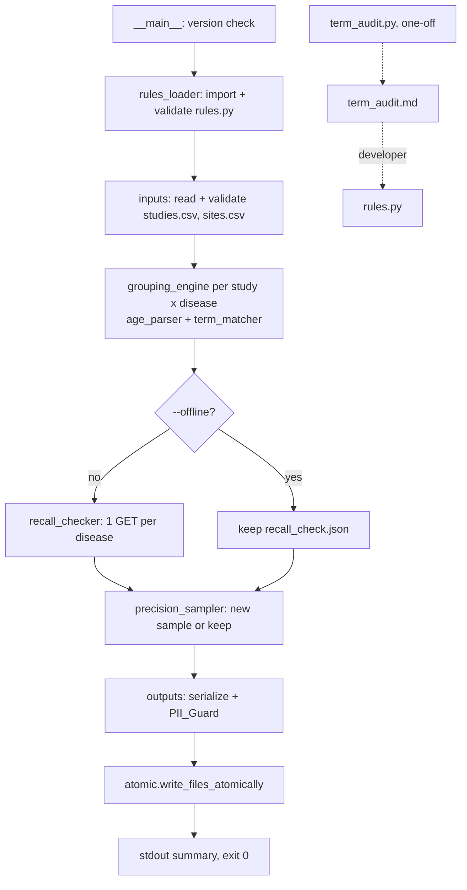

# Design Document: condition-grouping (Spec 2)

## Overview

Condition grouping reads Spec 1's `pipeline/processed/studies.csv` and `sites.csv`, assigns each study to zero or more PLACES measures using term lists in `pipeline/mapping/rules.py`, and writes three committed files: `pipeline/processed/study_diseases.csv`, `pipeline/processed/recall_check.json` and `burden_test/precision_sample.csv`. Entry point: `python -m pipeline.mapping [--offline] [--resample]`.

Before `rules.py` exists, a one-off Term_Audit (`python -m pipeline.mapping.term_audit`) lists the disease-related values that occur in the data. The developer fills dispositions in `term_audit.md` from `burden_test/inclusion_rules.md`, then builds `rules.py` from them. This is the first implementation step.

Key decisions:

| Decision | Choice | Why |
|---|---|---|
| Rules format | `rules.py` with two module-level literals, `DISEASES` and `SAMPLE_SEED`; term lists with reasons are lists of `(term, reason)` tuples, not dicts | A dict literal silently drops a duplicated key, which would hide the duplicates Req 2.6 must report |
| Age comparison | `fractions.Fraction` per unit (1 week = 10000/521775 year) | Exact `< 18` test with no float rounding (Req 5.6) |
| Ratio rounding | Exact rational, round half up to 3 decimals for both `ratio_found` and `ratio_included`; flag decided on the rounded `ratio_found` only | 0.7995 → 0.800 not flagged (Req 10.4, Open Item 11); float `round()` would give 0.799 |
| Multi-file write | New `write_files_atomically` in `pipeline/io/atomic.py`: temp file per target in its own directory, `os.replace`, roll back on a later replace failure | Targets live in two directories (`pipeline/processed/`, `burden_test/`); the Spec 1 `write_outputs` is fetch-log specific |
| CSV reading | New `read_table(path, header, list_columns)` in `pipeline/io/csv_reader.py`, returning rows with their start line numbers; `read_csv` becomes a thin wrapper | Spec 2 needs line numbers (Req 1.6, 6.6) and must read tables (`study_diseases.csv`, `precision_sample.csv`) that are not Spec 1 kinds |
| CSV writing | Reuse `csv_writer.quote_cell`, `encode_list_cell`, `serialize` and `EncodedTable` | Same bytes conventions as Spec 1 (Req 9.3, 9.4) |
| HTTP | Reuse `HttpClient.get` and `ctgov_fetcher.build_url` | Allowlist, 60 s timeout, 1/2/4 s retry already implemented (Req 10.2) |
| Sampling | `random.Random(SAMPLE_SEED).sample(sorted_candidates, k)` with a fresh generator per disease | Per-disease independence (Req 11.5) |
| Argument parsing | `argparse` with `allow_abbrev=False` | Otherwise `--off` would be accepted, breaking Req 12.3 |
| Recall query terms | "Asthma", "hypercholesterolemia OR hyperlipidemia OR dyslipidemia OR LDL", "Diabetes" | Fixed by Req 2.12; stored in `rules.py` like every other term. "High Cholesterol" returned only 6 studies against `found_count` 123 (Open Item 16) |
| Include masking | A value matching an Exclude_Term or a Questionable_Term is a Masked_Value and gives no include evidence; exclude-only masking still drives the questionable check of rule 3b | "Pediatric Asthma" phrase-matched "asthma" and was counted `included` (Req 4.1, Open Item 15) |

## Architecture



Every step before `write_files_atomically` is pure computation or reading. Any `PipelineError` before that point leaves all outputs untouched (Req 9.10, 12.5).

### Module layout

```
pipeline/mapping/
  __init__.py          # empty (must stay importable on any Python 3)
  __main__.py          # version check first, then CLI + run()        (Req 1.5, 12)
  rules.py             # plain data only, no imports                  (Req 2)
  rules_loader.py      # import + validate -> list[Disease]           (Req 2.5-2.9)
  inputs.py            # read/validate studies.csv, sites.csv         (Req 1, 6.6)
  age_parser.py        # maximumAge -> NoLimit | years Fraction | Unparseable  (Req 5.1-5.2, 5.4, 5.6)
  term_matcher.py      # normalize, exact/phrase match, find_matches  (Req 3)
  grouping_engine.py   # status decision, Determining_Match           (Req 4-8)
  recall_checker.py    # counts, URLs, ratio, recall JSON             (Req 10)
  precision_sampler.py # candidate set, seeded sample, keep check     (Req 11)
  outputs.py           # encode tables, PII_Guard, summary            (Req 9, 12.6)
  term_audit.py        # one-off: python -m pipeline.mapping.term_audit (Req 14)
tests/mapping/         # pytest + Hypothesis, mirrors the modules above
```

### Task mapping

| Task | Components |
|---|---|
| 1 | `term_audit.py` + tests, run it, fill dispositions, write `rules.py` |
| 2 | `rules_loader.py`, `age_parser.py`, `term_matcher.py`, `inputs.py`, `csv_reader.read_table` |
| 3 | `grouping_engine.py`, `study_diseases.csv` encoding in `outputs.py` |
| 4 | `recall_checker.py` |
| 5 | `precision_sampler.py`, PII_Guard, `write_files_atomically`, `__main__.py` |
| 6 | Full network run, commit the three outputs, KIRO_LOG entry; a flagged `ratio_found` is reported, not a stop condition |
| 7 | Questionable masking in `grouping_engine.py` + Property 15, HIGHCHOL recall term in `rules.py`, rerun, KIRO_LOG entry, commit |

## Components and Interfaces

### Term_Audit (`pipeline/mapping/term_audit.py`, Req 14)

`python -m pipeline.mapping.term_audit`. Never imported by `pipeline/mapping/__main__.py` (Req 14.10).

```python
AUDIT_KEYWORDS: tuple[tuple[str, str], ...] = (
    ("asthma", "CASTHMA"), ("cholesterol", "HIGHCHOL"), ("lipid", "HIGHCHOL"),
    ("LDL", "HIGHCHOL"), ("lipoprotein", "HIGHCHOL"), ("diabet", "DIABETES"))
AUDIT_COLUMNS = ("meshTerms", "ancestorTerms", "conditions")
TOP_N = 40

def audit_tables(rows: list[dict]) -> list[AuditTable]          # pure
def render(sha256_hex: str, row_count: int, tables) -> bytes    # pure
def filled_cells(existing_md: str) -> int                       # disposition cells with non-space text
def main(argv=None, root: Path = REPO_ROOT) -> int
```

- Reads `studies.csv` with `read_table(..., list_columns={"meshTerms","ancestorTerms","conditions"})`; only those three cells are JSON-checked (Req 14.12). The SHA-256 is computed on the same bytes that were parsed.
- Count = number of studies whose list contains the exact value (per-study `set`), values with empty Normalized_Text skipped. Sort key `(-count, value)`, keep the first 40 (Req 14.1-14.4).
- Output format (UTF-8, LF, no timestamp):

```
# Term audit (condition-grouping, Requirement 14)

- Source: pipeline/processed/studies.csv
- SHA-256: <hex>
- Data rows: <n>

## asthma / meshTerms (CASTHMA)

| rank | value | count | measureid | disposition | reason_or_note |
|---|---|---|---|---|---|
| 1 | Asthma | 107 | CASTHMA |  |  |
```

  A table with no values is replaced by the line `no values`. `|` inside a value is written `\|`.
- If `term_audit.md` exists and `filled_cells > 0` (disposition or reason/note cells, split on unescaped `|`), the file is kept, a notice with the count goes to stderr, and the exit code is 1 (Req 14.13). Otherwise it writes atomically through `write_files_atomically`.

**Developer step (not code).** For each listed row, the developer sets disposition `include` / `exclude` / `questionable` / `not_disease` by applying inclusion_rules.md. Ambiguous rows get `questionable` and a reason code. Same Normalized_Text under one measureid gets the same disposition everywhere (Req 14.7). Initial reason vocabulary (extendable, all pass Req 2.5): exclude `gestational`, `prediabetes`, `not_mellitus`, `ascvd_only`; questionable `complication_only` (for example "Diabetic Retinopathy"; a study that also lists diabetes is still `included` by Req 7.4), `broad_category` (for example "Lipid Metabolism Disorders"), `lab_value_only`, `monogenic_or_rare`, `secondary_cause`. A sample run on the current data already shows values the term lists must handle, for example "Diabetes Insipidus, Neurogenic" (meshTerms, exact match does not hit "Diabetes Insipidus", so it needs its own `not_mellitus` exclude entry) and "Homozygous Familial Hypercholesterolemia".

### Rules_Config (`pipeline/mapping/rules.py`, Req 2)

Fixed names and types (Req 2.9). No import statement (Req 2.11).

```python
SAMPLE_SEED = 20261024          # int, 0..4_294_967_295

DISEASES = [                    # list[dict[str, object]], 1..5 entries
    {
        "measureid": "DIABETES",                 # str, a Supported_Measure
        "disease_label": "Diabetes",             # str
        "ancestor_only_status": "questionable",  # "included" | "questionable"
        "recall_query_term": "Diabetes",         # str
        "include": [                             # list[str], >= 1
            "Diabetes Mellitus", "Diabetes Mellitus, Type 1", "Diabetes Mellitus, Type 2",
            "diabetes", "type 1 diabetes", "type 2 diabetes",  # ... plus Term_Audit results
        ],
        "exclude": [                             # list[tuple[str, str]]  (term, reason)
            ("Diabetes, Gestational", "gestational"), ("gestational diabetes", "gestational"),
            ("Prediabetic State", "prediabetes"), ("prediabetes", "prediabetes"),
            ("Diabetes Insipidus", "not_mellitus"),  # one entry: same Normalized_Text (Open Item 14)
            ("Diabetes Insipidus, Neurogenic", "not_mellitus"),
        ],
        "questionable": [                        # list[tuple[str, str]]  (term, reason)
            ("Diabetic Retinopathy", "complication_only"),
        ],
    },
    # CASTHMA: label "Asthma", ancestor_only_status "included", recall_query_term "Asthma",
    #   include ["Asthma", ...], questionable [("Pediatric Asthma", "pediatric_label"), ...]
    # HIGHCHOL: label "High cholesterol", ancestor_only_status "questionable",
    #   recall_query_term "hypercholesterolemia OR hyperlipidemia OR dyslipidemia OR LDL"  (Req 2.12),
    #   include ["Hypercholesterolemia", "Hyperlipidemias", "hyperlipidemia", "Dyslipidemias",
    #            "dyslipidemia", "Hyperlipoproteinemia Type II", "familial hypercholesterolemia",
    #            "Homozygous Familial Hypercholesterolemia", "high cholesterol", "elevated ldl",
    #            "lp(a)", "elevated lipoprotein(a)", ...every Term_Audit `include`],
    #   exclude [("Myocardial Infarction", "ascvd_only"), ("myocardial infarction"... same NT, one entry),
    #            ("Coronary Artery Disease", "ascvd_only"), ("Atherosclerosis", "ascvd_only"),
    #            ("atherosclerotic cardiovascular disease", "ascvd_only"), ("ASCVD", "ascvd_only")]
]
```

Rules for writing entries: every concept with a MeSH descriptor is listed in its MeSH_Form and at least one Free_Text_Form when the Normalized_Text differs (Req 2.10); identical Normalized_Text forms are one entry (Open Item 14); every Term_Audit disposition maps to the matching list (Req 14.8, 14.9). The listed terms above are the Req 2.3 minimum; the final lists come from `term_audit.md`.

### Rules loader (`rules_loader.py`, Req 2.4-2.9, 11.9)

```python
SUPPORTED_MEASURES = ("CASTHMA", "HIGHCHOL", "DIABETES", "BPHIGH", "DEPRESSION")
RESERVED_REASONS = ("child_only", "unparseable_age", "healthy_volunteers_only", "ancestor_only")

@dataclass(frozen=True)
class Term:      text: str; norm: str; kind: Literal["include","exclude","questionable"]; reason: str  # "" for include
@dataclass(frozen=True)
class Disease:   measureid: str; label: str; ancestor_only_status: str; recall_query_term: str; terms: tuple[Term, ...]
@dataclass(frozen=True)
class RulesConfig: diseases: tuple[Disease, ...]; seed: int   # diseases sorted by measureid

def load_rules(module_name: str = "pipeline.mapping.rules") -> RulesConfig
def validate(diseases_obj: object, seed_obj: object) -> RulesConfig   # pure, used by tests
```

- `importlib.import_module`; any exception, or a missing/ill-typed `DISEASES` / `SAMPLE_SEED`, raises `ConfigError("rules.py: ...")` (Req 2.9).
- `validate` collects every failed check from Req 2.5 and 2.6 into a list and raises one `ConfigError(lines)`; each line names the measureid or `Rules_Config` (Req 2.7). `type(seed) is int` (so `True` is rejected) and `0 <= seed <= 2**32-1` (Req 11.9). Reason code regex `^[a-z][a-z0-9_]{0,39}$`.
- `ConfigError` subclasses `PipelineError` and carries `lines: list[str]`; `__main__` prints one `error:` line per entry.

### Inputs (`inputs.py`, Req 1, 6.6)

```python
STUDIES_HEADER: tuple[str, ...]   # = csv_writer.COLUMNS["studies"] (18 columns)
SITES_HEADER:   tuple[str, ...]   # = csv_writer.COLUMNS["sites"] (9 columns)

@dataclass(frozen=True)
class Study: nct_id: str; brief_title: str; overall_status: str; healthy_volunteers: str
             maximum_age: str; conditions: tuple[str, ...]; mesh_terms: tuple[str, ...]
             ancestor_terms: tuple[str, ...]; conditions_cell: str; source_url: str

def read_inputs(paths) -> tuple[dict[str, Study], frozenset[str]]   # studies by nctId, nctIds with an MA_Site
```

- Uses `read_table(path, header, LIST_COLUMNS["studies"])`. `FileNotFoundError` / `OSError` / `UnicodeDecodeError` are wrapped as `PipelineError("<file>: cannot open (<type>)" | "<file>: not valid UTF-8")` (Req 1.3). Header mismatch and bad list cells use the reader's file/line/column messages (Req 1.3, 1.4).
- Then: zero rows, empty `nctId`, duplicate `nctId` (first offending line; message holds only the nctId) (Req 1.6); `healthyVolunteers` not in `{"true","false",""}` (file, line, column) (Req 6.6).
- MA_Site: `state in {"Massachusetts", "MA"}`. Site rows with unknown nctIds are dropped with one stderr warning giving the count (Req 1.7).
- `conditions_cell` keeps the JSON array string for the precision sample, re-encoded with `encode_list_cell`, which is byte-identical to the Spec 1 cell because Spec 1 wrote it with the same encoder (Req 11.4).

`csv_reader.read_table(path, header, list_columns) -> list[tuple[int, dict]]` records `reader.line_num + 1` before each record so a quoted multi-line cell reports the row's first line. `read_csv(path, kind)` calls it and drops the line numbers, so Spec 1 behaviour is unchanged.

### Age_Parser (`age_parser.py`, Req 5)

```python
_AGE_RE = re.compile(r"[0-9]+ [A-Za-z]+")          # fullmatch after .strip(); ASCII digits only
_YEARS_PER_UNIT = {"year": Fraction(1), "month": Fraction(1, 12), "week": Fraction(10000, 521775),
                   "day": Fraction(4, 1461), "hour": Fraction(1, 8766), "minute": Fraction(1, 525960)}
# keys also accept the plural ("years", ...); unit compared after .casefold()

NO_LIMIT = "no_limit"; UNPARSEABLE = "unparseable"
def parse_max_age(text: str) -> Fraction | str
def is_child_only(text: str) -> bool             # parsed value < 18 (exact)
```

Checks: "939 Weeks" = 9,390,000/521,775 ≈ 17.996 → child; "940 Weeks" ≈ 18.015 → not; "157788 Hours" = 18 exactly → not. Whitespace-only → `NO_LIMIT` (Req 5.2). `minimumAge`/`stdAges` are not read (Req 5.7).

### Term_Matcher (`term_matcher.py`, Req 3)

```python
def normalize(s: str) -> str:  return " ".join(s.casefold().split())
def exact_match(term_norm: str, value_norm: str) -> bool: return term_norm == value_norm
def phrase_match(term_norm: str, value_norm: str) -> bool  # every occurrence via str.find loop;
                                                          # boundary = index edge or not ch.isalnum()

@dataclass(frozen=True, order=True)
class Match: measureid: str; kind: str; term: str; source: str; value: str   # value as written

def find_matches(study: Study, disease: Disease) -> frozenset[Match]
```

`meshTerms` → source `mesh`, `ancestorTerms` → `ancestor` (both Exact_Match); `conditions` → `condition_text` (Phrase_Match). Values with empty Normalized_Text are skipped (Req 3.6). A `frozenset` gives one Match per distinct 5-tuple (Req 3.3). Normalized forms of study values are computed once per study.

### Grouping_Engine (`grouping_engine.py`, Req 4-8)

```python
SOURCE_ORDER = {"mesh": 0, "ancestor": 1, "condition_text": 2}
def dm_key(m: Match) -> tuple: return (SOURCE_ORDER[m.source], m.value, normalize(m.term))
def pick(cands) -> Match: return min(cands, key=dm_key)                      # Req 8.8

@dataclass(frozen=True)
class StudyDiseaseRow: nctId: str; measureid: str; disease_label: str; match_status: str
                       exclusion_reason: str; matched_on: str; matched_term: str

def decide(study: Study, disease: Disease, matches: frozenset[Match]) -> StudyDiseaseRow | None
def group(studies: dict[str, Study], rules: RulesConfig) -> list[StudyDiseaseRow]  # sorted (nctId, measureid)
```

Status decision for one (study, disease), first rule that applies wins (Req 7.6):

```text
if matches is empty: return None                                   # Req 3.7
masked   = {(m.source, m.value) for m in matches if m.kind == exclude}           # Exclude_Masked_Values
qmasked  = {(m.source, m.value) for m in matches if m.kind == questionable}
incMask  = masked | qmasked                                                       # Masked_Values, Req 4.1
incNM    = [m for include matches if (m.source, m.value) not in incMask]
direct   = [m in incNM if m.source in {mesh, condition_text}]
anc      = [m in incNM if m.source == ancestor]
excl     = exclude matches;  exclDirect = [m in excl if m.source != ancestor]
qNM      = [m for questionable matches if (m.source, m.value) not in masked]      # exclude masking only
reason(m) = the Rules_Config reason paired with m.term
age      = parse_max_age(study.maximum_age)

1. age is a Fraction < 18:            excluded, child_only,  DM = pick(incNM or matches)       # 5.3, 8.6b
2. hv == "true" and not direct:       excluded, healthy_volunteers_only, DM = pick(matches)     # 6.1, 6.3, 8.6e
3a. exclDirect and not direct and anc: excluded, DM = pick(exclDirect), reason(DM)               # 4.3, 8.6d
3b. excl and not incNM and not qNM:    excluded, DM = pick(excl), reason(DM)                     # 4.2, 8.6c
4. age == UNPARSEABLE:                 questionable, unparseable_age, DM = pick(incNM or matches) # 5.4, 8.6b
5. evidence = direct or (anc if ancestor_only_status == included else [])
   if evidence:                        included, "", DM = pick(evidence)                          # 7.3, 7.4, 4.4
6. cands = qNM + (anc if ancestor_only_status == questionable else [])
                                       questionable, DM = pick(cands),
                                       reason = ancestor_only if DM.kind == include else reason(DM) # 7.1, 7.2, 7.5
```

Notes:

- Rule 6 always has candidates: reaching it means no evidence and rule 3b did not fire, so either `qNM` is non-empty or `anc` is non-empty with status `questionable`. The engine asserts this.
- Rule 3a requires a non-empty `anc`. With no unmasked include match at all, rule 3b decides, so Open Item 9 (a questionable match beats a term-based exclude) holds for that case. When `anc` is non-empty, Req 4.3 applies "regardless of any Questionable_Term matches", so rule 3a wins. This keeps Req 4.2 and 4.3 disjoint, as Req 4.3's last sentence states.
- Excludes only in `ancestorTerms` with ancestor-only include evidence fall through to rules 5/6 (Req 4.5).
- Questionable masking (Req 4.1, Open Item 15). `incNM`, `direct` and `anc` drop include matches on values that also match an Exclude_Term or a Questionable_Term. `masked` keeps its exclude-only meaning, and `qNM` is still filtered by `masked` alone, so a questionable match on a questionable-masked value stays a rule 6 candidate with its configured reason. Rule 3b is unchanged in effect: an include match dropped only by `qmasked` implies a questionable match on a value outside `masked`, so `qNM` is non-empty and 3b does not fire either way. Rule 3a now also fires when the only direct include values are questionable-masked and an ancestor include exists, which is what Req 4.3 states ("regardless of any Questionable_Term matches"). Rule 2 uses the narrower `direct`, so a healthy-volunteer study whose only direct includes are questionable-masked gets `healthy_volunteers_only` (Req 6.1). Rules 1 and 4 pick the Determining_Match from the narrower `incNM` (Req 8.6b).
- Exact_Match compares whole Normalized_Text values and Req 2.6 forbids duplicate terms, so a `mesh` or `ancestor` value matches at most one term per disease. Masking therefore only changes outcomes for `condition_text` values (Phrase_Match), for example "Pediatric Asthma" matching both "asthma" and "Pediatric Asthma".
- `matched_on = DM.source`, `matched_term = DM.value` (Req 8.5).

### Recall_Checker (`recall_checker.py`, Req 10)

```python
ACTIVE = ("RECRUITING", "NOT_YET_RECRUITING", "ACTIVE_NOT_RECRUITING")
def found_count(rows, studies, ma_ids, measureid) -> int     # distinct nctIds, any match_status
def included_count(rows, studies, ma_ids, measureid) -> int  # distinct nctIds, match_status included
# both count only studies with an Active_Status overallStatus and at least one MA_Site (Req 10.1)
def request_url(term: str) -> str     # ctgov_fetcher.build_url([("query.cond", term), ("query.locn", "Massachusetts"),
                                      #   ("filter.overallStatus", ",".join(ACTIVE)), ("countTotal", "true"),
                                      #   ("pageSize", "1"), ("fields", "NCTId")])
def rounded_ratio(count: int, ctgov: int) -> Fraction | None # floor(Fraction(count, ctgov) * 1000 + 1/2) / 1000; None if ctgov == 0
def is_flagged(ratio_found: Fraction | None) -> bool         # ratio_found is None or < Fraction(800, 1000)
# ratio_found = rounded_ratio(found_count, ctgov); ratio_included = rounded_ratio(included_count, ctgov)
# flagged = is_flagged(ratio_found); ratio_included is never passed to is_flagged (Req 10.4)
def check(rules, rows, studies, ma_ids, client, today: date) -> RecallResult
def serialize(result) -> bytes
```

- Requests are sent in ascending measureid order through `client.get(url)`. `PipelineError` (including `HttpStatusError`), invalid JSON, or a `totalCount` that is missing, a `bool`, not an `int` or negative raise `PipelineError("recall check failed for <measureid>: <url> (<type>)")`. The response body is never included (Req 10.7).
- JSON: `json.dumps(obj, ensure_ascii=False, indent=2) + "\n"`, keys in this order:

```json
{"check_date": "YYYY-MM-DD", "threshold": 0.8,
 "diseases": [{"measureid": "", "disease_label": "", "recall_query_term": "",
               "found_count": 0, "included_count": 0, "ctgov_count": 0,
               "ratio_found": 0.0, "ratio_included": 0.0, "flagged": false, "request_url": ""}]}
```

  `ratio_found` and `ratio_included` are each written as `float(rounded)` (for example `0.8`, `1.125`) or `null`; neither is capped at 1.0 (Open Item 12). `check_date` comes from an injected UTC clock (Open Item 10).
- One stderr warning per flagged disease: `warning: recall <measureid>: found_count=<n> included_count=<n> ctgov_count=<n> ratio_found=<r|null>` (Req 10.6). Flagged diseases do not change the exit code (0).

### Precision_Sampler (`precision_sampler.py`, Req 11)

```python
HEADER = ("nctId", "measureid", "briefTitle", "conditions", "matched_term", "source_url", "correct")
def candidates(rows, ma_ids, measureid) -> list[str]          # sorted by nctId
def select(cands: list[str], seed: int) -> list[str]          # random.Random(seed).sample(cands, min(20, len(cands)))
def existing_state(path, resample: bool) -> Literal["write", "keep"], int   # (decision, filled correct cells)
def build(rules, rows, studies, ma_ids) -> EncodedTable       # rows sorted (measureid, nctId)
```

- `existing_state`: with `--resample` or no file, `write`. Otherwise the file is read with `read_table(path, HEADER, frozenset())`; a read or header failure raises `PipelineError` naming the file (Req 11.8). Any `correct` cell with non-whitespace → `keep` plus a notice with the count (Req 11.6); else `write` (Req 11.7).
- A disease with fewer than 20 candidates gets a stderr warning with the count (Req 11.2).

### Outputs and PII_Guard (`outputs.py`, Req 9, 12.6, 12.8)

```python
STUDY_DISEASES_HEADER = ("nctId","measureid","disease_label","match_status","exclusion_reason","matched_on","matched_term")
def encode_study_diseases(rows) -> EncodedTable            # sorted by (nctId, measureid)
def pii_check(file_name: str, table_or_json, id_key: str) -> None   # uses patterns.PATTERNS
def summary(rules, rows) -> str
```

- `EncodedTable(kind="study_diseases", header=..., rows=...)` is passed to `csv_writer.serialize` for exact Spec 1 byte conventions. Only `serialize` is used, so `file_name` (which looks up Spec 1 kinds) is not called.
- PII_Guard checks each cell string, and for `precision_sample.csv` the decoded `conditions` elements too. For `recall_check.json` it checks every string value. On a match: `PipelineError("<file>: column <c>: nctId <id>")` (or `key <k>: measureid <m>`) with no content (Req 9.9).
- Summary format (Req 12.6):

```
CASTHMA: included 95, questionable 3, excluded 12
  ancestor_only: 3
  child_only: 12
```

### Atomic write (`pipeline/io/atomic.py`, Req 9.11, 9.12)

```python
def write_files_atomically(files: list[tuple[Path, bytes]]) -> None
```

1. For each target: `tempfile.mkstemp(dir=target.parent, prefix=".tmp-")`, write, `fsync` (reuses `_write_bytes`). A failure here leaves every target untouched.
2. Read the original bytes of each existing target (or note it is absent).
3. `os.replace` each temp onto its target in list order. If replace *k* fails, targets 1..*k*-1 are restored from the saved bytes by the same temp-and-replace method (or deleted if they did not exist before), then `PipelineError("could not write <file> (<OSError type>)")` is raised.
4. `finally`: remove leftover temp files.

Only files that should change are passed in. A kept `recall_check.json` (`--offline`) or kept `precision_sample.csv` is never opened for writing.

### Entry point (`pipeline/mapping/__main__.py`, Req 12)

- Lines 1-6 copy the Spec 1 version check (Python-3-only syntax, before any pipeline import) (Req 1.5).
- `build_parser()`: `prog="python -m pipeline.mapping"`, `allow_abbrev=False`, `--offline` and `--resample` as `store_true`; unknown options or positional arguments → argparse usage to stderr, exit 2, before any I/O (Req 12.3, 12.4).
- `run(argv, paths, client=None, clock=None, stdout=sys.stdout, stderr=sys.stderr) -> int`, with `Paths(root)` giving `processed/`, `burden_test/`, and the input files, rooted at `REPO_ROOT = Path(__file__).resolve().parents[2]` (Req 12.2). Tests pass a temporary root.
- Order: load rules → read inputs → group → recall (skipped if `--offline`; if `recall_check.json` is also absent, a notice says no recall file exists, Req 10.9) → sampler → encode + PII_Guard for all files → `write_files_atomically` → summary → `0`.
- `PipelineError` → its line(s) to stderr, exit 1. Any other exception → `error: unexpected <TypeName>`, exit 1, no traceback (Req 12.5). No network client is built under `--offline` (Req 10.8).
- No new third-party packages; `requirements.txt` is unchanged (Req 12.9).

## Data Models

| File | Format | Key / sort |
|---|---|---|
| `pipeline/processed/study_diseases.csv` | 7 columns per data contract, Spec 1 CSV conventions | one row per (nctId, measureid), sorted by both |
| `pipeline/processed/recall_check.json` | JSON object above, indent 2, LF, trailing newline | `diseases` sorted by measureid |
| `burden_test/precision_sample.csv` | 7 columns (`HEADER` above), `correct` empty | sorted (measureid, nctId) |
| `.kiro/specs/condition-grouping/term_audit.md` | Markdown tables, Term_Audit only | keyword order, column order, (-count, value) |

`match_status` ∈ {`included`, `questionable`, `excluded`}. `exclusion_reason` is empty iff `included`; otherwise a Rules_Config reason of that disease or one of the reserved codes. `matched_on` ∈ {`mesh`, `ancestor`, `condition_text`}; `matched_term` is the study value as written.

## Correctness Properties

*A property is a characteristic or behavior that should hold true across all valid executions of a system-essentially, a formal statement about what the system should do. Properties serve as the bridge between human-readable specifications and machine-verifiable correctness guarantees.*

Redundancy review: Req 4.6 is a special case of Req 7.8 (masked-only includes are "no evidence"), so they form one property. Req 8.1 and 8.7 both constrain which rows exist and are combined. Req 7.7, 8.2-8.4 constrain cell values of one row and are combined. Req 6.4, 6.5 and 6.7 together describe the healthy-volunteer rule and form one property. Req 9.7, 9.8 and 8.8 are all determinism and are combined. Req 10.3 and 10.4 are combined so both written ratios and the flag are tested together. Property 15 overlaps Property 2 on its first half; it is kept separate because its generators force values that phrase-match both an Include_Term and a Questionable_Term (for example "pediatric asthma" with include "asthma"), and its second half checks that a clean direct include value still gives `included`, which Property 2 does not test. Req 4.8 is a check on the committed data, not a property; it is verified in task 7.4.

### Property 1: Case- and whitespace-insensitive matching

For any study, any disease definition and any perturbation that changes letter case of study values or Rules_Config terms, or adds leading, trailing or extra internal whitespace next to existing whitespace, `find_matches` returns the same set of (measureid, kind, normalized term, source) tuples.

**Validates: Requirements 3.4, 3.1, 3.2**

### Property 2: No include evidence, never included

For any study and disease whose include matches are all on Masked_Values (values that also match an Exclude_Term or a Questionable_Term of that disease) or in `ancestorTerms` under Ancestor_Only_Status `questionable` (or absent), the row's match_status is not `included`; in particular, a study whose only include matches are on Masked_Values gets `excluded` or `questionable`.

**Validates: Requirements 4.6, 7.8, 4.1**

### Property 3: Exclude monotonicity

For any study and disease whose row status is `excluded` or `questionable`, adding to `conditions`, `meshTerms` or `ancestorTerms` a value that matches an Exclude_Term and no Include_Term of that disease does not make the status `included`.

**Validates: Requirements 4.7**

### Property 4: Child-only studies are never included

For any study whose `maximumAge` parses to less than 18 years, every Study_Disease_Row of that study has match_status `excluded` and exclusion_reason `child_only`.

**Validates: Requirements 5.5, 5.3**

### Property 5: Exact age threshold

For any non-negative integer n and any of the 12 units in any letter case, `is_child_only(f"{n} {unit}")` is true exactly when n × d < 18 × u, compared as integers, where the unit is d/u years from Req 5.1 (year 1/1, month 1/12, week 10000/521775, day 4/1461, hour 1/8766, minute 1/525960). Note that 52.1775 weeks per year makes a week 10,080.2 minutes, so minute-based integer shortcuts are wrong for weeks.

**Validates: Requirements 5.1, 5.6**

### Property 6: Healthy-volunteer rule

For any study and disease with no Include_Term match in `conditions` or `meshTerms` on a value that matches no Exclude_Term and no Questionable_Term of that disease, setting `healthyVolunteers` to `true` yields no `included` row (and `healthy_volunteers_only` unless child-only); for any study that has such a match, the row with `true` equals the row with `false`; and `healthyVolunteers` of `false` or empty never yields `healthy_volunteers_only`.

**Validates: Requirements 6.7, 6.4, 6.5, 6.1**

### Property 7: Row values are valid

For any generated rules config and studies, every Study_Disease_Row has `disease_label` equal to its Disease_Definition's label, match_status in {included, questionable, excluded}, an empty exclusion_reason exactly when `included`, and, when `questionable`, an exclusion_reason equal to `ancestor_only`, `unparseable_age` or a Questionable_Term reason of that measureid; when `excluded`, a reserved code or an Exclude_Term reason of that measureid.

**Validates: Requirements 7.7, 8.2, 8.3, 8.4**

### Property 8: Rows exist exactly for matched pairs

For any rules config and studies, the set of (nctId, measureid) pairs in the output equals the set of pairs with at least one term match, each pair appears once, every nctId exists in the input studies, and every measureid is a configured one.

**Validates: Requirements 8.1, 8.7, 3.7, 2.4**

### Property 9: Match consistency

For any Study_Disease_Row, `matched_on` and `matched_term` are non-empty, `matched_term` is an element (as written) of the study column named by `matched_on`, and that element matches at least one term of the row's Disease_Definition under Exact_Match (mesh, ancestor) or Phrase_Match (condition_text).

**Validates: Requirements 8.9, 8.5**

### Property 10: study_diseases.csv round trip

For any list of Study_Disease_Rows whose cells may be empty or contain commas, double quotes, CR, LF or non-ASCII characters, serializing with `encode_study_diseases` + `csv_writer.serialize` and reading back with `read_table` returns the same 7 cell strings per row.

**Validates: Requirements 9.6, 9.4, 9.3**

### Property 11: Deterministic, order-independent output

For any rules config and studies, running `group` + encoding twice gives byte-identical `study_diseases.csv`, and permuting the input row order, or the element order within any list cell, gives the same bytes, with rows sorted by (nctId, measureid).

**Validates: Requirements 9.7, 9.8, 8.8, 9.5**

### Property 12: Ratio rounding and flag depend only on ratio_found

For any integers found ≥ included ≥ 0 and ctgov ≥ 0, `ratio_found` and `ratio_included` are both null when ctgov = 0 and otherwise equal floor(1000·found/ctgov + 1/2)/1000 and floor(1000·included/ctgov + 1/2)/1000 computed exactly (no cap at 1.0); `flagged` is true exactly when `ratio_found` is null or below 0.800; and for a fixed `ratio_found`, changing `included` (and so `ratio_included`) never changes `flagged`.

**Validates: Requirements 10.3, 10.4, 13.5**

### Property 13: Deterministic precision sample

For any seed in 0..2³²−1 and any candidate lists, `select` returns the same nctIds on repeated calls, returns min(20, n) distinct candidates, gives the same selection for a disease when other Disease_Definitions are added or removed, and every copied `briefTitle`, `conditions`, `source_url` and `matched_term` cell equals its source.

**Validates: Requirements 11.5, 11.1, 11.4**

### Property 14: Term_Audit determinism

For any `studies.csv` content, `render(audit_tables(rows))` is byte-identical across runs and across permutations of the data rows, and each table is ordered by count descending then value ascending.

**Validates: Requirements 14.6, 14.3**

### Property 15: Questionable-masked include evidence is never included

For any study and disease whose Include_Term matches are all on values that also match an Exclude_Term or a Questionable_Term of that disease (or are ancestor-only under Ancestor_Only_Status `questionable`), the row's match_status is not `included`; and for any study and disease with at least one Include_Term match on a `conditions` or `meshTerms` value that matches no Exclude_Term and no Questionable_Term of that disease, a `maximumAge` that is empty or parses to 18 years or more, and `healthyVolunteers` not `true`, the row's match_status is `included`.

**Validates: Requirements 4.1, 4.4, 4.6, 7.4, 7.8**

## Error Handling

All defined failures raise `PipelineError` (or its subclass `ConfigError`). Messages carry only file names, line numbers, column names, nctIds, measureids, reason codes, URLs and OS error type names (Req 12.8). No output is replaced until every step has passed (Req 9.10).

| Condition | Where | Result |
|---|---|---|
| Python < 3.11 | `__main__` first lines | stderr, exit 1, no I/O (Req 1.5) |
| Bad CLI args | argparse | usage, exit 2, no I/O (Req 12.4) |
| `rules.py` missing / import error / wrong names or types | `rules_loader` | one error, exit 1, inputs not read (Req 2.9) |
| Config check failures | `rules_loader.validate` | one line per check, exit 1 (Req 2.7) |
| Input file missing, not UTF-8, bad header, bad list cell, zero rows, empty/duplicate nctId, bad `healthyVolunteers` | `inputs` | file + check + line/column, exit 1 (Req 1.3, 1.4, 1.6, 6.6) |
| Orphan site rows | `inputs` | warning with count, continue (Req 1.7) |
| Recall request failure, non-2xx, bad JSON, bad `totalCount` | `recall_checker` | measureid + URL, exit 1, nothing written (Req 10.7) |
| Flagged `ratio_found` | `recall_checker` | warning per disease, exit 0 (Req 10.6) |
| Existing sample unreadable / wrong header (no `--resample`) | `precision_sampler` | file name, exit 1 (Req 11.8) |
| Filled sample kept; fewer than 20 candidates | `precision_sampler` | notice / warning, exit 0 (Req 11.2, 11.6) |
| PII pattern in an output value | `outputs.pii_check` | file + column/key + id, exit 1 (Req 9.9) |
| Temp write or replace failure | `write_files_atomically` | rollback, temps removed, file + OS error type, exit 1 (Req 9.12) |
| Any other exception | `run` | `error: unexpected <Type>`, exit 1, no traceback (Req 12.5) |
| Term_Audit input errors / filled `term_audit.md` | `term_audit.main` | file + check, exit 1, file unchanged (Req 14.12, 14.13) |

## Testing Strategy

Tests live in `tests/mapping/`, mirror the module names, and use the existing `tests/conftest.py` (network block that fails a test and reports the URL; Hypothesis profile `max_examples=100, deadline=None`). No new packages: pytest 9.1.1 and Hypothesis 6.170.9 are already pinned. Every test works on files under `tmp_path` (copies or generated), never on the committed `pipeline/processed/` or `burden_test/` files (Req 13.8), except the read-only `rules.py`/`term_audit.md` consistency checks.

**Property tests.** One Hypothesis test per property above, each with at least 100 examples and tagged with a comment `# Feature: condition-grouping, Property <n>: <title>`. Generators in `tests/mapping/strategies.py`:

- Rules configs with 1-5 diseases drawn from a small vocabulary (for example `asthma`, `type 2 diabetes`, `gestational diabetes`, `ldl`), random ancestor-only status, include/exclude/questionable terms with valid reason codes, and random letter case.
- Studies built from that vocabulary plus noise words, so matches, masked values and boundary cases (`asthmatic`) are frequent. Values include empty and whitespace-only strings, mixed case and extra spaces.
- `maximumAge`: empty, whitespace, each of the 12 units in mixed case with values near the 18-year boundary, and malformed strings (`-1 Years`, `1.5 Years`, `17Years`, `17 Decades`).
- `healthyVolunteers`: `true`, `false`, empty.

**Example tests** (Req 13.3-13.6, 13.8):

- Age examples: "17 Years", "215 Months", "939 Weeks", "6574 Days", "157787 Hours", "0 Years" are child-only; "18 Years", "216 Months", "940 Weeks", "6575 Days", "157788 Hours" are not.
- One representative study per reason code (`child_only`, `unparseable_age`, `healthy_volunteers_only`, `ancestor_only`, and every Exclude/Questionable reason in `rules.py`, including `gestational`, `prediabetes`, `not_mellitus`, `ascvd_only`) and one `included` study per disease, each asserting `match_status`, `exclusion_reason`, `matched_on` and `matched_term`. Reason codes are enumerated from the loaded `rules.py`, so a new reason without an example fails the test.
- Phrase-match examples from Req 3.2, the Req 4.3/4.4 gestational examples, and the HIGHCHOL "Myocardial Infarction" → `ascvd_only` example.
- Questionable masking (Req 4.1): "Pediatric Asthma" only → `questionable`/`pediatric_label`; "Pediatric Asthma" + "Asthma" → `included`; a healthy-volunteer study with only "Pediatric Asthma" → `excluded`/`healthy_volunteers_only` (Req 6.1).
- Recall with a stub client: URL parameters, `found_count` (counts included, questionable and excluded rows) and `included_count` (included only), both ratios rounded half up, both null on `ctgov_count` 0, flagged for `ratio_found` 0.799 and null, not flagged for 0.8 and 0.7995, and not flagged for `ratio_found` 0.9 with `ratio_included` 0.1 (Req 13.5). Failure stubs (raised `PipelineError`, non-JSON body, missing or `bool` `totalCount`) assert exit ≠ 0, measureid and URL on stderr, and byte-identical outputs.
- Precision sample: a filled `correct` cell keeps the file without `--resample` and replaces it with `--resample`.
- CLI and I/O: usage errors exit 2, config errors, input errors, PII hit, simulated replace failure with rollback, `--offline` with and without an existing `recall_check.json`, run from another working directory, summary format.
- Static checks: `rules.py` parses with `ast` and contains no `Import`/`ImportFrom` node (Req 2.11); the Req 2.3 minimum terms and Req 2.8 statuses are present; every `term_audit.md` disposition has a matching entry in `rules.py` with the same reason, and no `not_disease` value appears (Req 14.7-14.9); `python -m pipeline.mapping` does not import `pipeline.mapping.term_audit` (Req 14.10).
- Term_Audit examples: `LDL` lists "LDL Cholesterol" and "VLDL", duplicates within one study count once, case variants count separately, `no values` table, filled-file refusal.

**Final run (task 6).** `python -m pipeline.mapping` on the real data with network, then `pytest`. The three outputs are committed. A flagged `ratio_found` (below 0.8 or null) is a warning: the run exits 0, the task reports the flagged diseases with their counts, and it does not stop.

**Questionable-masking rerun (task 7).** Before counts (stdout summary and `recall_check.json`) are taken from the committed outputs, the pipeline is rerun with network, and the six studies of Req 4.8 are checked in the new `study_diseases.csv`. The HIGHCHOL `ratio_found` may stay above 1.0 because `found_count` counts `excluded` rows (Open Item 16).
