# Design Document

## Overview

The Dashboard is a static Vite + React single-page application (SPA) living in `web/`, deployed on Vercel with the project root directory set to `web`. It reads only four precomputed, same-origin files from `web/public/data/` — `what.json`, `investigate.json`, `evidence.json`, and `sources.json` — and makes no other runtime network requests. There is no backend, database, server-side function, API key, or AI-generated text at runtime (Req 1).

> **Version note — hidden WHERE view.** The WHERE view (a per-county map of distance to the nearest verified recruiting site) is hidden in this version: county shapes would require a data source outside clinicaltrials.gov / data.cdc.gov, so `where.json` and `ma_counties.geojson` are neither shipped nor fetched, `/where` is not routed, and the nav carries no WHERE link. The national (US) comparison is deferred: `us_studies` in `investigate.json` is always `null`, the Investigate page renders no United States row when it is `null`, and the Method page carries one sentence saying the national comparison is planned (Req 7.2, 11.7). The `Where` page, `CountyMap`, the Where/County-boundaries providers, and the `where.json`/`ma_counties.geojson` schema and validators are retained (unused) so the view can be reinstated without a rebuild. Sections below that describe the WHERE map, its text alternative, the county-state resolver, and the where/geojson sample files apply only when the view is reinstated.

The audience is pharmaceutical and biotech R&D strategy and clinical-development professionals doing early opportunity screening. They use the Dashboard to decide what to investigate next, not to make investment or drug-development decisions. The success criterion is that a researcher picks a disease, sees burden versus observed research activity, and reaches at least one record-supported explanation plus what remains unknown, in under one minute on a phone. The design therefore optimizes for a mobile-first, keyboard- and screen-reader-accessible experience that surfaces the diseases with the lowest observed research activity relative to measured burden (lowest `mid`) first (Req 16).

The product is a *burden-vs-activity index*, never a prediction or recommendation. It describes a descriptive discrepancy between measured burden (how common a disease is among Massachusetts adults 18+) and observed research activity (distinct recruiting Massachusetts studies). It never claims a disease is neglected, underfunded, or needs more trials, never implies an optimal burden-to-trial ratio, never claims unmet therapeutic need, and never infers pharmaceutical-company motives (Forbidden_Terms, Req 17). Every page carries the same footer disclaimer and source links, every number shown comes straight from the JSON files (nothing is recomputed into new disease or trial counts), and every chart and map has a text-alternative table (health-safety steering; Req 3.6, 6, 10, 13, 15).

The core metric is **distinct recruiting Massachusetts studies (distinct ClinicalTrials.gov NCT IDs) per 100,000 affected adults (18+)**, shown as a low-high range. The range is computed upstream from CDC PLACES prevalence confidence limits as `[T / (N * p_high), T / (N * p_low)] * 100,000`; the Dashboard reads the precomputed `low`, `mid`, and `high` fields and **does not recompute the formula at runtime** (Req 5.1, Req 11.1, assumption 8). `T` counts recruiting Massachusetts studies only; the Investigate and Evidence views cover all four fetched statuses (recruiting, not yet recruiting, active not recruiting, and recently updated completed). The WHERE county-distance view is hidden in this version (see the version note above).

This document also defines the JSON data contract and concrete sample placeholder files so the Dashboard can be built and tested before the `research-gap-data-pipeline` and `scoring-export` specs produce real data (Req 2).

### Key design decisions

| Decision | Choice | Rationale |
| --- | --- | --- |
| Framework | Vite + React + TypeScript | Required by steering (`tech.md`); TypeScript enforces the data contract at build time. |
| Routing | `react-router-dom` (v6) with `BrowserRouter` | Client-side routing with direct-URL entry and active-link indication (Req 14); needs Vercel SPA rewrite to `index.html`. |
| Chart | Hand-rolled SVG dot + whisker chart (no charting library) | A dot+whisker is simple geometry; hand-rolled SVG gives full control over the accessibility tree, keyboard order, colour-blind-safe palette, and the text-alternative association — avoiding a dependency whose a11y we cannot fully control. Satisfies steering's "single lightweight chart library" intent by choosing zero extra runtime chart code bundled beyond our own SVG. |
| Map | Inline SVG choropleth rendered from `ma_counties.geojson` via `d3-geo` projection only (no map tiles, no Leaflet/Mapbox) | Keeps everything same-origin and bundled; no tile server requests (Req 1.2). `d3-geo` is a small, pure projection/path library with no network use. |
| State / data | React Context providers that fetch each JSON file once per page view and expose loading / error / empty / ready states | Fetch-once-per-page (Req 16.3); centralizes schema validation and error handling (Req 3). One provider per file so a per-file failure degrades independently. |
| Styling | Plain CSS modules with CSS custom properties for the palette | No heavy UI framework; full control over WCAG AA contrast and 375 px layout (Req 15). |
| Forbidden language | A shared `forbiddenTerms.ts` constant + authored copy | Centralizes the Forbidden_Terms list so page copy can be authored against it and tested (Req 17). |

### Research notes

- **ClinicalTrials.gov / CDC PLACES** are the only data sources; the Dashboard never calls them at runtime, it only links out to them (Req 1.2, 11.3). Source links and the "Data as of" date come from `sources.json`.
- **Vercel SPA hosting**: a static SPA using `BrowserRouter` needs a rewrite so unknown paths serve `index.html`; this is configured in `web/vercel.json`. This makes direct-URL entry to any page work (Req 14.3).
- **GeoJSON size**: Massachusetts county cartographic boundaries from the U.S. Census, simplified (e.g. with mapshaper) to stay under 300 KB (Req 2.12). Simplification is a build-time/author-time step, not runtime.
- **Colour-blind-safe palette**: a sequential single-hue scheme avoids red/green confusion. We adopt a blue sequential ramp for the choropleth and a fixed accessible accent for chart marks, all verified for WCAG AA contrast against the page background.
- **Content safety**: no field in any data file and no rendered page may expose investigator, contact, or official names, emails, or phone numbers (Req 2.13; product.md non-negotiable rules). Validators and a render-time check guard against this.

## Architecture

The Dashboard is a single bundle served statically. At runtime the browser loads `index.html`, the JS/CSS bundle, and — on demand per page — the JSON data files from the same origin.

```mermaid
graph TD
    subgraph Browser[Browser - static SPA, same origin only]
        Router[AppRouter - react-router-dom]
        Layout[Layout: Nav + Footer on every page]
        subgraph Pages
            Home[Home_Page]
            What[What_View]
            Investigate[Investigate_Page]
            Evidence[Evidence_Page]
            Where[Where_View]
            Method[Method_Page]
            Build[Build_Page]
        end
        subgraph DataLayer[Data layer - fetch once per page]
            WhatCtx[WhatDataProvider]
            InvestigateCtx[InvestigateDataProvider]
            EvidenceCtx[EvidenceDataProvider]
            WhereCtx[WhereDataProvider]
            SourcesCtx[SourcesProvider]
            GeoCtx[CountyBoundariesProvider]
            Validate[Schema validation + omit-invalid]
        end
        Chart[DotWhiskerChart SVG + TextAlternative table]
        Map[CountyMap SVG choropleth + TextAlternative table]
    end
    subgraph Origin[Same origin: web/public/data]
        WhatJson[what.json]
        InvestigateJson[investigate.json]
        EvidenceJson[evidence.json]
        WhereJson[where.json]
        SourcesJson[sources.json]
        GeoJson[ma_counties.geojson]
    end
    subgraph External[External - navigation only, never fetched]
        CTGov[ClinicalTrials.gov]
        CDC[CDC PLACES]
        GitHub[GitHub repo blob URLs]
    end

    Router --> Layout --> Pages
    What --> Chart
    Where --> Map
    Home --> WhatCtx
    What --> WhatCtx
    Investigate --> InvestigateCtx
    Evidence --> EvidenceCtx
    Evidence --> SourcesCtx
    Where --> WhereCtx
    Where --> GeoCtx
    Method --> SourcesCtx
    Layout --> SourcesCtx
    WhatCtx --> Validate
    InvestigateCtx --> Validate
    EvidenceCtx --> Validate
    WhereCtx --> Validate
    SourcesCtx --> Validate
    WhatCtx -.fetch.-> WhatJson
    InvestigateCtx -.fetch.-> InvestigateJson
    EvidenceCtx -.fetch.-> EvidenceJson
    WhereCtx -.fetch.-> WhereJson
    SourcesCtx -.fetch.-> SourcesJson
    GeoCtx -.fetch.-> GeoJson
    Evidence -. user click (navigation) .-> CTGov
    Method -. user click (navigation) .-> CTGov
    Method -. user click (navigation) .-> CDC
    Build -. user click (navigation) .-> GitHub
```



### Runtime request policy

All `fetch` calls target relative, same-origin paths under `/data/` (e.g. `fetch("/data/what.json")`). The design forbids absolute URLs to other origins in runtime code. Fonts are bundled (self-hosted via Vite) and all chart code is our own SVG — so there is exactly one set of origins touched at runtime: the Dashboard's own (Req 1.2). In this version the four active data paths are `/data/what.json`, `/data/investigate.json`, `/data/evidence.json`, and `/data/sources.json`; `/data/where.json` and `/data/ma_counties.geojson` are not fetched because the WHERE view is hidden. Outbound links the user clicks (ClinicalTrials.gov, CDC PLACES, GitHub blob URLs) are navigation and are rendered with `rel="noopener noreferrer"` and, where they open a new context, `target="_blank"` (Req 8.1).

### Vercel configuration

`web/vercel.json` rewrites all paths to `/index.html` so client-side routes resolve on direct entry and refresh (Req 14.3). The Vercel project root directory is `web` (Req 1.4).

## Components and Interfaces

### Routing table

Routes use `measure_id` to identify a disease so display labels can change without breaking links (assumption 7; Req 5.5, 7, 8).

| Path | Component | Data needed | Requirements |
| --- | --- | --- | --- |
| `/` | `Home_Page` | What_Data | 4 |
| `/what` | `What_View` | What_Data | 5, 6, 16 |
| `/investigate/:measureId` | `Investigate_Page` | Investigate_Data, What_Data (headline `t` + `prevalence_year`) | 7, 19 |
| `/evidence/:measureId` | `Evidence_Page` | Evidence_Data, Sources_Data | 8 |
| `/method` | `Method_Page` | Sources_Data | 11 |
| `/build` | `Build_Page` | none | 12 |
| `*` (unknown) | `NotFoundPage` | none | 14.3 (graceful) |

The `/where` route (`Where_View`, needing Where_Data + County_Boundaries, Req 9/10) is **not registered in this version** — the WHERE view is hidden (see the version note in the Overview). A direct request to `/where` matches the `*` route and renders `NotFoundPage`.

Navigation (Req 14) is a persistent `<nav>` in `Layout` linking to Home, WHAT, Method, and Build (no WHERE link in this version). The active route is marked with `aria-current="page"` and a visible style (Req 14.4). All navigation uses react-router `<Link>`/`<NavLink>`, so no full-document reload occurs (Req 4.5, 14.2). The Investigate and Evidence pages are reached by selecting a disease in the WHAT view (then following the Investigate→Evidence link), not from the top nav.

### Layout, Navigation, and Footer

`Layout` wraps every routed page and renders `<SkipLink>`, `<Nav>`, the page `<main id="main">`, and `<Footer>`. Because `Layout` is the shared shell, the Footer appears on all seven pages (Req 13.1).

`Footer` (consumes Sources_Data):
- Always renders the exact `Disclaimer_Text`: `"Not medical advice. Index, not prediction."` (Req 13.2).
- Renders one named link per Source_Entry to its `url` (Req 13.3).
- Renders the `data_as_of` value labeled "Data as of" (Req 13.4).
- If Sources_Data failed to load, still renders the disclaimer and shows "Source information is unavailable" in place of links and the date (Req 13.5).

`Nav` highlights the active page and is fully keyboard operable with visible focus (Req 14.4, 15.3, 15.4).

### Data layer (providers + hooks)

Each data file has a provider that performs a single fetch per page view, validates against the schema, and exposes a discriminated-union state. A page-level provider instance is remounted per page view so data is loaded at most once per view and reused by both a chart and its text alternative on that page (Req 16.3).

```ts
type LoadState<T> =
  | { status: "loading" }
  | { status: "error"; reason: "timeout" | "network" | "parse"; file: string }
  | { status: "empty" }                       // all entries omitted (Req 3.5) / no entries
  | { status: "ready"; data: T; omittedCount: number; isSample: boolean };
```

Fetch behavior (`loadJson<T>`):
1. Start an `AbortController` with a 10 s timeout (Req 3.2, 3.3).
2. `fetch(relativePath)` → on network/404/abort → `{ status: "error", reason }` (Req 1.7, 3.3).
3. Parse JSON → on parse failure or wrong top-level shape → `{ status: "error", reason: "parse" }` (Req 3.3).
4. Validate each entry against its schema validator; drop invalid entries and count them (Req 3.4).
5. If the top-level shape is valid but every entry was dropped (or the array is empty) → `{ status: "empty" }` (Req 3.5).
6. Otherwise `{ status: "ready", data, omittedCount, isSample }`.

While `loading`, pages show a loading indicator in place of data content (Req 3.2). On `error`, pages show "This data is currently unavailable" naming the file and render no partial or placeholder numeric values (Req 1.7, 3.3, 3.6). On `empty`, pages show "No valid data is available" and render no empty chart/table/list (Req 3.5).

**Sample-data detection** (`isSample`): `sources.json` carries an optional boolean `is_sample`. When `sources.json.is_sample === true`, the Dashboard renders a sample-data label reachable within the first screen at 375 px without scrolling (Req 2.7). This keeps `what.json`/`investigate.json`/`evidence.json`/`where.json` exactly matching their array contracts while still signaling sample mode. The label is placed in the header region so it is visible above the fold on mobile.

### Chart: DotWhiskerChart + Text Alternative

`DotWhiskerChart` renders inline SVG. For each disease (already sorted ascending by `mid`), it draws a horizontal whisker from `low` to `high` on a shared linear scale and a dot at `mid` (Req 5.1). All diseases appear in a single chart — there is no tab split (Req 5.2). The axis is labeled "distinct recruiting MA studies per 100,000 affected adults (18+)" (Req 5.4). Marks use the Colorblind_Safe_Palette and never rely on colour alone — each row also has a text label and numeric values (Req 5.8, 15.2).

Accessibility:
- The chart container has `role="img"` with an `aria-label` summarizing it, and is programmatically associated with its text-alternative table via `aria-describedby` pointing at the table's id (Req 6.3, 15.5, 15.8).
- A visually-complete data table (`TextAlternative`) lists one row per disease with columns `condition`, `low`, `mid`, `high`, `t` (distinct study count), `affected_adults`, in the same order as the chart (Req 6.1, 6.2). Missing cells show "unavailable" rather than blank (Req 6.5).
- Selecting a disease (dot/row is a keyboard-focusable `<button>`/`<Link>`) navigates to the Investigate page by `measure_id` (Req 5.5, 15.3).
- The What_View never uses any Forbidden_Terms in labels, headings, or captions (Req 5.11, 17).

Empty state: where What_Data has zero valid diseases, the chart region shows "No diseases are available" and the table shows headers with no rows plus a no-data note (Req 5.7, 6.4).

### Map: CountyMap + Text Alternative

`CountyMap` renders the 14 MA counties from `ma_counties.geojson` as SVG paths using a `d3-geo` projection (`geoMercator`/`geoAlbers` fit to the feature collection). A disease selector (`<select>`) chooses the selected disease and updates the map and text alternative (Req 9.2, 10.4). Each county path is filled by a sequential blue ramp bucket derived from the `miles_to_nearest` value of the Where_Entry matching the selected disease and that county's `county_fips` (distance to the nearest *verified* recruiting site) (Req 9.1).

**Unknown state**: a county renders with a distinct hatched "unknown" pattern (never the zero-distance bucket, never blank) when either the matching Where_Entry is in the Unknown_Distance state (`miles_to_nearest` is `null` and `has_verified_site` is `false`) or there is no matching Where_Entry for the selected disease and that county (Req 9.3, 9.4). The legend text includes "unknown" so colour is not the only signal.

Accessibility mirrors the chart: `role="img"` + `aria-describedby` → a data table listing each county's `county` label and its distance to the nearest verified recruiting site for the selected disease, showing "unknown" (not a number or blank) for counties in the unknown state (Req 10.1, 10.2, 10.3). Colours come from the Colorblind_Safe_Palette and legend text conveys buckets so colour is not the only signal (Req 9.5, 15.2). Distances are labeled as miles to the nearest verified recruiting site and no Forbidden_Terms appear (Req 9.7, 17). If Where_Data has zero entries, the view shows "No distance data is available" (Req 9.6).

### Pages

- **Home_Page**: one-sentence problem statement (1-200 chars) framing the burden-vs-activity question (Req 4.1); top finding = disease with the lowest `mid` (ties broken by case-insensitive ascending `condition`), naming it and its low-high range (Req 4.2, 4.3); a visible-text link to the WHAT view navigating without a full reload (Req 4.4, 4.5); "no disease data available" message when there are zero valid entries (Req 4.6). The top finding is described as a discrepancy between measured burden and observed research activity and uses no Forbidden_Terms (Req 4.7, 17).

- **Investigate_Page**: for the `:measureId`, finds the Investigate_Entry with that `measure_id` and renders four breakdowns — by overall status, by study type, by intervention type, and by phase — from each array's `label`/`count` pairs (Req 7.1); shows a fixed caption next to the intervention-type (Drug) breakdown: "Drug means the study lists a drug intervention; it may be an existing drug, comparator or placebo." (Req 7.8); shows the study counts in this order (Req 7.2, 19.3, 19.4): (1) the headline count, the `t` of the What_Entry with the same `measure_id`, labeled "Recruiting studies in Massachusetts (used in the index)" — read from What_Data, never from Investigate_Data, so WHAT and Investigate show one number from one source; (2) `ma_studies`, labeled as Massachusetts studies across all fetched statuses (recruiting, not yet recruiting, active not recruiting, and recently updated completed); (3) the United States count **only** when `us_studies` is a number — when it is `null` no US row and no placeholder text is rendered. The route wraps the page in both `WhatDataProvider` and `InvestigateDataProvider` (one fetch each per page view, Req 16.3, 19.8). The headline region and the prevalence-year line depend only on What_Data and are wrapped in their own `LoadStateView`, so while `what.json` is loading or after it fails they show the shared loading indicator / unavailable message naming `what.json`, while the breakdowns, findings, and `ma_studies` (Investigate_Data) still render (Req 19.6, 3.6). When What_Data is ready (or `empty`) but has no valid entry for the `measure_id`, the headline value is "unknown" — never 0 and never a number from `investigate.json` (Req 19.5). Directly below the "Prevalence means…" definition, the page shows "Prevalence data year: <year> (CDC PLACES)" from that What_Entry's `prevalence_year`, and omits the line entirely when the value is missing or empty (Req 19.7). A pure helper `selectInvestigateHeadline(whatEntries, measureId)` returns `{ t: number | null, prevalenceYear: string | null }` so the headline rule is testable without rendering; renders each `findings[]` entry together with its `Evidence_Label` badge and **never renders a causal or uncertain explanatory statement that is not accompanied by one of the two Evidence_Label values** ("possible explanation from available records" / "cannot determine from public data") (Req 7.3); shows a link to the Evidence page for the same `measure_id` (Req 7.4); grade-8 plain language with ≤20-word definitions for "interventional" and "prevalence" at first use (Req 7.5); shows a "disease not found" message with a link back to WHAT when no entry matches (Req 7.6); displays no diagnosis/treatment/eligibility/enrollment text and no Forbidden_Terms (Req 7.7, 17). When WHAT navigates here for a `measure_id` with no Investigate_Entry, this not-found message is what renders (Req 5.10).

- **Evidence_Page**: for the `:measureId`, finds the Evidence_Entry with that `measure_id` and renders each `ncts[]` entry as a table row with columns for the `nct_id` (a link whose destination is that entry's `url`, opening in a separate browser context via `target="_blank"`, `rel="noopener noreferrer"`, so the Evidence page stays open), `title`, `status`, `phases`, and `intervention_names`, showing "unknown" for any optional detail a study omits (Req 8.1); shows the applied `filters`, the `mapping_choices`, and the `missing_data_notes` (Req 8.2); shows the `data_as_of` value from Sources_Data labeled "Data as of" (Req 8.3); shows "no contributing studies are available" with no broken link when `ncts` is empty (Req 8.4); shows a "disease not found" message with a link back to WHAT when no entry matches (Req 8.5); displays no diagnosis/eligibility text and no Forbidden_Terms (Req 8.6, 17). The `status`, `study_type`, `phases`, and `intervention_types` values arrive in raw ClinicalTrials.gov code form (copied verbatim from `studies.csv`), so the Evidence page runs each code through `formatCtgovLabel` before display, turning known codes into readable labels (`RECRUITING` → "Recruiting", `ACTIVE_NOT_RECRUITING` → "Active, not recruiting", `PHASE2` → "Phase 2", `NA` → "Not applicable", `INTERVENTIONAL` → "Interventional", `DRUG` → "Drug", and the rest of the known status/type/phase/intervention-type vocabulary) and leaving any unknown code unchanged (Req 18.6, 18.7).

### Code-to-label formatting (`formatCtgovLabel`)

`formatCtgovLabel(code: string): string` is a pure function in `web/src/data/` that maps a single ClinicalTrials.gov code to a human-readable label. It is a lookup over a fixed table of the known status, study-type, phase, and intervention-type codes (at least `RECRUITING`→"Recruiting", `NOT_YET_RECRUITING`→"Not yet recruiting", `ACTIVE_NOT_RECRUITING`→"Active, not recruiting", `COMPLETED`→"Completed", `INTERVENTIONAL`→"Interventional", `OBSERVATIONAL`→"Observational", `PHASE1`→"Phase 1", `PHASE2`→"Phase 2", `PHASE3`→"Phase 3", `PHASE4`→"Phase 4", `NA`→"Not applicable", `DRUG`→"Drug", `BIOLOGICAL`→"Biological", `DEVICE`→"Device", `BEHAVIORAL`→"Behavioral", `PROCEDURE`→"Procedure"). For any code not in the table it returns the input unchanged, and it returns a non-empty string for every input (Req 18.6, 18.7, 18.8). The Evidence page applies it per code (mapping over the `phases` and `intervention_types` arrays element by element) while keeping the existing "unknown" placeholder for omitted details. Because it is a pure code→string function with a bounded, well-defined contract (non-empty output; known codes map; unknown codes pass through), it is covered by unit tests and one property-based test; the raw codes themselves stay in `evidence.json` so the data remains a verbatim copy of `studies.csv`.

- **Method_Page**: displays the Index_Value formula `[T / (N * p_high), T / (N * p_low)] * 100,000` with `T` the distinct recruiting MA study count, `N` the adult (18+) denominator, and `p_low`/`p_high` the CDC PLACES crude-prevalence confidence limits (Req 11.1); the crosswalk and filters used to attribute studies to each disease (Req 11.2); each Source_Entry as a named link with its `fetched` date (Req 11.3); the limit that burden is CDC PLACES crude prevalence for adults 18+ with no DALYs or severity (Req 11.4); the limit that MA trial activity does not represent all research relevant to MA patients (Req 11.5); one sentence, kept as an exported constant `NATIONAL_COMPARISON_PLANNED`, stating that a national (United States) comparison is planned for a later version and is not included in this one (Req 11.7); grade-8 language and no Forbidden_Terms (Req 11.6, 17).

- **Build_Page**: title "How we built it with Kiro" (Req 12.1); links to the `.kiro/` spec and steering files and `KIRO_LOG.md` using full GitHub repository blob URLs of the form `https://github.com/ethancfay/research-gap-index/blob/main/<path>` (for example `https://github.com/ethancfay/research-gap-index/blob/main/.kiro/specs/dashboard/design.md` and `https://github.com/ethancfay/research-gap-index/blob/main/KIRO_LOG.md`), because Vercel serves only the `web/` root and does not serve the repository's `.kiro/` directory or `KIRO_LOG.md`, so site-relative paths to those files would 404; these are outbound navigation links (rendered with `rel="noopener noreferrer"`), not runtime data fetches, and are therefore permitted under the same-origin runtime policy (Req 1.2) (Req 12.2); a short description of how the Dashboard and pipeline were built with Kiro (Req 12.3).

## Data Models

TypeScript types encode the exact JSON contract and bounds from Req 2. Validators (hand-written type guards) enforce the bounds at runtime so invalid entries are omitted (Req 3.4).

```ts
// The two permitted finding labels (Req 2.2, 7.3)
type EvidenceLabel =
  | "possible explanation from available records"
  | "cannot determine from public data";

// what.json — JSON array of WhatEntry (Req 2.1)
interface WhatEntry {
  condition: string;        // non-empty
  measure_id: string;       // non-empty; stable id used in routes/links
  low: number;              // >= 0
  mid: number;              // >= 0; invariant: low <= mid <= high
  high: number;             // >= 0
  t: number;                // non-negative integer distinct study count
  affected_adults: number;  // non-negative integer (adults 18+)
  p_low: number;            // > 0 and <= 1; invariant: p_low <= p_high
  p_high: number;           // > 0 and <= 1
  prevalence_year?: string; // CDC PLACES data year, e.g. "2023" (optional extra key)
  ctgov_url: string;        // begins with "https://"
}

// investigate.json — JSON array of InvestigateEntry (Req 2.2)
interface LabelCount {
  label: string;            // non-empty
  count: number;            // non-negative integer
}
interface Finding {
  text: string;             // non-empty
  label: EvidenceLabel;     // exactly one of the two Evidence_Label strings
}
interface InvestigateEntry {
  measure_id: string;       // non-empty
  condition: string;        // non-empty
  ma_studies: number;       // non-negative integer (all four fetched statuses)
  us_studies: number | null;// null in this version (national comparison deferred)
  by_overall_status: LabelCount[];
  by_study_type: LabelCount[];
  by_intervention_type: LabelCount[];
  by_phase: LabelCount[];
  phase_overlap_studies?: number; // non-negative integer (optional extra key)
  findings: Finding[];
}

// evidence.json — JSON array of EvidenceEntry (Req 2.3)
interface NctRef {
  nct_id: string;           // matches ^NCT\d{8}$
  url: string;              // begins with "https://clinicaltrials.gov/"
  title?: string;           // optional extra key (rendered in the evidence table)
  status?: string;          // optional extra key
  study_type?: string;      // optional extra key
  phases?: string[];        // optional extra key
  intervention_types?: string[];  // optional extra key
  intervention_names?: string[];  // optional extra key
}
interface EvidenceEntry {
  measure_id: string;       // non-empty
  condition: string;        // non-empty
  ncts: NctRef[];
  filters: string[];        // non-empty strings
  mapping_choices: string[];// non-empty strings
  missing_data_notes: string[]; // strings (may be empty strings? treat as plain strings)
}

// where.json — JSON array of WhereEntry (Req 2.4)
interface WhereEntry {
  county_fips: string;      // non-empty (5-char MA county FIPS)
  county: string;           // non-empty
  condition: string;        // non-empty
  measure_id: string;       // non-empty (matches a WhatEntry measure_id)
  miles_to_nearest: number | null; // number >= 0, or null
  has_verified_site: boolean;      // unknown = (miles_to_nearest === null && has_verified_site === false)
}

// sources.json — JSON object (Req 2.5)
interface SourcesData {
  data_as_of: string;       // ISO 8601 YYYY-MM-DD
  is_sample?: boolean;      // true in sample fixtures (drives sample-data label, Req 2.7)
  sources: SourceEntry[];
  prevalence_years?: Record<string, string>; // measure_id -> PLACES year (optional extra key)
}
interface SourceEntry {
  name: string;             // non-empty
  url: string;              // begins with "https://"
  fetched: string;          // ISO 8601 YYYY-MM-DD
}

// ma_counties.geojson — FeatureCollection of exactly 14 Features (Req 2.12)
interface CountyFeature {
  type: "Feature";
  properties: { county_fips: string /* 5 chars, matches where.json */ };
  geometry: GeoJSON.Polygon | GeoJSON.MultiPolygon;
}
```

Validation rules (used by `loadJson`):
- `validateWhatEntry`: valid iff every required field is present and typed, strings `condition`/`measure_id` non-empty, `ctgov_url` starts with `https://`, `low`/`mid`/`high`/`affected_adults`/`t` are `>= 0`, `t`/`affected_adults` are integers, `p_low`/`p_high` are `> 0` and `<= 1`, `low <= mid <= high`, and `p_low <= p_high`; the optional `prevalence_year`, when present, is a non-empty contact-free string (Req 2.1, 3.4, 5.9).
- `validateInvestigateEntry`: valid iff `measure_id`/`condition` non-empty strings, `ma_studies` a non-negative integer, `us_studies` either `null` or a non-negative integer, each of `by_overall_status`/`by_study_type`/`by_intervention_type`/`by_phase` is an array of `{ label: non-empty string, count: non-negative integer }`, and every `findings[]` entry has a non-empty `text` and a `label` that is exactly one of the two `EvidenceLabel` strings; the optional `phase_overlap_studies`, when present, is ignored by rendering (Req 2.2, 3.4, 7.3).
- `validateEvidenceEntry`: valid iff `measure_id`/`condition` non-empty strings, each `ncts[]` entry has `nct_id` matching `^NCT\d{8}$` and `url` starting `https://clinicaltrials.gov/`, `filters` and `mapping_choices` are arrays of non-empty strings, and `missing_data_notes` is an array of strings; the optional per-study detail keys (`title`, `status`, `study_type`, `phases`, `intervention_types`, `intervention_names`), when present, are contact-free strings or arrays of contact-free strings (Req 2.3, 3.4).
- `validateWhereEntry`: valid iff `county_fips`/`county`/`condition`/`measure_id` are non-empty strings, `has_verified_site` is a boolean, and `miles_to_nearest` is either a number `>= 0` or `null` (Req 2.4, 3.4).
- `validateSourceEntry`: valid iff `name` non-empty, `url` starts with `https://`, `fetched` matches `YYYY-MM-DD`; `data_as_of` must match `YYYY-MM-DD` (Req 2.5, 3.4).

### Content-safety check

A shared `containsContactData(value: string): boolean` guard scans string values against email (`\S+@\S+\.\S+`) and North-American phone patterns. Validators reject any entry whose string fields contain an email or phone number, and a render-time assertion (in tests) checks rendered page text contains no such patterns, enforcing that no investigator/contact/official name, email, or phone number is ever exposed (Req 2.13; product.md non-negotiable rules).

### Forbidden_Terms guard

`forbiddenTerms.ts` exports the canonical list used as the single source of truth for both authoring and testing:

```ts
export const FORBIDDEN_TERMS: readonly string[] = [
  "neglected",
  "underfunded",
  "needs more trials",
  // phrasings implying an optimal/correct burden-to-trial ratio,
  // claiming unmet therapeutic need, or inferring pharma motives
  "unmet need",
  "optimal ratio",
];
```

Page copy is authored to avoid these terms, and a test asserts that the rendered text of every page contains none of them (Req 17.1-17.4). The two permitted Evidence_Label strings are likewise exported from a single module so findings and validators agree on their exact spelling:

```ts
export const EVIDENCE_LABELS = {
  possible: "possible explanation from available records",
  cannotDetermine: "cannot determine from public data",
} as const;
```

### Resolving per-county map state

`resolveCountyState(where, measureId, countyFips)` returns a discriminated result used by both the map fill and the text alternative:

```ts
type CountyState =
  | { kind: "bucket"; miles: number; bucket: 1 | 2 | 3 | 4 | 5 }
  | { kind: "unknown" };
```

It returns `{ kind: "unknown" }` when there is no WhereEntry for `(measureId, countyFips)` or when the matching entry is in the Unknown_Distance state (`miles_to_nearest === null && has_verified_site === false`); otherwise it returns `{ kind: "bucket", miles, bucket }` with the bucket derived from `miles_to_nearest`. It never returns the zero-distance bucket for an unknown county (Req 9.1, 9.3, 9.4).

### Colorblind_Safe_Palette

Concrete palette, all verified for WCAG AA contrast (≥ 4.5:1 for text, ≥ 3:1 for large text/graphics) against a white (`#FFFFFF`) background:

```css
:root {
  --bg: #FFFFFF;
  --ink: #1A1A1A;             /* body text, ~16:1 on white */
  --accent: #0F6CBD;          /* links, chart dot/whisker; AA on white */
  --focus: #B54708;           /* visible focus ring, AA on white */
  /* Sequential blue choropleth ramp (light -> dark), colour-blind safe */
  --seq-1: #DEEBF7;
  --seq-2: #9ECAE1;
  --seq-3: #4292C6;
  --seq-4: #2171B5;
  --seq-5: #08519C;
  --unknown: #BDBDBD;         /* "unknown" fill, paired with a hatch pattern */
}
```

The choropleth uses a single-hue sequential ramp (no red↔green pairing) so it is distinguishable under deuteranopia/protanopia; the "unknown" county additionally uses an SVG hatch pattern so it is not distinguished by colour alone (Req 9.3, 15.2).

### Sample data file plan

Sample files live in `web/public/data/` and satisfy Req 2.6-2.10. `sources.json` sets `is_sample: true` to trigger the sample-data label (Req 2.7). In this version only four sample files are shipped — `what.json`, `investigate.json`, `evidence.json`, and `sources.json`; `where.json` and `ma_counties.geojson` are omitted because the WHERE view is hidden.

- **`what.json`** — 3 to 5 entries with distinct `measure_id` drawn from the diseases in scope (Req 2.8): asthma (`CASTHMA`), high cholesterol (`HIGHCHOL`), high blood pressure (`BPHIGH`), diabetes (`DIABETES`), depression (`DEPRESSION`). Each has all required fields in bounds with `low <= mid <= high`, `0 < p_low <= p_high <= 1`, an `https://clinicaltrials.gov/...` `ctgov_url`, and a `prevalence_year` (the CDC PLACES data year shown next to the prevalence-derived affected-adults count and on the Investigate page). **`prevalence_year` is copied, never guessed, from the `year` column of `pipeline/processed/places_ma.csv`** for the rows whose `measureid` equals the entry's `measure_id`; every measure must have exactly one distinct `year` across its 14 county rows, otherwise the value is not set and the conflict is reported (Req 2.1, 19.1). As of the 2026-10-24 fetch all five in-scope measures (CASTHMA, DEPRESSION, BPHIGH, DIABETES, HIGHCHOL) carry `year` = 2023; the earlier sample values of "2022" for CASTHMA, DIABETES, and HIGHCHOL were wrong and are replaced. Values use a realistic studies-per-100k spread so the single chart shows a clear ascending-`mid` order.
- **`investigate.json`** — one Investigate_Entry per `measure_id` present in `what.json` (Req 2.9); each has at least one entry in every breakdown array (`by_overall_status`, `by_study_type`, `by_intervention_type`, `by_phase`) and at least one finding carrying each of the two Evidence_Label values; `ma_studies` is a non-negative integer (all four fetched statuses), `us_studies` is `null` (national comparison deferred), and `phase_overlap_studies` is supplied as an extra key.
- **`evidence.json`** — one Evidence_Entry per `measure_id` present in `what.json` (Req 2.10); each has at least one NCT in its `ncts` array (`nct_id` matching `^NCT\d{8}$`, `url` under `https://clinicaltrials.gov/`), with the per-study detail keys (`title`, `status`, `study_type`, `phases`, `intervention_types`, `intervention_names`) populated for the evidence table, plus non-empty `filters`/`mapping_choices` and some `missing_data_notes`. **Every NCT entry is copied verbatim from a row of `pipeline/processed/studies.csv`; nothing in `ncts` is ever invented, paraphrased, or edited (Req 18.1, 18.2).** For each `measure_id` we select up to three studies by **exact list-item equality** against the disease's MeSH heading — Asthma (CASTHMA), Depressive Disorder (DEPRESSION), Hypertension (BPHIGH), Diabetes Mellitus, Type 2 (DIABETES), Hypercholesterolemia (HIGHCHOL): a study qualifies when one of its `meshTerms` list items equals the heading exactly, and only when fewer than three studies qualify on `meshTerms` do we additionally admit studies one of whose `ancestorTerms` list items equals the heading exactly. Matching is never substring or prefix based — for BPHIGH this means "Hypertension, Pulmonary" and "Hypertension, Pregnancy-Induced" do **not** match "Hypertension". Each candidate study must also have at least one Massachusetts site in `pipeline/processed/sites.csv` (unless `studies.csv` is confirmed MA-only, recorded in the implementation notes). We also exclude child-only studies — any study whose `stdAges` includes neither `ADULT` nor `OLDER_ADULT` (equivalently `maximumAge` < 18 years) — matching Spec 2's inclusion rule, since the index is about adults (18+). Among qualifying studies we prefer `overallStatus` = RECRUITING, then copy each row's `nctId`, `briefTitle`, `overallStatus`, `studyType`, `phases`, `interventionTypes`, `interventionNames`, and `source_url` into the NCT's `nct_id`, `title`, `status`, `study_type`, `phases`, `intervention_types`, `intervention_names`, and `url`, respectively, keeping every code in its original ClinicalTrials.gov form (e.g. `RECRUITING`, `INTERVENTIONAL`, `DRUG`, `PHASE2`, `NA`) — the Evidence page maps codes to readable labels at render time (Req 18.4). The CSV stores each multi-valued field (`phases`, `interventionTypes`, `interventionNames`) as a JSON-array string (e.g. `"[""PHASE2"",""PHASE3""]"`); we parse that string into an array so each element is an individual value with no delimiter or array-encoding characters (Req 18.3). `mapping_choices` describes this exact-match MeSH-heading selection rule, and `missing_data_notes` includes the exact note "Sample: hand-picked from the 2026-10-24 fetch; replaced by the scoring export." (Req 18.5). If a disease has zero qualifying studies, its `ncts` is left empty (the Evidence page already renders "No contributing studies are available") and a `missing_data_notes` line says so — nothing is invented or substituted (Req 18.5). This replaces an earlier draft whose `ncts` mixed four real-but-unrelated NCT IDs with six that do not exist.
- **`sources.json`** — `data_as_of` set, `is_sample: true`, two Source_Entry items (ClinicalTrials.gov and the CDC PLACES county release) each with `https://` `url` and a `YYYY-MM-DD` `fetched` date, and a `prevalence_years` map from each `measure_id` to its PLACES year that mirrors `what.json` exactly — same keys, same values (Req 2.5, 19.2).
- **`where.json`** and **`ma_counties.geojson`** — not shipped in this version (the WHERE view is hidden). When the view is reinstated, `where.json` provides one Where_Entry per each of the 14 MA `county_fips` for one disease including at least one Unknown_Distance entry (Req 2.11), and `ma_counties.geojson` is a FeatureCollection of exactly 14 Features with matching 5-char `county_fips`, ≤ 300 KB (Req 2.12).

No sample file contains any investigator/contact/official name, email, or phone number (Req 2.13).

The 14 MA county FIPS codes (state 25): 25001 Barnstable, 25003 Berkshire, 25005 Bristol, 25007 Dukes, 25009 Essex, 25011 Franklin, 25013 Hampden, 25015 Hampshire, 25017 Middlesex, 25019 Nantucket, 25021 Norfolk, 25023 Plymouth, 25025 Suffolk, 25027 Worcester.

## Correctness Properties

*A property is a characteristic or behavior that should hold true across all valid executions of a system — essentially, a formal statement about what the system should do. Properties serve as the bridge between human-readable specifications and machine-verifiable correctness guarantees.*

The Dashboard is mostly UI rendering, but its decision logic is a set of pure functions over the loaded JSON — schema validation/omission, sorting, top-finding selection, per-county map-state resolution, finding-label enforcement, and copy/link checks. These are exactly the parts where behavior varies meaningfully with input and where 100+ generated inputs find edge cases that a few examples would miss, so they are specified as properties below. Pure UI wiring, fixed strings, routing, layout, and accessibility structure are covered by example and edge-case tests in the Testing Strategy, not as properties.

The following prework analysis was performed to classify every acceptance criterion (PROPERTY / EXAMPLE / EDGE_CASE) before writing these properties, then reflected on to remove redundancy (the chart sort, the table order, and the table row-per-disease folded into one ordering property; the per-county map state and the WHERE text-alternative folded into one resolution property; footer presence and disclaimer folded into one; the two "named link per source" criteria folded into one). The old cancer-partition property and over-30-miles-sum property were removed because those concepts no longer exist in the requirements.

### Property 1: Schema validation accepts valid entries and rejects invalid ones

*For any* candidate entry object for any of the five entry types (WhatEntry, InvestigateEntry, EvidenceEntry, WhereEntry, SourceEntry), its validator accepts it if and only if every required field is present and of the correct type, every string required to be non-empty is non-empty, every URL field begins with its required prefix, every numeric field required to be `>= 0` is `>= 0`, every integer field is a non-negative integer, every date field matches `YYYY-MM-DD`, every probability field is `> 0` and `<= 1`, every `nct_id` matches `^NCT\d{8}$`, every finding `label` is one of the two Evidence_Label strings, and (for a WhatEntry) `low <= mid <= high` and `p_low <= p_high`.

**Validates: Requirements 2.1, 2.2, 2.3, 2.4, 2.5, 3.4, 5.9**

### Property 2: Loading omits exactly the invalid entries and preserves order

*For any* JSON array mixing valid and invalid entries of a given type, the data layer's loaded result contains exactly the valid entries in their original relative order, `omittedCount` equals the number of invalid entries removed, and no invalid entry appears in the result.

**Validates: Requirements 3.4, 5.9**

### Property 3: All-omitted or empty input yields the empty state

*For any* JSON array whose entries are all invalid (including the empty array), the data layer produces the `empty` state and never produces a `ready` state with zero usable entries.

**Validates: Requirements 3.5, 5.7**

### Property 4: Diseases are sorted ascending by midpoint with alphabetical tie-break, and the text alternative matches

*For any* set of valid diseases, the chart ordering is a permutation of those diseases that is non-decreasing in `mid`, and for any two diseases with equal `mid` the one whose `condition` label is case-insensitively smaller comes first; and the text-alternative table lists exactly those same diseases, one row each, in the identical order.

**Validates: Requirements 5.2, 5.3, 6.1, 6.2, 16.1**

### Property 5: The home top finding is the lowest-midpoint disease, ties broken alphabetically

*For any* What_Data containing at least one valid disease, the selected top finding's `mid` equals the minimum `mid` over all valid diseases, and among diseases sharing that minimum `mid` its `condition` label is the case-insensitively smallest.

**Validates: Requirements 4.2, 4.3**

### Property 6: Displayed index values always show the full low-high range, with the dot inside the whisker

*For any* valid disease rendered in the chart or table, both the `low` and `high` values are shown (never a single `mid`-only ranking), and on the chart scale the dot position for `mid` lies between the whisker endpoints for `low` and `high` (i.e. `x(low) <= x(mid) <= x(high)`).

**Validates: Requirements 5.1, 5.6**

### Property 7: Every county resolves to its own distance bucket or an explicit unknown marker (WHERE view — reinstated only)

*For any* Where_Data and selected disease, each of the 14 counties resolves to a colour bucket derived from the `miles_to_nearest` of the Where_Entry matching that disease and the county's `county_fips` when such an entry exists and is not in the Unknown_Distance state, and resolves to the explicit unknown marker (never the zero-distance bucket, never blank) when no such entry exists or the entry is in the Unknown_Distance state; and the WHERE text-alternative table lists, for each county, the same numeric distance, or "unknown", matching that resolution.

**Validates: Requirements 9.1, 9.3, 9.4, 10.1, 10.2**

### Property 8: Every source renders as a named link to its URL with its fetched date

*For any* Sources_Data, both the Method page and the Footer render exactly one named link per Source_Entry whose destination equals that entry's `url`, and the Method page additionally shows that entry's `fetched` date; no source is omitted and no extra link is introduced.

**Validates: Requirements 11.3, 13.3**

### Property 9: The footer and its disclaimer appear on every page

*For any* route in the Dashboard routing table, the rendered page contains the Footer and the Footer contains the exact Disclaimer_Text "Not medical advice. Index, not prediction.".

**Validates: Requirements 13.1, 13.2**

### Property 10: Runtime data requests are same-origin and confined to the data directory

*For any* sequence of Dashboard page views, every network request the Dashboard issues at runtime is a same-origin request whose path is under the Data_Directory (`/data/`), and no runtime request targets any other origin.

**Validates: Requirements 1.2**

### Property 11: Every Investigate finding carries exactly one Evidence_Label

*For any* valid Investigate_Entry, every explanatory finding the Investigate page renders is displayed together with exactly one of the two Evidence_Label strings, and no causal or uncertain explanatory statement is rendered without such a label.

**Validates: Requirements 7.3**

### Property 12: No rendered page copy contains a Forbidden_Term

*For any* page in the Dashboard and any valid data it is given, the rendered text of that page contains none of the Forbidden_Terms (case-insensitively), including "neglected", "underfunded", "needs more trials", and the optimal-ratio / unmet-need / pharma-motive phrasings.

**Validates: Requirements 17.1, 17.2, 17.3, 17.4**

### Property 13: Every Evidence NCT renders as a link to a valid ClinicalTrials.gov URL

*For any* valid Evidence_Entry, each `nct_id` in its `ncts` array renders as a link whose destination is that entry's `url`, every such `url` begins with `https://clinicaltrials.gov/`, and every `nct_id` matches the pattern `^NCT\d{8}$`.

**Validates: Requirements 8.1**

### Property 14: Code-to-label formatting is total, maps known codes, and passes unknown codes through

*For any* string code, `formatCtgovLabel(code)` returns a non-empty string; for any code in the known status/study-type/phase/intervention-type table it returns that code's readable label; and for any code not in the table it returns the input unchanged.

**Validates: Requirements 18.6, 18.7, 18.8**

### Property 15: The Investigate headline count equals the WHAT `t` for the same disease

*For any* generated pair of What_Data and Investigate_Data and any `measure_id` present in the Investigate_Data, the headline count rendered on the Investigate page for that `measure_id` (labeled "Recruiting studies in Massachusetts (used in the index)") equals the `t` of the What_Entry with that `measure_id`, regardless of the Investigate_Entry's `ma_studies` value; when What_Data has no entry for that `measure_id`, the headline shows "unknown". Generators deliberately draw `t` and `ma_studies` independently so a page that read the headline from `investigate.json` would fail.

**Validates: Requirements 7.2, 19.3, 19.5**

### Property 16: The recruiting count never exceeds the all-statuses count

*For every* `measure_id` present in both the shipped `what.json` and `investigate.json`, `what.t <= investigate.ma_studies`. `t` counts eligible MA studies that are recruiting (with a recruiting MA site), which is a subset of the eligible MA studies across all fetched statuses counted by `ma_studies` (scoring-export design: `t_ids ⊆ eligible_ids`). This is an invariant of the shipped data rather than of rendering, so it is checked by a data test that loads the shipped sample files (and, after Spec 3 merges, the real export) instead of a fast-check generator. If the files violate it, the sample numbers are fixed, never the test.

**Validates: Requirements 19.9**

## Error Handling

The data layer is the single place that turns failures into the discriminated `LoadState`, so every page handles errors the same way.

| Condition | State | User-visible result | Requirements |
| --- | --- | --- | --- |
| Fetch rejects (network) or 404 | `error:"network"` | "This data is currently unavailable" naming the file; no numbers rendered | 1.7, 3.3 |
| No response within 10 s (AbortController) | `error:"timeout"` | Same unavailable message; loading indicator replaced | 3.2, 3.3 |
| Body is not valid JSON / wrong top-level shape | `error:"parse"` | Same unavailable message, naming the file | 1.7, 3.3 |
| Some entries invalid | `ready` (with `omittedCount`) | Invalid entries omitted; valid ones shown | 3.4 |
| All entries invalid / empty array | `empty` | "No valid data is available"; no empty chart/table/list | 3.5 |
| Unknown `measure_id` on `/investigate/:measureId` | — | "Disease not found" + link back to WHAT | 5.10, 7.6 |
| `what.json` fails on `/investigate/:measureId` | `error` (What only) | Headline region shows the unavailable message naming `what.json`; breakdowns/findings from `investigate.json` still render | 19.6, 3.6 |
| No What_Entry for the `measure_id` on `/investigate/:measureId` | `ready`/`empty` | Headline value "unknown"; prevalence-year line omitted | 19.5, 19.7 |
| Unknown `measure_id` on `/evidence/:measureId` | — | "Disease not found" + link back to WHAT | 8.5 |
| Evidence_Entry with empty `ncts` | — | "No contributing studies are available"; no broken link | 8.4 |
| Sources_Data fails to load | `error` | Footer still shows disclaimer; "Source information is unavailable" replaces links and date | 13.5 |
| Where_Data has zero entries (WHERE view, reinstated only) | `empty` | "No distance data is available"; no empty map | 9.6 |
| County has no Where_Entry, or entry is Unknown_Distance, for selection (WHERE view, reinstated only) | — | County marked "unknown" (hatched), not shaded zero, not blank | 9.3, 9.4 |

Principles:
- The Dashboard never renders a partial, stale, or placeholder number for a failed file (Req 1.7, 3.3, 3.6).
- Each failure names the specific file that could not be loaded (Req 1.7).
- Errors degrade gracefully per-file: a failure loading `evidence.json` does not blank the Footer, which depends only on `sources.json` (Req 13.5); a failed `sources.json` does not blank the Evidence page's study list.
- No error surfaces raw response bodies or stack traces to the user; messages are plain-language and grade-8 (steering health-safety; Req 11.6).

## Testing Strategy

The project uses **Vitest** as the test runner for the web package and **fast-check** for property-based tests, with **@testing-library/react** for component/DOM and interaction tests and **jsdom** as the environment. (The Python pipeline uses pytest + Hypothesis per `tech.md`; this web package mirrors that dual approach with the JavaScript-ecosystem equivalents.) Tests make no network requests — `fetch` is always mocked; a test that performs real I/O must fail.

### Property-based tests

- Library: **fast-check**. Each property test runs a **minimum of 100 generated examples** (`fc.assert(fc.property(...), { numRuns: 100 })`).
- Each property test is implemented as a **single** property-based test and is tagged with a comment referencing its design property, in the form:
  `// Feature: dashboard, Property N: <property text>`
- Target the pure logic modules so generators are cheap and in-memory: `validateWhatEntry`, `validateInvestigateEntry`, `validateEvidenceEntry`, `validateWhereEntry`, `validateSourceEntry`, `loadJson` (with a stubbed fetch returning a generated body), `sortConditions`, `selectTopFinding`, `chartScale`, `resolveCountyState`, `formatCtgovLabel`, the finding-label check, the Forbidden_Terms check, and the Evidence NCT-link check.
- Generators: arbitraries for `WhatEntry`, `InvestigateEntry`, `EvidenceEntry`, `WhereEntry`, `SourceEntry` (both valid and each kind of violation), arrays mixing valid/invalid entries, datasets with duplicate `mid` values to exercise tie-breaking, and county/selection combinations (including Unknown_Distance entries and missing entries). Edge cases (empty arrays, all-invalid arrays, whitespace-only strings, missing fields, range/probability violations, `null` miles, bad NCT patterns, missing county entries) are produced by the generators rather than by separate hand-written cases.

- Generator hygiene: any generated array that React renders as a keyed list (breakdown `label`s, What_Entry `measure_id`s, source names, NCT ids) is built with `fc.uniqueArray(..., { selector })` on the key field, so generated data never triggers React's duplicate-key warning (e.g. the keys "K", "Delta", "range", "Gamma" seen from the Investigate and Forbidden_Terms generators). This mirrors the Property 8 fix (`fc.uniqueArray` keyed by `name`) and matches the real data, where labels within one breakdown are distinct. The test run must emit no "Encountered two children with the same key" warning.

Mapping of properties to the Correctness Properties above: Properties 1-15 each have one property-based test; Property 16 is a data invariant over the shipped files and has one data test.

### Unit / example tests

Cover the criteria classified EXAMPLE/EDGE_CASE in the prework:
- Error states: network error, 404, malformed JSON, and a >10 s timeout each produce the correct `error` state and render no numbers, for each of the six files (Req 1.7, 3.3, 3.2).
- Sample fixtures: load the shipped `what.json`, `investigate.json`, `evidence.json`, `where.json`, `sources.json`, `ma_counties.geojson`; assert zero omitted entries, 3-5 distinct in-scope `measure_id`s in `what.json`, one Investigate_Entry and one Evidence_Entry per `measure_id` (each breakdown array non-empty, ≥1 finding per Evidence_Label, ≥1 NCT), exactly 14 distinct `county_fips` for the designated disease with ≥1 Unknown_Distance entry, 14 GeoJSON features ≤ 300 KB, and matching FIPS between GeoJSON and `where.json` (Req 2.6, 2.8-2.12).
- Sample-data label renders when `is_sample` is true and is absent otherwise (Req 2.7).
- Investigate page: known `measure_id` shows the four breakdowns from label/count pairs, the headline `t` from What_Data labeled "Recruiting studies in Massachusetts (used in the index)" followed by `ma_studies` labeled as all fetched statuses (Req 19.3, 19.4); `us_studies: null` renders no US row at all, a numeric `us_studies` renders a labeled US row (Req 7.2); "Prevalence data year: <year> (CDC PLACES)" appears below the prevalence definition when `prevalence_year` is set and is absent when it is missing (Req 19.7); a missing What_Entry shows "unknown" and a failed `what.json` shows the unavailable message naming it while the breakdowns still render (Req 19.5, 19.6); each finding with its Evidence_Label badge, a link to the Evidence page, and ≤20-word definitions for "interventional"/"prevalence"; unknown id shows not-found + back link; no diagnosis/eligibility text (Req 7).
- Evidence page: known `measure_id` lists each NCT as a `target="_blank"` link to its url, shows filters/mapping_choices/missing_data_notes and the "Data as of" value; empty `ncts` shows the no-studies message with no broken link; unknown id shows not-found + back link (Req 8); raw ClinicalTrials.gov codes (`RECRUITING`, `ACTIVE_NOT_RECRUITING`, `PHASE2`, `NA`, `INTERVENTIONAL`, `DRUG`) render as their readable labels and an unknown code renders unchanged (Req 18.6, 18.7).
- `formatCtgovLabel`: unit tests asserting each known status/study-type/phase/intervention-type code maps to its readable label and an unknown code is returned unchanged (Req 18.6, 18.7, 18.8).
- Sample `evidence.json` provenance: every NCT entry is verifiable against a row of `pipeline/processed/studies.csv` — its `nct_id`, `title`, `status`, `study_type`, `phases`, `intervention_types`, `intervention_names`, and `url` equal that row's `nctId`, `briefTitle`, `overallStatus`, `studyType`, `phases`, `interventionTypes`, `interventionNames`, and `source_url`; each entry's `missing_data_notes` includes the "Sample: hand-picked from the 2026-10-24 fetch; replaced by the scoring export." note (Req 18.1, 18.2, 18.3, 18.5).
- Content safety: no rendered page text and no sample-file string field matches an email or phone pattern (Req 2.13).
- Fixed strings: chart axis unit label "distinct recruiting MA studies per 100,000 affected adults (18+)", Method formula and limit strings, Build page title and its `.kiro/`/`KIRO_LOG.md` links (asserted to be absolute `https://github.com/ethancfay/research-gap-index/blob/main/...` URLs rather than site-relative paths), Footer "Data as of" label (Req 5.4, 11, 12, 13.4).
- Forbidden language: the rendered copy of every page is asserted to contain none of the `FORBIDDEN_TERMS` (Req 17).
- Routing: navigation reaches every page without full reload, direct-URL entry renders each route including `/investigate/:measureId` and `/evidence/:measureId`, active page indicated, focus moves to `#main` on route change (Req 14, 15.7).
- Accessibility: `aria-describedby` links each chart/map to its table (Req 6.3, 10.3); every interactive control is keyboard operable with a visible focus style and a programmatic label (Req 15.3, 15.4, 15.8); unknown counties use a hatch pattern and every row/county has a text label (Req 15.2); contrast ratios of each palette text/background pair meet WCAG AA (Req 15.1).
- Layout: at 375 px there is no horizontal overflow and the three lowest-`mid` diseases appear first (Req 15.6, 16.1); touch targets are single-tap operable (Req 16.2).
- Fetch-once: rendering a page with a chart and its text alternative issues exactly one fetch per data file (Req 16.3).

### Reading-level and manual checks

Grade-8 reading-level targets (Req 7.5, 11.6) are checked with an automated Flesch-Kincaid assertion over the Investigate and Method copy where feasible; full WCAG AA conformance (screen-reader behavior, real assistive-technology testing) requires manual review and is noted as out of scope for automated tests.
