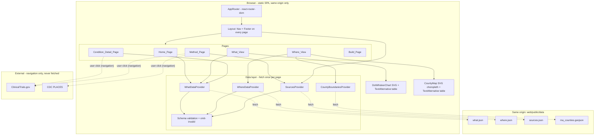

# Design Document

## Overview

The Dashboard is a static Vite + React single-page application (SPA) living in `web/`, deployed on Vercel with the project root directory set to `web`. It reads only four precomputed, same-origin files from `web/public/data/` — `what.json`, `where.json`, `sources.json`, and `ma_counties.geojson` — and makes no other runtime network requests. There is no backend, database, server-side function, API key, or AI-generated text at runtime (Req 1).

The audience is Massachusetts patient advocacy organizations. The success criterion is that an advocate can name three under-served conditions in under one minute on a phone, so the design optimizes for a mobile-first, keyboard- and screen-reader-accessible experience that surfaces the most under-served (lowest `mid`) non-cancer conditions first (Req 15).

The product is an *index*, never a prediction or recommendation. Every page carries the same footer disclaimer and source links, every number shown comes straight from the JSON files (nothing is recomputed into new disease or trial counts), and every chart and map has a text-alternative table (health-safety steering; Req 3.6, 6, 9, 12, 14).

This document also defines the JSON data contract and concrete sample placeholder files so the Dashboard can be built and tested before the `research-gap-data-pipeline` and `scoring-export` specs produce real data (Req 2).

### Key design decisions

| Decision | Choice | Rationale |
| --- | --- | --- |
| Framework | Vite + React + TypeScript | Required by steering (`tech.md`); TypeScript enforces the data contract at build time. |
| Routing | `react-router-dom` (v6) with `BrowserRouter` | Client-side routing with direct-URL entry and active-link indication (Req 13); needs Vercel SPA rewrite to `index.html`. |
| Chart | Hand-rolled SVG dot + whisker chart (no charting library) | A dot+whisker is simple geometry; hand-rolled SVG gives full control over the accessibility tree, keyboard order, colour-blind-safe palette, and the text-alternative association — avoiding a dependency whose a11y we cannot fully control. Satisfies steering's "single lightweight chart library" intent by choosing zero extra runtime chart code bundled beyond our own SVG. |
| Map | Inline SVG choropleth rendered from `ma_counties.geojson` via `d3-geo` projection only (no map tiles, no Leaflet/Mapbox) | Keeps everything same-origin and bundled; no tile server requests (Req 1.2). `d3-geo` is a small, pure projection/path library with no network use. |
| State / data | React Context providers that fetch each JSON file once per page view and expose loading / error / data states | Fetch-once-per-page (Req 15.3); centralizes schema validation and error handling (Req 3). |
| Styling | Plain CSS modules with CSS custom properties for the palette | No heavy UI framework; full control over WCAG AA contrast and 375 px layout (Req 14). |

### Research notes

- **ClinicalTrials.gov / CDC PLACES** are the only data sources; the Dashboard never calls them at runtime, it only links out to them (Req 1.2, 12.3). Source links and the "Data as of" date come from `sources.json`.
- **Vercel SPA hosting**: a static SPA using `BrowserRouter` needs a rewrite so unknown paths serve `index.html`; this is configured in `web/vercel.json`. This makes direct-URL entry to any page work (Req 13.3).
- **GeoJSON size**: Massachusetts county cartographic boundaries from the U.S. Census, simplified (e.g. with mapshaper) to stay under 300 KB (Req 2.8). Simplification is a build-time/author-time step, not runtime.
- **Colour-blind-safe palette**: a sequential single-hue scheme avoids red/green confusion. We adopt a blue sequential ramp for the choropleth and a fixed accessible accent for chart marks, all verified for WCAG AA contrast against the page background.

## Architecture

The Dashboard is a single bundle served statically. At runtime the browser loads `index.html`, the JS/CSS bundle, and — on demand per page — the JSON data files from the same origin.



### Runtime request policy

All `fetch` calls target relative, same-origin paths under `/data/` (e.g. `fetch("/data/what.json")`). The design forbids absolute URLs to other origins in runtime code. Fonts are bundled (self-hosted via Vite), the map geometry is a bundled/same-origin GeoJSON file, and all chart code is our own SVG — so there is exactly one set of origins touched at runtime: the Dashboard's own (Req 1.2). Outbound links the user clicks (ClinicalTrials.gov, CDC PLACES) are navigation and are rendered with `rel="noopener noreferrer"` and `target="_blank"` on the detail page link (Req 7.2).

### Vercel configuration

`web/vercel.json` rewrites all paths to `/index.html` so client-side routes resolve on direct entry and refresh (Req 13.3). The Vercel project root directory is `web` (Req 1.4).

## Components and Interfaces

### Routing table

Routes use `measure_id` to identify a condition so display labels can change without breaking links (Req 1-level assumption 7; Req 5.5, 7).

| Path | Component | Data needed | Requirements |
| --- | --- | --- | --- |
| `/` | `Home_Page` | What_Data | 4 |
| `/what` | `What_View` | What_Data | 5, 6, 15 |
| `/condition/:measureId` | `Condition_Detail_Page` | What_Data | 7 |
| `/where` | `Where_View` | Where_Data, County_Boundaries | 8, 9 |
| `/method` | `Method_Page` | Sources_Data | 10 |
| `/build` | `Build_Page` | none | 11 |
| `*` (unknown) | `NotFoundPage` | none | 13.3 (graceful) |

Navigation (Req 13) is a persistent `<nav>` in `Layout` linking to Home, WHAT, WHERE, Method, and Build. The active route is marked with `aria-current="page"` and a visible style (Req 13.4). All navigation uses react-router `<Link>`/`<NavLink>`, so no full-document reload occurs (Req 4.5, 13.2). The Condition detail page is reached by selecting a condition in the WHAT view, not from the top nav.

### Layout, Navigation, and Footer

`Layout` wraps every routed page and renders `<SkipLink>`, `<Nav>`, the page `<main id="main">`, and `<Footer>`. Because `Layout` is the shared shell, the Footer appears on all six pages (Req 12.1).

`Footer` (consumes Sources_Data):
- Always renders the exact `Disclaimer_Text`: `"Not medical advice. Index, not prediction."` (Req 12.2).
- Renders one named link per Source_Entry to its `url` (Req 12.3).
- Renders the `data_as_of` value labeled "Data as of" (Req 12.4).
- If Sources_Data failed to load, still renders the disclaimer and shows "Source information is unavailable" in place of links and the date (Req 12.5).

`Nav` highlights the active page and is fully keyboard operable with visible focus (Req 13.4, 14.3, 14.4).

### Data layer (providers + hooks)

Each data file has a provider that performs a single fetch per page view, validates against the schema, and exposes a discriminated-union state. A page-level provider instance is remounted per page view so data is loaded at most once per view and reused by both a chart and its text alternative on that page (Req 15.3).

```ts
type LoadState<T> =
  | { status: "loading" }
  | { status: "error"; reason: "timeout" | "network" | "parse"; file: string }
  | { status: "empty" }                       // all entries omitted (Req 3.5) / no entries
  | { status: "ready"; data: T; omittedCount: number; isSample: boolean };
```

Fetch behavior (`loadJson<T>`):
1. Start an `AbortController` with a 10 s timeout (Req 3.2, 3.3).
2. `fetch(relativePath)` → on network/404/abort → `{ status: "error", reason }` (Req 1.7, 3.3).
3. Parse JSON → on parse failure → `{ status: "error", reason: "parse" }` (Req 3.3).
4. Validate each entry against its schema validator; drop invalid entries and count them (Req 3.4).
5. If the top-level shape is valid but every entry was dropped (or the array is empty) → `{ status: "empty" }` (Req 3.5).
6. Otherwise `{ status: "ready", data, omittedCount, isSample }`.

While `loading`, pages show a loading indicator in place of data content (Req 3.2). On `error`, pages show "This data is currently unavailable" naming the file and render no partial or placeholder numeric values (Req 1.7, 3.3, 3.6). On `empty`, pages show "No valid data is available" and render no empty chart/table/list (Req 3.5).

**Sample-data detection** (`isSample`): the sample files include a top-level marker. For `what.json`/`where.json` (arrays), the real pipeline emits a plain array; the sample fixtures are wrapped so the loader can detect them, OR — to keep arrays schema-identical to the contract — the loader treats the presence of a sibling `sample.flag` convention. **Chosen approach:** `sources.json` carries an optional boolean `is_sample`. When `sources.json.is_sample === true`, the Dashboard renders a sample-data label reachable within the first screen at 375 px without scrolling (Req 2.5). This keeps `what.json`/`where.json` exactly matching the array contract in Req 2.1-2.2 while still signaling sample mode. The label is placed in the header region so it is visible above the fold on mobile.

### Chart: DotWhiskerChart + Text Alternative

`DotWhiskerChart` renders inline SVG. For each condition (already sorted), it draws a horizontal whisker from `low` to `high` on a shared linear scale and a dot at `mid` (Req 5.1). The axis is labeled "recruiting MA trial sites per 100,000 affected adults (18+)" (Req 5.4). Marks use the Colorblind_Safe_Palette and never rely on colour alone — each row also has a text label and numeric values (Req 5.8, 14.2).

Accessibility:
- The chart container has `role="img"` with an `aria-label` summarizing it, and is programmatically associated with its text-alternative table via `aria-describedby` pointing at the table's id (Req 6.3, 14.5, 14.8).
- A visually-complete data table (`TextAlternative`) lists one row per condition with columns `condition`, `low`, `mid`, `high`, `studies`, `affected_adults`, in the same order as the chart (Req 6.1, 6.2). Missing cells show "unavailable" rather than blank (Req 6.6).
- Selecting a condition (dot/row is a keyboard-focusable `<button>`/`<Link>`) navigates to the detail page by `measure_id` (Req 5.5, 14.3).

Tabs: `What_View` shows a non-cancer tab (default) and a cancer tab; switching tabs re-sorts and re-filters, updating both chart and table within 500 ms (Req 5.2, 6.4). An empty tab shows "No conditions are available in this tab" and the table shows headers with no rows plus a no-data note (Req 5.7, 6.5).

### Map: CountyMap + Text Alternative

`CountyMap` renders the 14 MA counties from `ma_counties.geojson` as SVG paths using a `d3-geo` projection (`geoMercator`/`geoAlbers` fit to the feature collection). Each county path is filled by a sequential blue ramp bucket derived from the selected condition's `miles_to_nearest`; counties with no matching Where_Entry are rendered with a distinct hatched "no data" pattern, not shaded as zero (Req 8.1, 8.5). A condition selector (`<select>`) changes the selected condition and updates the map and text alternative (Req 8.2, 9.3). The total `adults_over_30mi` summed across counties for the selected condition is shown in both the map region and the text-alternative table (Req 8.3, 9.4).

Accessibility mirrors the chart: `role="img"` + `aria-describedby` → a data table listing each county's `county` label, `miles_to_nearest`, and `adults_over_30mi` for the selected condition (Req 9.1, 9.2). Colours come from the Colorblind_Safe_Palette and legend text conveys buckets so colour is not the only signal (Req 8.4, 14.2). If Where_Data has zero entries, the view shows "No distance data is available" (Req 8.6).

### Pages

- **Home_Page**: one-sentence problem statement (1-200 chars); top finding = non-cancer condition with lowest `mid` (ties broken by case-insensitive ascending `condition`), naming it and its low-high range; a visible-text link to the WHAT view; "no condition data available" message when there are zero valid non-cancer entries (Req 4).
- **Condition_Detail_Page**: for the `:measureId`, shows `studies`, `sites`, `affected_adults` (labeled 18+), and the Index_Value as a `low`-`high` range with the unit string; a ClinicalTrials.gov link to `ctgov_url` opening in a new browser context (or an "unavailable" message if `ctgov_url` is absent/empty); the severity-vs-commonness caveat; grade-8 plain language with ≤20-word definitions for "interventional" and "prevalence" at first use; no diagnosis/eligibility text; "condition not found" + link back to WHAT when no entry matches (Req 7, 5.10).
- **Method_Page**: the formula (sites per 100,000 affected adults), each Source_Entry as a named link with its `fetched` date, the severity-vs-commonness limit, the PLACES-coverage/18+ limit, grade-8 language (Req 10).
- **Build_Page**: title "How we built it with Kiro"; links to the `.kiro/` spec and steering files and `KIRO_LOG.md` using full GitHub repository URLs of the form `https://github.com/ethancfay/research-gap-index/blob/main/<path>` (for example `https://github.com/ethancfay/research-gap-index/blob/main/.kiro/specs/dashboard/design.md` and `https://github.com/ethancfay/research-gap-index/blob/main/KIRO_LOG.md`), because Vercel serves only the `web/` root and does not serve the repository's `.kiro/` directory or `KIRO_LOG.md`, so site-relative paths to those files would 404; these are outbound navigation links (rendered with `rel="noopener noreferrer"`), not runtime data fetches, and are therefore permitted under the same-origin runtime policy (Req 1.2); a short description of Kiro usage (Req 11).

## Data Models

TypeScript types encode the exact JSON contract and bounds from Req 2. Validators (hand-written type guards) enforce the bounds at runtime so invalid entries are omitted (Req 3.4).

```ts
// what.json — JSON array of What_Entry (Req 2.1)
interface WhatEntry {
  condition: string;        // non-empty
  measure_id: string;       // non-empty; stable id used in routes/links
  low: number;              // >= 0
  high: number;             // >= 0
  mid: number;              // >= 0; invariant: low <= mid <= high
  studies: number;          // non-negative integer
  sites: number;            // non-negative integer
  affected_adults: number;  // non-negative integer
  ctgov_url: string;        // begins with "https://"
}

// where.json — JSON array of Where_Entry (Req 2.2)
interface WhereEntry {
  county_fips: string;      // non-empty (5-char MA county FIPS)
  county: string;           // non-empty
  condition: string;        // non-empty (matches a What_Entry condition/measure)
  miles_to_nearest: number; // >= 0
  adults_over_30mi: number; // non-negative integer
}

// sources.json — JSON object (Req 2.3)
interface SourcesData {
  data_as_of: string;       // ISO 8601 YYYY-MM-DD
  is_sample?: boolean;      // true in sample fixtures (drives sample-data label, Req 2.5)
  sources: SourceEntry[];
}
interface SourceEntry {
  name: string;             // non-empty
  url: string;              // begins with "https://"
  fetched: string;          // ISO 8601 YYYY-MM-DD
}

// ma_counties.geojson — FeatureCollection of exactly 14 Features (Req 2.8)
interface CountyFeature {
  type: "Feature";
  properties: { county_fips: string /* 5 chars, matches where.json */ };
  geometry: GeoJSON.Polygon | GeoJSON.MultiPolygon;
}
```

Validation rules (used by `loadJson`):
- A `WhatEntry` is valid iff every field is present and typed, strings `condition`/`measure_id` are non-empty, `ctgov_url` starts with `https://`, numbers are `>= 0`, `studies`/`sites`/`affected_adults` are integers, and `low <= mid <= high` (Req 2.1, 3.4, 5.9).
- A `WhereEntry` is valid iff every field is present and typed, strings non-empty, `miles_to_nearest >= 0`, `adults_over_30mi` is a non-negative integer (Req 2.2, 3.4).
- A `SourceEntry` is valid iff `name` non-empty, `url` starts with `https://`, `fetched` matches `YYYY-MM-DD` (Req 2.3, 3.4).
- `data_as_of` must match `YYYY-MM-DD`.

### Cancer condition identification

`Cancer_Condition` is defined by an explicit, versioned set of cancer `measure_id` values in a single module `cancerMeasures.ts`:

```ts
// CDC PLACES cancer-related measure ids used by this project.
export const CANCER_MEASURE_IDS: ReadonlySet<string> = new Set([
  "CANCER",   // All cancer (except skin) among adults
]);
export const isCancerCondition = (measureId: string) =>
  CANCER_MEASURE_IDS.has(measureId);
```

The set is the single source of truth for the WHAT view tab split (Req 5.2) and is confirmed/extended against the measure ids actually present in the real `what.json` during the scoring-export spec. Keeping it as a set of ids (not a label-substring heuristic) means a display-label change never reclassifies a condition.

### Colorblind_Safe_Palette

Concrete palette, all verified for WCAG AA contrast (≥ 4.5:1 for text, ≥ 3:1 for large text/graphics) against a white (`#FFFFFF`) background:

```css
:root {
  --bg: #FFFFFF;
  --ink: #1A1A1A;             /* body text, ~16:1 on white */
  --accent: #0F6CBD;          /* links, chart dot/whisker; AA on white */
  --focus: #B54708;           /* visible focus ring, AA on white */
  /* Sequential blue choropleth ramp (light -> dark), colour-blind safe */
  --seq-1: #DEEBF7;
  --seq-2: #9ECAE1;
  --seq-3: #4292C6;
  --seq-4: #2171B5;
  --seq-5: #08519C;
  --nodata: #BDBDBD;          /* "no data" fill, paired with a hatch pattern */
}
```

The choropleth uses a single-hue sequential ramp (no red↔green pairing) so it is distinguishable under deuteranopia/protanopia; the "no data" county additionally uses an SVG hatch pattern so it is not distinguished by colour alone (Req 8.5, 14.2).

### Sample data file plan

Sample files live in `web/public/data/` and satisfy Req 2.4-2.8. `sources.json` sets `is_sample: true` to trigger the sample-data label (Req 2.5).

- **`what.json`** — ≥ 4 entries with distinct `measure_id`: at least one cancer (`measure_id: "CANCER"`) and at least three non-cancer (e.g. `HIGHCHOL`, `CASTHMA`, `BPHIGH`) (Req 2.6). Each has all nine fields in bounds with `low <= mid <= high` and an `https://clinicaltrials.gov/...` `ctgov_url`. Values mirror the realistic spread from product.md (cancer ~260, several non-cancer under 2) so the cancer tab clearly needs its own scale.
- **`where.json`** — for exactly one condition, exactly one Where_Entry per each of the 14 MA `county_fips` values (so the full map renders), with varied `miles_to_nearest` and `adults_over_30mi` (Req 2.7). May include a few extra entries for other conditions to exercise the selector.
- **`sources.json`** — `data_as_of` set, `is_sample: true`, and two Source_Entry items: ClinicalTrials.gov and CDC PLACES, each with `https://` `url` and a `YYYY-MM-DD` `fetched` date (Req 2.3).
- **`ma_counties.geojson`** — FeatureCollection of exactly 14 Features, each `properties.county_fips` a 5-char string matching `where.json`, simplified to ≤ 300 KB (Req 2.8).

The 14 MA county FIPS codes (state 25): 25001 Barnstable, 25003 Berkshire, 25005 Bristol, 25007 Dukes, 25009 Essex, 25011 Franklin, 25013 Hampden, 25015 Hampshire, 25017 Middlesex, 25019 Nantucket, 25021 Norfolk, 25023 Plymouth, 25025 Suffolk, 25027 Worcester.

## Correctness Properties

*A property is a characteristic or behavior that should hold true across all valid executions of a system — essentially, a formal statement about what the system should do. Properties serve as the bridge between human-readable specifications and machine-verifiable correctness guarantees.*

The Dashboard is mostly UI rendering, but its decision logic is a set of pure functions over the loaded JSON — schema validation/omission, tab partitioning, sorting, top-finding selection, per-county map-state resolution, and aggregation. These are exactly the parts where behavior varies meaningfully with input and where 100+ generated inputs find edge cases that a few examples would miss, so they are specified as properties below. Pure UI wiring, fixed strings, routing, layout, and accessibility structure are covered by example and edge-case tests in the Testing Strategy, not as properties.

The following prework analysis was performed to classify every acceptance criterion (PROPERTY / EXAMPLE / EDGE_CASE) before writing these properties, then reflected on to remove redundant properties (range-field omission folded into the general omission property; the chart sort, the table order, and the table row-per-condition folded into one ordering property; the per-county map state and the WHERE text-alternative folded into one resolution property; footer presence and disclaimer folded into one; the two "named link per source" criteria folded into one).

### Property 1: Schema validation accepts valid entries and rejects invalid ones

*For any* candidate entry object, the entry validator accepts it if and only if every required field is present and of the correct type, every string field required to be non-empty is non-empty, every URL field begins with `https://`, every numeric field required to be `>= 0` is `>= 0`, every integer field is a non-negative integer, every date field matches `YYYY-MM-DD`, and (for a What_Entry) `low <= mid <= high`.

**Validates: Requirements 2.1, 2.2, 2.3, 3.4, 5.9**

### Property 2: Loading omits exactly the invalid entries and preserves order

*For any* JSON array mixing valid and invalid entries, the data layer's loaded result contains exactly the valid entries in their original relative order, `omittedCount` equals the number of invalid entries removed, and no invalid entry appears in the result.

**Validates: Requirements 3.4, 5.9**

### Property 3: All-omitted or empty input yields the empty state

*For any* JSON array whose entries are all invalid (including the empty array), the data layer produces the `empty` state and never produces a `ready` state with zero usable entries.

**Validates: Requirements 3.5, 5.7**

### Property 4: Conditions are sorted ascending by midpoint with alphabetical tie-break, and the text alternative matches

*For any* set of valid conditions in a tab, the chart ordering is a permutation of those conditions that is non-decreasing in `mid`, and for any two conditions with equal `mid` the one whose `condition` label is case-insensitively smaller comes first; and the text-alternative table lists exactly those same conditions, one row each, in the identical order.

**Validates: Requirements 5.3, 6.1, 6.2, 15.1**

### Property 5: The tab split is a disjoint, covering partition that matches the cancer-measure set

*For any* set of valid conditions, the cancer tab contains exactly the conditions whose `measure_id` is in `CANCER_MEASURE_IDS` and the non-cancer tab contains exactly the rest; the two tabs are disjoint and their union equals the full set of valid conditions.

**Validates: Requirements 5.2, 6.4**

### Property 6: The home top finding is the lowest-midpoint non-cancer condition, ties broken alphabetically

*For any* What_Data containing at least one valid non-cancer condition, the selected top finding is a non-cancer condition, its `mid` equals the minimum `mid` over all valid non-cancer conditions, and among non-cancer conditions sharing that minimum `mid` its `condition` label is the case-insensitively smallest.

**Validates: Requirements 4.2, 4.3**

### Property 7: Displayed index values always show the full low-high range, with the dot inside the whisker

*For any* valid condition rendered in the chart or table, both the `low` and `high` values are shown (never a single `mid`-only ranking), and on the chart scale the dot position for `mid` lies between the whisker endpoints for `low` and `high` (i.e. `x(low) <= x(mid) <= x(high)`).

**Validates: Requirements 5.1, 5.6**

### Property 8: Every county resolves to its own distance bucket or an explicit no-data marker

*For any* Where_Data and selected condition, each of the 14 counties renders with a colour bucket derived from the `miles_to_nearest` of the Where_Entry matching that condition and the county's `county_fips` when such an entry exists, and renders with the explicit no-data marker (never the zero-distance bucket) when no such entry exists; and the WHERE text-alternative table lists, for each county, the same `miles_to_nearest` and `adults_over_30mi` values (or a no-data indication).

**Validates: Requirements 8.1, 8.5, 9.1**

### Property 9: The over-30-miles total equals the sum across counties for the selected condition

*For any* Where_Data and selected condition, the total displayed for adults living more than 30 miles from the nearest recruiting site equals the sum of `adults_over_30mi` over exactly the Where_Entries for that condition, and the identical total value appears in both the map region and the text-alternative table.

**Validates: Requirements 8.3, 9.4**

### Property 10: Every source renders as a named link to its URL with its fetched date

*For any* Sources_Data, both the Method page and the Footer render exactly one named link per Source_Entry whose destination equals that entry's `url`, and the Method page additionally shows that entry's `fetched` date; no source is omitted and no extra link is introduced.

**Validates: Requirements 10.2, 12.3**

### Property 11: The footer and its disclaimer appear on every page

*For any* route in the Dashboard routing table, the rendered page contains the Footer and the Footer contains the exact Disclaimer_Text "Not medical advice. Index, not prediction.".

**Validates: Requirements 12.1, 12.2**

### Property 12: Runtime data requests are same-origin and confined to the data directory

*For any* sequence of Dashboard page views, every network request the Dashboard issues at runtime is a same-origin request whose path is under the Data_Directory (`/data/`), and no runtime request targets any other origin.

**Validates: Requirements 1.2**

## Error Handling

The data layer is the single place that turns failures into the discriminated `LoadState`, so every page handles errors the same way.

| Condition | State | User-visible result | Requirements |
| --- | --- | --- | --- |
| Fetch rejects (network) or 404 | `error:"network"` | "This data is currently unavailable" naming the file; no numbers rendered | 1.7, 3.3 |
| No response within 10 s (AbortController) | `error:"timeout"` | Same unavailable message; loading indicator replaced | 3.2, 3.3 |
| Body is not valid JSON / wrong top-level shape | `error:"parse"` | Same unavailable message, naming the file | 1.7, 3.3 |
| Some entries invalid | `ready` (with `omittedCount`) | Invalid entries omitted; valid ones shown | 3.4 |
| All entries invalid / empty array | `empty` | "No valid data is available"; no empty chart/table/list | 3.5 |
| Unknown `measure_id` on detail route | — | "Condition not found" + link back to WHAT | 5.10, 7.6 |
| `ctgov_url` absent/empty on detail | — | "Trial search link is unavailable"; no broken link | 7.3 |
| Sources_Data fails to load | `error` | Footer still shows disclaimer; "Source information is unavailable" replaces links and date | 12.5 |
| Where_Data has zero entries | `empty` | "No distance data is available"; no empty map | 8.6 |
| County has no Where_Entry for selection | — | County marked no-data (hatched), not shaded zero | 8.5 |

Principles:
- The Dashboard never renders a partial, stale, or placeholder number for a failed file (Req 1.7, 3.3, 3.6).
- Each failure names the specific file that could not be loaded (Req 1.7).
- Errors degrade gracefully per-file: a failure loading `where.json` does not blank the Footer, which depends on `sources.json` (Req 12.5).
- No error surfaces raw response bodies or stack traces to the user; messages are plain-language and grade-8 (steering health-safety; Req 10.5).

## Testing Strategy

The project uses **Vitest** as the test runner for the web package and **fast-check** for property-based tests, with **@testing-library/react** for component/DOM and interaction tests and **jsdom** as the environment. (The Python pipeline uses pytest + Hypothesis per `tech.md`; this web package mirrors that dual approach with the JavaScript-ecosystem equivalents.) Tests make no network requests — `fetch` is always mocked; a test that performs real I/O must fail.

### Property-based tests

- Library: **fast-check**. Each property test runs a **minimum of 100 generated examples** (`fc.assert(fc.property(...), { numRuns: 100 })`).
- Each property test is implemented as a **single** property-based test and is tagged with a comment referencing its design property, in the form:
  `// Feature: dashboard, Property N: <property text>`
- Target the pure logic modules so generators are cheap and in-memory: `validateWhatEntry`/`validateWhereEntry`/`validateSourceEntry`, `loadJson` (with a stubbed fetch returning a generated body), `partitionByCancer`, `sortConditions`, `selectTopFinding`, `chartScale`, `resolveCountyState`, and `sumAdultsOver30mi`.
- Generators: arbitraries for `WhatEntry`, `WhereEntry`, `SourceEntry` (both valid and each kind of violation), arrays mixing valid/invalid entries, datasets with duplicate `mid` values to exercise tie-breaking, and county/selection combinations. Edge cases (empty arrays, all-invalid arrays, whitespace-only strings, missing fields, range violations, missing county entries) are produced by the generators rather than by separate hand-written cases.

Mapping of properties to the twelve Correctness Properties above (Properties 1-12), one property-based test each.

### Unit / example tests

Cover the criteria classified EXAMPLE/EDGE_CASE in the prework:
- Error states: network error, 404, malformed JSON, and a >10 s timeout each produce the correct `error` state and render no numbers (Req 1.7, 3.3, 3.2).
- Sample fixtures: load the shipped `what.json`, `where.json`, `sources.json`, `ma_counties.geojson`; assert zero omitted entries, ≥1 cancer + ≥3 distinct non-cancer `measure_id`s, exactly 14 distinct `county_fips` for the designated condition, 14 GeoJSON features ≤ 300 KB, and matching FIPS between GeoJSON and `where.json` (Req 2.4, 2.6, 2.7, 2.8).
- Sample-data label renders when `is_sample` is true and is absent otherwise (Req 2.5).
- Detail page: known `measure_id` shows the entry's exact counts and the unit string; unknown id shows not-found + back link; absent `ctgov_url` shows the unavailable message; no diagnosis/eligibility text; definitions present for "interventional"/"prevalence" (Req 7).
- Fixed strings: chart axis unit label, Method formula and limit strings, Build page title and its `.kiro/`/`KIRO_LOG.md` links (asserted to be absolute `https://github.com/ethancfay/research-gap-index/blob/main/...` URLs rather than site-relative paths), Footer "Data as of" label (Req 5.4, 10, 11, 12.4).
- Routing: navigation reaches every page without full reload, direct-URL entry renders each route, active page indicated, focus moves to `#main` on route change (Req 13, 14.7).
- Accessibility: `aria-describedby` links each chart/map to its table (Req 6.3, 9.2); every interactive control is keyboard operable with a visible focus style and a programmatic label (Req 14.3, 14.4, 14.8); no-data uses a hatch pattern and every row/county has a text label (Req 14.2); contrast ratios of each palette text/background pair meet WCAG AA (Req 14.1).
- Layout: at 375 px there is no horizontal overflow and the three lowest-`mid` non-cancer conditions appear first (Req 14.6, 15.1).
- Fetch-once: rendering a page with a chart and its text alternative issues exactly one fetch per data file (Req 15.3).

### Reading-level and manual checks

Grade-8 reading-level targets (Req 7.5, 10.5) are checked with an automated Flesch-Kincaid assertion over the detail and method copy where feasible; full WCAG AA conformance (screen-reader behavior, real assistive-technology testing) requires manual review and is noted as out of scope for automated tests.
