# Design Document: Research Gap Data Pipeline

## Overview

This design implements `requirements.md` (Requirements 1 to 14, cited below as "Req N.M"). The Pipeline is a local Python 3.11+ command-line program, `python -m pipeline [--offline]`. It does the following:

1. Fetches studies within 150 miles of (42.3, -71.8) from ClinicalTrials.gov v2 using two queries. Q1 fetches `RECRUITING`, `NOT_YET_RECRUITING`, and `ACTIVE_NOT_RECRUITING` studies. Q2 fetches `COMPLETED` studies last updated on or after the Recent_Completed_Cutoff. All study types are fetched. The two result sets are merged and deduplicated by `nctId`.
2. Fetches Massachusetts crude prevalence rows from CDC PLACES 2025 (`swc5-untb`).
3. Scrubs contact data from every ClinicalTrials.gov page before the page is cached or used.
4. Writes `studies.csv`, `sites.csv`, `places_ma.csv`, and `fetch_log.json` to `pipeline/processed/`, all-or-nothing.

The Pipeline keeps all study types and all site statuses. Spec 3 (scoring) filters by study type, site status, and the recent-COMPLETED rule for metrics. This pipeline applies only the overall status filter and the Recent_Completed_Cutoff (Req 4.1). Q2 applies the cutoff on the server if probe V10 passes. The Study_Transformer applies it again after the fetch in every case, so the server filter only reduces how much is downloaded and never changes the output rows.

### Requirements changes needed before implementation

`structure.md` says to update the spec before code differs from it. The split fetch changes the following text in `requirements.md`. **Applied on 2026-10-24 at the end of task 1.** V10 passed, so Q2 keeps `filter.advanced` (see `probe_results.md`).

| Location | Current text | Change to |
|---|---|---|
| Glossary, CTGov_Query | One query with four statuses | Two entries. **CTGov_Query_Active (Q1):** `filter.geo`, `filter.overallStatus=RECRUITING,NOT_YET_RECRUITING,ACTIVE_NOT_RECRUITING`, `pageSize=1000`, `countTotal=true`. **CTGov_Query_Completed (Q2):** the same, but with `filter.overallStatus=COMPLETED` plus `filter.advanced=AREA[LastUpdatePostDate]RANGE[<cutoff − 1 day>,MAX]`. The `filter.advanced` parameter is left out if V10 fails. |
| Glossary, Total_Count | `totalCount` of "the first … page of a run" | `totalCount` of the first page **of each query** |
| Req 1.1 | "send one GET request" | Send one first-page request per query: Q1 first, then Q2 |
| Req 1.2 | "identical to the first request of the run" | "identical to the first request **of the same query**" |
| Req 1.3 | Stop, then pass the records "in page order" | Stop paging **that query**. Pass the Q1 records, then the Q2 records, each in page order |
| Req 1.5 | Token "used earlier in the same run" | Token used earlier **in the same query** |
| Req 1.7 | 100 pages "in one run" | 100 pages **per query** |
| Req 1.9, 1.10 | One Total_Count check | The check runs **per query**. The message names the query |
| Req 1.11 | The message names `filter.geo` | The message names `filter.geo`, and for Q2 also `filter.advanced` |
| Req 4.5 | "API response order" | Q1 pages, then Q2 pages, then position within the page |
| Req 10.1, 10.4 | One ClinicalTrials.gov page sequence | Raw file names identify the query. A complete fetch needs both queries to end with no `nextPageToken` |
| Req 12.11 | One Total_Count and one fetched count | A Total_Count and a fetched count for each query |

The server lower bound is set to the **cutoff minus 1 day**, so it does not matter whether `RANGE` is inclusive. The post-fetch filter then removes the extra day.

### Expected volume

- `studies.csv`: more than 4,000 rows. Adding `COMPLETED` puts the count above the 3,145 recruiting MA studies recorded in `product.md`.
- Fetched records (Q1 + Q2 Total_Count) will still be higher than the `studies.csv` row count. The radius covers sites outside Allowed_States, and those sites are dropped during transformation. If V10 passes, Q2 returns only recent `COMPLETED` studies, not decades of them. If V10 fails, Q2 returns every `COMPLETED` study in the radius, and the cutoff is applied only after the fetch. The real counts are unknown until probes V4 and V10 run.
- Pages: ceil(Total_Count / 1000) for each query. The 100-page limit applies per query (Req 1.7, as amended), so the design breaks if either query's Total_Count is above 100,000. Probes V4 and V10 check the headroom.
- Memory: every scrubbed page stays in memory until the transformers finish. At tens of thousands of records with a restricted `fields` list, this should be a few hundred MB at most. No streaming is planned.
- The Req 11.1 sanity threshold (at least 2,000 interventional studies with a recruiting MA site) does not change.

## Architecture

### Module layout

This follows `.kiro/steering/structure.md`.

```
pipeline/
  __init__.py              # empty; must parse on old Pythons (see Version check)
  __main__.py              # entry point: version check, argument parsing, run orchestration
  errors.py                # PipelineError (shared by all subpackages)
  data/
    __init__.py
    http_client.py         # HTTP_Client
    ctgov_fetcher.py       # CTGov_Fetcher
    places_fetcher.py      # PLACES_Fetcher
    contact_scrubber.py    # Contact_Scrubber
    raw_store.py           # Raw_Store
  transform/
    __init__.py
    study_transformer.py   # Study_Transformer
    places_transformer.py  # PLACES_Transformer
    pii_guard.py           # PII_Guard
    sanity_checker.py      # Sanity_Checker
  io/
    __init__.py
    atomic.py              # staging directory + os.replace commit
    csv_writer.py          # CSV_Writer (cell encoding, quoting, sorting)
    csv_reader.py          # CSV_Reader
    fetch_log_writer.py    # Fetch_Log_Writer
  raw/                     # gitignored cache
  processed/               # outputs

tests/
  __init__.py
  conftest.py              # network block (Req 13.6), Hypothesis profile (Req 13.7)
  strategies.py            # shared Hypothesis generators
  fixtures/                # small recorded, already-scrubbed raw pages
  data/   __init__.py, test_http_client.py, test_ctgov_fetcher.py, test_places_fetcher.py,
          test_contact_scrubber.py, test_raw_store.py
  transform/ __init__.py, test_study_transformer.py, test_places_transformer.py,
          test_pii_guard.py, test_sanity_checker.py
  io/     __init__.py, test_csv_writer.py, test_csv_reader.py, test_fetch_log_writer.py
  test_main.py             # end-to-end runs with a fake HTTP_Client
```

`pipeline/errors.py` holds `PipelineError`, so that `transform/` and `io/` do not have to import from `data/` just to get the error type. `structure.md` lists it. It is not in `pipeline/__init__.py` because that file must stay free of 3.11-only syntax (see Version check).

`pipeline/io` is a subpackage, so it does not shadow the standard library `io` under absolute imports. The `__init__.py` files under `tests/` stop pytest's default `prepend` import mode from mixing `tests/io` with the stdlib `io`.

### Data flow

```mermaid
flowchart LR
  A[__main__: version check, args] --> B{--offline?}
  B -- no --> C[Raw_Store.begin_network_run]
  C --> D[CTGov_Fetcher Q1 pages, then Q2 pages] --> E[Contact_Scrubber] --> F[Raw_Store.write_page]
  F --> D
  F --> G[PLACES_Fetcher pages] --> H[Raw_Store.write_page] --> G
  H --> I[Raw_Store.finish_network_run: manifest]
  B -- yes --> J[Raw_Store.load] --> K[Contact_Scrubber re-scrub]
  I --> L[Fetch checks: Total_Count per query, Allowed_States]
  K --> L
  L --> M[Study_Transformer + PLACES_Transformer]
  M --> N[CSV_Writer.encode: sort + cell strings]
  N --> O[PII_Guard] --> P[Sanity_Checker]
  P --> Q[stage CSVs, commit] --> R[stage fetch_log, commit] --> S[stdout summary, exit 0]
```



The order matches the `structure.md` data flow, with one refinement: rows are sorted and encoded to their final cell strings before the PII_Guard runs. This is needed for two reasons:

- Req 8.1 requires the guard to check the exact written string form.
- Req 8.4 identifies Site_Rows by their 1-based position in `sites.csv`, which is only known after sorting.

### Error model

- Every defined failure raises `PipelineError(message)`. `__main__` catches it, prints `message` to stderr, and exits with code 1 (Req 14.8). Argument errors exit with code 2 (argparse default).
- Messages contain only URLs, page numbers, counts, field names, identifiers, and timestamps (Req 3.3). No exception message includes response body text, and none uses `repr()` of a record.
- Unexpected exceptions are caught in `__main__`, which prints the exception type name and exits with code 1. It does not print a traceback with local values, because a traceback could include record content.
- No error path touches `pipeline/processed/`. Outputs are only committed after every check has passed (see Atomic output).

### Version check (Req 14.2)

`pipeline/__main__.py` starts with a check that uses only syntax every Python 3 can parse:

```python
import sys
if sys.version_info < (3, 11):
    sys.stderr.write("Python %d.%d.%d detected; minimum is 3.11\n" % sys.version_info[:3])
    sys.exit(1)
```

Imports of pipeline modules come after this block. `pipeline/__init__.py` stays empty because `python -m pipeline` imports it first.

### CLI

```
python -m pipeline            # network run
python -m pipeline --offline  # Offline_Mode from pipeline/raw/
```

The "Common commands" section of `tech.md` lists these commands.

## Components and Interfaces

### HTTP_Client (`pipeline/data/http_client.py`), Req 9, 14.3

```python
class HttpClient:
    def __init__(self, sleep=time.sleep, opener=urllib.request.urlopen, clock=time.monotonic): ...
    def get(self, url: str) -> bytes: ...
```

- Host allowlist: the client raises `PipelineError` before sending anything if the URL host is not `clinicaltrials.gov` or `data.cdc.gov` (Req 14.3).
- Attempts: 1 initial attempt plus up to 3 retries, waiting 1, 2, then 4 s (Req 9.1). Each `get` call has its own counter (Req 9.2).
- Retried failures: `URLError` / `ConnectionError`, timeouts, HTTP 429, and HTTP 5xx. `Retry-After` is ignored because the requirements fix the waits.
- Other 4xx: raises `HttpStatusError(url, status)` (a `PipelineError` subclass) with no retry (Req 9.4). The CTGov_Fetcher turns status 400 into the Req 1.11 message.
- Exhaustion: the message contains the URL, the final status or error type, and "4 attempts" (Req 9.3).
- 60 s total per attempt (Req 9.5): urllib's `timeout` applies to each socket operation, not to the whole response. The client therefore records a deadline when it sends the request, reads the body in 64 KiB chunks, and resets the socket timeout to the remaining time before each read. Passing the deadline raises a timeout failure.
- Headers: `User-Agent: research-gap-index-pipeline` and `Accept: application/json`. No API keys.
- The client returns the raw bytes. It never logs bodies.

### CTGov_Fetcher (`pipeline/data/ctgov_fetcher.py`), Req 1, 3.1

```python
Q2_SERVER_CUTOFF: bool = True   # set from probe V10 in task 1

@dataclass
class QueryResult:
    query: Literal["q1", "q2"]
    pages: list[dict]          # scrubbed pages, in order
    urls: list[str]            # one per page, in order sent (Req 1.4)
    total_count: int | None    # from this query's page 1 (Req 1.9)

@dataclass
class CtgovFetchResult:
    queries: list[QueryResult] # always [q1, q2], in that order
    removal_counts: RemovalCounts

def fetch_ctgov(client: HttpClient, raw_store, fetch_date: datetime) -> CtgovFetchResult
```

The fetcher runs Q1 to completion, then Q2. Each query builds its parameters once, and only `pageToken` changes between pages of the same query (Req 1.2):

| Parameter | Q1 (active) | Q2 (recent completed) |
|---|---|---|
| `filter.geo` | `distance(42.3,-71.8,150mi)` | same |
| `filter.overallStatus` | `RECRUITING,NOT_YET_RECRUITING,ACTIVE_NOT_RECRUITING`. The separator is confirmed by probe V2. | `COMPLETED` |
| `filter.advanced` | omitted | `AREA[LastUpdatePostDate]RANGE[<cutoff − 1 day>,MAX]`, with the date as `YYYY-MM-DD`. Omitted when `Q2_SERVER_CUTOFF` is `False`. |
| `pageSize` | `1000` | same |
| `countTotal` | `true` | same |
| `fields` | List below | same |
| `pageToken` | Omitted on page 1, then the previous `nextPageToken` | same |

- `Q2_SERVER_CUTOFF` records the V10 outcome. When it is `False`, Q2 fetches every `COMPLETED` study in the radius, which is the original post-fetch-only behaviour.
- The cutoff comes from the Fetch_Date, so the Q2 URL changes from day to day. Offline runs reuse the stored URLs and the stored Fetch_Date, so byte-identity (Req 10.5) is not affected.
- No `filter.studyType` or equivalent parameter is sent (Req 1).
- URLs are built with `urllib.parse.urlencode(params, safe="(),")` in a fixed parameter order, so they depend only on the Fetch_Date and the page tokens. The brackets in `filter.advanced` are percent-encoded.

The `fields` list covers only what Req 4 and 5 need (Req 3.1):

```
protocolSection.identificationModule.nctId
protocolSection.identificationModule.briefTitle
protocolSection.statusModule.overallStatus
protocolSection.statusModule.lastUpdatePostDateStruct
protocolSection.designModule.studyType
protocolSection.designModule.phases
protocolSection.eligibilityModule.healthyVolunteers
protocolSection.conditionsModule.conditions
protocolSection.armsInterventionsModule.interventions.type
protocolSection.armsInterventionsModule.interventions.name
protocolSection.contactsLocationsModule.locations.facility
protocolSection.contactsLocationsModule.locations.city
protocolSection.contactsLocationsModule.locations.state
protocolSection.contactsLocationsModule.locations.zip
protocolSection.contactsLocationsModule.locations.status
protocolSection.contactsLocationsModule.locations.geoPoint
derivedSection.conditionBrowseModule.meshes
derivedSection.conditionBrowseModule.ancestors
```

`centralContacts`, `overallOfficials`, `locations.contacts`, and `responsibleParty` are not requested. Probes V3 and V6 confirm that sub-field paths are accepted and that they exclude `contacts`. If probe V3 fails, the list falls back to the whole `locations` object, and the Contact_Scrubber becomes the only barrier before disk. The PII_Guard remains as the last check in both cases.

Per-page loop, run separately for each query. Page numbers, seen tokens, and the 100-page limit are all tracked per query:

1. Record the URL, then call `client.get`.
2. Parse with `json.loads`. If parsing fails, or the result has no `studies` list, stop with the URL and page number (Req 1.6, 3.5). Nothing from the page is written.
3. Scrub the page (Contact_Scrubber), then call `raw_store.write_page("ctgov_q1" or "ctgov_q2", n, page)` (Req 10.1). This happens before the next request.
4. On the query's page 1, read `totalCount`. A non-integer or `bool` value fails the check in Req 1.10, which runs after the fetch.
5. Read `nextPageToken`. If the field is absent, null, or `""`, stop paging this query (Req 1.3). If the token was seen earlier in this query, stop with an error naming the token and the query (Req 1.5). If this is the query's page 100 and a token is present, stop with an error stating the 100-page limit (Req 1.7).
6. HTTP 400 from `HttpStatusError`: stop with the URL, status 400, and the hint "check parameter filter.geo". For Q2 the hint is "check parameter filter.geo or filter.advanced" (Req 1.11).

Merge: the transformers receive the Q1 pages followed by the Q2 pages. Deduplication by `nctId` happens in the Study_Transformer (Req 4.5). A study can appear in both queries if its status changes between the two queries. In that case the Q1 copy is kept.

The Fetch_Date is captured as `datetime.now(timezone.utc)` once, before the first request (Req 1.8). It is formatted as `YYYY-MM-DDTHH:MM:SSZ`.

### Fetch checks (in `__main__.py`), Req 1.10, 1.12

These checks run after the CTGov pages are available (network or offline) and before transformation:

- Req 1.10, per query: page 1 of each query must have an integer `totalCount`, and that query's total number of `studies` elements across its pages must equal it. Duplicates and records without an `nctId` are counted at this stage, because the count is of records as received. Studies that appear in both queries count once in each query. On failure, the message names the query and gives both numbers. In Offline_Mode, `totalCount` is read from each query's stored page 1, which keeps that field.
- Req 1.12: at least one record must have a location whose state matches Allowed_States, using the Req 5.3 comparison. Otherwise the run stops with a message that names `filter.geo`.

If ClinicalTrials.gov data changes between page requests, the count check can fail. When that happens, the remedy is to rerun. The Pipeline does not retry the whole fetch automatically.

### PLACES_Fetcher (`pipeline/data/places_fetcher.py`), Req 2

Base URL: `https://data.cdc.gov/resource/swc5-untb.json`. Query parameters, in a fixed order:

| Parameter | Value |
|---|---|
| `$select` | `locationname,locationid,measureid,measure,data_value,low_confidence_limit,high_confidence_limit,totalpop18plus,geolocation,year,stateabbr,datavaluetypeid` |
| `$where` | `stateabbr='MA' AND datavaluetypeid='CrdPrv'` |
| `$order` | `locationname,measureid,:id` |
| `$limit` | `1000` |
| `$offset` | `0`, `1000`, `2000`, … |

- The `:id` tie-breaker is my addition to the Req 2.3 sort. Without it, rows with the same `locationname` and `measureid` (for example two `year` values) can appear in either order, and could shift across a page boundary. Probe V9 confirms that Socrata accepts it. If it is rejected, `:id` is dropped. At the expected volume (14 counties × about 40 measures, so roughly 560 rows) everything fits on one page anyway.
- The body must parse as a JSON list of objects. Otherwise the run stops with an "invalid format" error (Req 2.8). The run also stops if page 1 is empty (Req 2.7).
- Paging stops when a page has fewer than 1,000 rows (Req 2.5). The run stops if page 100 still has 1,000 rows (Req 2.9).
- Each page is written to the Raw_Store before the next request (Req 10.1). PLACES pages are not scrubbed because they contain no contact structures. The PII_Guard still checks their output.

### Contact_Scrubber (`pipeline/data/contact_scrubber.py`), Req 3.2, 3.4, 3.6

```python
@dataclass
class RemovalCounts:
    centralContacts: int = 0
    overallOfficials: int = 0
    locations_contacts: int = 0          # reported as "locations[].contacts"
    responsibleParty_investigator: int = 0
    def __add__(self, other) -> "RemovalCounts": ...

def scrub(page: dict) -> tuple[dict, RemovalCounts]   # returns a new object; input not reused
```

The scrubber walks the whole JSON tree recursively, so it handles any nesting depth:

- It removes any key named `centralContacts` or `overallOfficials`, wherever it appears, and counts one per removed key.
- For any key named `locations` whose value is a list, it removes `contacts` from each dict element and counts one per removed `contacts` key.
- For any key named `responsibleParty` whose value is a dict, it removes `investigatorFullName`, `investigatorTitle`, `investigatorAffiliation`, and `oldNameTitle`, counting one per removed field. `oldNameTitle` is the legacy name field.
- The walk is iterative (explicit stack) to avoid recursion limits on deep generated inputs.
- If the walk raises anything, the error is re-raised as a `PipelineError` with the page number and URL only (Req 3.5).

Offline_Mode re-scrubs every stored page (Req 3.6). See the Fetch log section for how the counts are reported.

### Raw_Store (`pipeline/data/raw_store.py`), Req 10

Files in `pipeline/raw/` (already gitignored, Req 10.2):

```
ctgov_q1_page_001.json … ctgov_q1_page_NNN.json    # scrubbed pages, Q1
ctgov_q2_page_001.json … ctgov_q2_page_NNN.json    # scrubbed pages, Q2
places_page_001.json … places_page_NNN.json
manifest.json                                      # written last; it marks a complete fetch
```

`manifest.json` holds:

```json
{"fetch_date": "...Z",
 "q2_server_cutoff": true,
 "urls": {"clinicaltrials_gov": [...], "cdc_places": [...]},
 "pages": {"ctgov_q1": N1, "ctgov_q2": N2, "cdc_places": M},
 "contact_removals": {"centralContacts": 0, "overallOfficials": 0,
                      "locations[].contacts": 0, "responsibleParty investigator name fields": 0}}
```

Network run:

1. `begin_network_run()` deletes `manifest.json` first, then every `ctgov_*page_*.json` and `places_page_*.json` (Req 10.8). From this point the store counts as incomplete. A failed run therefore leaves no usable offline cache (Req 10.9). This is the trade-off the requirements choose over keeping the previous cache.
2. `write_page(source, n, obj)` writes `json.dumps(obj, ensure_ascii=False, sort_keys=True, separators=(",", ":"))` to a temporary name, then calls `os.replace`. A write failure stops the run and names the file (Req 10.9).
3. `finish_network_run(fetch_date, urls, removal_counts)` writes `manifest.json` after both sources have finished (Req 10.7).

`load()` (Offline_Mode) requires all of the following:

- `manifest.json` parses.
- Every page listed in the manifest exists for Q1, Q2, and PLACES.
- The last page of each CTGov query has no `nextPageToken`.
- The last PLACES page has fewer than 1,000 records.

If any condition fails, the run stops with an error naming "ClinicalTrials.gov", "PLACES", or both (Req 10.4). In Offline_Mode, the HTTP_Client is never constructed, which guarantees zero network requests (Req 10.3, 14.4).

### Study_Transformer (`pipeline/transform/study_transformer.py`), Req 4, 5

```python
def build_study_and_site_rows(pages: list[dict], fetch_date: datetime
    ) -> tuple[list[StudyRow], list[SiteRow], list[MissingGeo]]
```

Steps, in this order:

1. Flatten the Q1 records, then the Q2 records. Within each query, records are ordered by page, then by position within the page.
2. Drop records with an absent or empty `nctId` (Req 4.9).
3. Deduplicate by `nctId` across both queries, keeping the first record. The later records and their sites are discarded (Req 4.5). This step runs before the status filter, so "first record" means first in the Q1-then-Q2 order.
4. Apply the status filter (Req 4.1). Keep records with `overallStatus` in `{RECRUITING, NOT_YET_RECRUITING, ACTIVE_NOT_RECRUITING, COMPLETED}`, compared exactly. A `COMPLETED` record is kept only if `lastUpdatePostDateStruct.date` matches `^\d{4}-\d{2}-\d{2}$`, parses with `date.fromisoformat`, and is on or after the cutoff. The cutoff is `recent_completed_cutoff(fetch_date)`: the UTC date minus 3 years, with 29 February mapped to 28 February. Offline_Mode uses the stored Fetch_Date, so offline output stays byte-identical (Req 10.5). Every `studyType` is kept, including an empty or absent one.
5. Build sites (Req 5). Keep a location only if its stripped, casefolded `state` is one of `massachusetts, ma, rhode island, ri, new hampshire, nh, connecticut, ct, new york, ny, vermont, vt` (Req 5.3). Each kept location becomes a Site_Row with stripped text values. A missing or empty value becomes `""`.
   - `siteStatus` is the location `status`, stripped. All statuses are kept (Req 5.2).
   - Geo: if `geoPoint.lat` and `geoPoint.lon` are both `int` or `float` (not `bool`) and finite, they are range-checked. Within range gives `ok`. Out of range gives `out_of_range` with empty coordinates (Req 5.7). Anything else gives `missing_geo` with empty coordinates (Req 5.4).
   - Deduplicate on (`nctId`, `facility`, `city`, `state`, `zip`), comparing the stripped values and keeping the first (Req 5.10).
6. Drop any study left with zero Site_Rows (Req 4.3).
7. Build the missing-geo list from the remaining Site_Rows whose quality is not `ok`. Each entry is (`nctId`, `facility`, `location_quality`). After deduplication, each site appears at most once (Req 5.11).

Study_Row columns, in this order (Req 4.2, 7.2). "list" marks multi-valued fields:

| Column | Source | Kind |
|---|---|---|
| `nctId` | `identificationModule.nctId` | scalar |
| `briefTitle` | `identificationModule.briefTitle` | scalar |
| `overallStatus` | `statusModule.overallStatus` | scalar |
| `studyType` | `designModule.studyType` | scalar |
| `phases` | `designModule.phases` | list |
| `healthyVolunteers` | `eligibilityModule.healthyVolunteers` → `true` / `false` / `""` | scalar |
| `conditions` | `conditionsModule.conditions` | list |
| `interventionTypes` | `interventions[].type` | list |
| `interventionNames` | `interventions[].name` | list |
| `meshTerms` | `conditionBrowseModule.meshes[].term` | list |
| `meshIds` | `conditionBrowseModule.meshes[].id` | list |
| `ancestorTerms` | `conditionBrowseModule.ancestors[].term` | list |
| `ancestorIds` | `conditionBrowseModule.ancestors[].id` | list |
| `lastUpdatePostDate` | `statusModule.lastUpdatePostDateStruct.date` | scalar |
| `source_url` | `https://clinicaltrials.gov/study/<nctId>` | scalar |

Paired lists (intervention type and name, MeSH term and id) are built in a single pass over the source list. A missing element value becomes `""`, so the paired lists always have equal length (Req 4.7). Req 4.7 states this rule for interventions; I apply the same rule to the MeSH pairs. Non-string list elements are converted with `str()`, so every element is a string (Req 7.7).

Site_Row columns, in this order: `nctId, facility, city, state, zip, latitude, longitude, siteStatus, location_quality`. Coordinates are written with `repr(float(x))`, the shortest round-trip form. Raw pages are stored with the same `json` float handling, so network and offline runs produce the same strings.

### PLACES_Transformer (`pipeline/transform/places_transformer.py`), Req 6

```python
def build_places_rows(records: list[dict]) -> tuple[list[PlacesRow], list[PlacesDuplicate]]
```

1. Keep only records with `stateabbr == "MA"` and `datavaluetypeid == "CrdPrv"` (Req 6.2). If none remain, stop (Req 6.7).
2. Validate the identifiers (Req 6.6). If `locationname`, `locationid`, or `measureid` is missing or empty, stop. `locationid` is converted to a string (an `int` from JSON is accepted, a `float` or `bool` is not) and must match `^\d{1,5}$`. The County_FIPS is `str(locationid).zfill(5)` (Req 6.8). Error messages name the field plus the `locationname` and `measureid`.
3. Resolve duplicates on (County_FIPS, `measureid`) (Req 6.3). Keep the record with the highest numeric `year`, where a missing or non-numeric year counts as oldest. Ties go to the first record in fetch order. Each resolved pair is recorded as (`locationid`, `measureid`, kept `year`, discarded count), and the run continues.
4. Build the value cells. Numeric fields keep the source text, so no float formatting happens (Req 6.1). Validation uses `decimal.Decimal`, and the value must be finite. `data_value` and both confidence limits must be within 0..100. `totalpop18plus` must be at least 0. A value that fails becomes `""` (Req 6.4).
5. Geolocation (Req 6.5): Socrata returns a GeoJSON point `{"type":"Point","coordinates":[lon, lat]}`, longitude first. The WKT form `POINT (lon lat)` is also accepted in case probe V8 shows strings. A missing or out-of-range point gives empty `latitude` and `longitude`.

PLACES_Row columns, in this order: `locationname, locationid, measureid, measure, data_value, low_confidence_limit, high_confidence_limit, totalpop18plus, latitude, longitude, year`.

Socrata leaves null fields out of the JSON entirely. The transformer treats an absent key the same as an empty value.

**PLACES measures do not all share one data year.** Probe V5 found 490 MA crude prevalence rows from 2023 and 70 from 2022, all in the same 2025 release. These are different measures, not duplicates: no (`locationname`, `measureid`) pair repeats. Each PLACES_Row therefore keeps its own `year` column, and code must never assume one year for the whole release. Downstream outputs (Spec 2 grouping, Spec 3 scoring and `web/public/data/*.json`, Spec 4 display) must carry the data year for each measure alongside the prevalence values. They must not show one release-wide year in its place.

### CSV_Writer (`pipeline/io/csv_writer.py`), Req 7

```python
def encode_rows(kind: Literal["studies","sites","places"], rows) -> EncodedTable  # header + list[list[str]]
def serialize(table: EncodedTable) -> bytes
```

- Sorting (Req 7.8) uses plain `str` comparison, which is Unicode code point order:
  - Studies: `nctId`.
  - Sites: `nctId, facility, zip`, then the remaining columns in column order as tie-breakers.
  - PLACES: `locationname, measureid, locationid`, then the remaining columns.

  The extra tie-breakers make the output byte-identical even when the specified keys are equal.
- List cells are written as `json.dumps(lst, ensure_ascii=False, separators=(",", ":"))`, and an empty list is written as `[]` (Req 7.4, 7.5). JSON escapes line breaks, quotes, and backslashes inside the elements. CSV quoting is the only other layer of escaping.
- Scalar cells: `None` is written as `""`, and every other value is already a string.
- Quoting uses a custom function instead of `csv.writer`. A cell is wrapped in `"` with inner `"` doubled if and only if it contains `,`, `"`, `\r`, or `\n` (Req 7.3). With `lineterminator="\n"`, Python's `QUOTE_MINIMAL` does not guarantee that a lone `\r` is quoted. A small function makes the rule exact and testable.
- Rows end with `\n` and the file is encoded as UTF-8 without a BOM (Req 7.2). An empty table produces the header row only (Req 7.9).

### CSV_Reader (`pipeline/io/csv_reader.py`), Req 7.6

The reader opens the file with `newline=""` and parses it with `csv.reader`. It maps each data line to a dict keyed by the header. Cells in the known list columns of each table are decoded with `json.loads`, and `[]` decodes to an empty list. The set of list columns is defined once in `csv_writer.py` and shared with the reader.

### PII_Guard (`pipeline/transform/pii_guard.py`), Req 8

```python
EMAIL = re.compile(r"[A-Za-z0-9._%+-]+@[A-Za-z0-9.-]+\.[A-Za-z]{2,}")
PHONE = re.compile(r"(?<![\d.])(?:\+?1[ .-]?)?(?:\(\d{3}\)|\d{3})[ .-]?\d{3}[ .-]?\d{4}(?!\d)")

def check(tables: dict[str, EncodedTable]) -> None   # raises PipelineError listing every match
```

- For each cell, the guard searches the encoded string. For list columns, it also searches each decoded element (Req 8.1).
- On any match, it raises one error. The error states the total number of matches and has one line per match: file, row identifier, field, and `email` or `phone`. Matched text is never included (Req 8.4).
  - Row identifiers: `nctId` for studies, `nctId` plus the 1-based data row position for sites, and `locationname` plus `measureid` for PLACES.
- Without the `(?<![\d.])` lookbehind, the decimal part of a high-precision coordinate (such as `-71.8123456789`) would match the phone pattern. With it, a run of 10 or more digits right after a decimal point is not treated as a phone number. Phone numbers written straight after a `.` with no space are missed by the guard. In the pipeline's actual fields, the Contact_Scrubber is the main defence, so this risk is accepted.

### Sanity_Checker (`pipeline/transform/sanity_checker.py`), Req 11

```python
def check(studies, sites, places) -> list[str]   # warning texts, also printed to stderr
```

- Warning 1: count the distinct `nctId`s where `studyType == "INTERVENTIONAL"` and some site has a casefolded state of `massachusetts` or `ma` and `siteStatus == "RECRUITING"`. Warn if the count is below 2,000, and state the count and the threshold.
- Warning 2: warn if the number of distinct `locationname` values is not 14, and state the count and the expected 14.

### Fetch_Log_Writer (`pipeline/io/fetch_log_writer.py`), Req 12

The log is written with `json.dumps(obj, ensure_ascii=False, indent=2)` plus a trailing `\n`. The key order is fixed:

```json
{
  "run_started_at": "2026-10-24T15:00:00Z",
  "run_mode": "network",
  "fetch_date": "2026-10-24T15:00:00Z",
  "files": {"studies.csv": 0, "sites.csv": 0, "places_ma.csv": 0},
  "clinicaltrials_gov": {"q1": {"total_count": 0, "records_fetched": 0},
                         "q2": {"total_count": 0, "records_fetched": 0},
                         "q2_server_cutoff": true},
  "urls": {"clinicaltrials_gov": [], "cdc_places": []},
  "contact_removals": {"centralContacts": 0, "overallOfficials": 0,
                       "locations[].contacts": 0,
                       "responsibleParty investigator name fields": 0},
  "missing_geo": {"count": 0, "sites": [{"nctId": "", "facility": "", "location_quality": ""}]},
  "places_duplicates": [{"locationid": "", "measureid": "", "kept_year": "", "discarded": 0}],
  "warnings": []
}
```

- `run_mode` is `"network"` or `"offline"`.
- `urls.clinicaltrials_gov` lists the Q1 URLs, then the Q2 URLs, in the order sent. `q2_server_cutoff` comes from the manifest in Offline_Mode.
- `run_started_at` and `run_mode` are the only fields allowed to differ between a network run and an offline rerun of its cache (Req 10.5).
- `contact_removals`: in a network run, these are the scrubber totals from that run. In Offline_Mode, they are the totals stored in the manifest plus the re-scrub totals. The re-scrub totals are 0 unless the raw files were edited, so offline logs match the network log. If they were edited, the log reports the extra removals.
- The row counts in `files` are the data row counts of the tables that were encoded and written (Req 12.7).
- `missing_geo.sites` is sorted by `nctId`, then `facility`. `places_duplicates` is sorted by `locationid`, then `measureid`.

### Atomic output (`pipeline/io/atomic.py`), Req 7.1, 7.10, 8.2, 9.6, 12.1, 12.9

1. Nothing is written until the transformers, the PII_Guard, and the Sanity_Checker have all finished.
2. The writer creates a staging directory with `tempfile.mkdtemp(dir="pipeline/", prefix=".staging-")`. It sits on the same filesystem as `processed/` and outside it, so a failure creates no new file in `processed/`.
3. It writes and `fsync`s the three CSVs into staging. If one fails, the run stops with that file's name and `processed/` is untouched.
4. It moves each CSV into `processed/` with `os.replace`. Each replace is atomic for that file.
5. It writes `fetch_log.json` to staging, then moves it with `os.replace` (Req 12.1).
6. It removes the staging directory. A `finally` block also removes it on failure.

Remaining risk: if the second or third `os.replace` fails (for example, a disk error), the CSVs already moved are new while the rest are old. Making the whole set atomic would need a directory swap with a `processed` symlink. I consider that out of proportion for a laptop tool. If the user reports the problem, it can be added later. `.gitignore` excludes `pipeline/.staging-*/`.

## Data Models

```python
@dataclass(frozen=True)
class StudyRow:  nctId: str; briefTitle: str; overallStatus: str; studyType: str
                 phases: list[str]; healthyVolunteers: str; conditions: list[str]
                 interventionTypes: list[str]; interventionNames: list[str]
                 meshTerms: list[str]; meshIds: list[str]
                 ancestorTerms: list[str]; ancestorIds: list[str]
                 lastUpdatePostDate: str; source_url: str

@dataclass(frozen=True)
class SiteRow:   nctId: str; facility: str; city: str; state: str; zip: str
                 latitude: str; longitude: str; siteStatus: str
                 location_quality: Literal["ok", "missing_geo", "out_of_range"]

@dataclass(frozen=True)
class PlacesRow: locationname: str; locationid: str; measureid: str; measure: str
                 data_value: str; low_confidence_limit: str; high_confidence_limit: str
                 totalpop18plus: str; latitude: str; longitude: str; year: str
```

All fields are strings or lists of strings by the time rows reach the CSV_Writer. This makes the Req 7.7 round-trip a plain equality check.

## Correctness Properties

Each property is one Hypothesis test, run with at least 100 examples (Req 13.7):

| # | Property | Req | Test file |
|---|---|---|---|
| P1 | Two outcomes: stop with `processed/` unchanged, or no Email_Pattern / Phone_Pattern match in any output | 8.3, 13.1 | `tests/test_main.py` |
| P2 | Contact data only inside contact structures leads to exit code 0 and clean outputs | 8.6, 13.9 | `tests/test_main.py` |
| P3 | Every Site_Row `nctId` is in `studies.csv` | 5.5, 13.2 | `tests/transform/test_study_transformer.py` |
| P4 | Non-empty coordinates are in range, including the boundary values ±90 and ±180 | 5.6, 13.3 | `tests/transform/test_study_transformer.py` |
| P5 | CSV round-trip, including `\|`, `\`, `[`, `]`, JSON-like strings, commas, quotes, line breaks, non-ASCII, `""` elements, and `[]` | 7.7, 13.4 | `tests/io/test_csv_reader.py` |
| P6 | The scrubber removes contact structures at any depth, and the counts equal the injected counts | 3.2, 3.4, 13.10 | `tests/data/test_contact_scrubber.py` |
| P7 | `locationid` is 5 digits and equals the zero-padded source value | 6.8, 13.11 | `tests/transform/test_places_transformer.py` |
| P8 | `nctId` is unique in `studies.csv`, with duplicates generated within and across pages | 4.6, 13.12 | `tests/transform/test_study_transformer.py` |

P1 and P2 call `pipeline.__main__.run(argv, paths, client)` with a fake `HttpClient` that serves generated pages, and a `tmp_path` project root. "Unchanged" is checked by comparing hashes of `processed/` before and after the run.

The tests are example-based where a property adds little:

- Retry timing, using an injected `sleep` and `opener`.
- Error messages, including the Req 1.11 and Req 8.4 formats.
- The Recent_Completed_Cutoff, including 29 February.
- PLACES duplicate year rules.
- Offline byte-identity against a fixture cache.
- Sanity thresholds at exactly 1,999 and 2,000.
- The version check, run as a subprocess with a patched `sys.version_info`.

## Testing Strategy

- `tests/conftest.py` patches `socket.socket.connect` and `urllib.request.urlopen` so that any attempt fails with `NetworkBlocked(url)`, which includes the URL in the failure (Req 13.5, 13.6). Fakes are injected through the `HttpClient` interface, so they never reach the socket layer.
- `conftest.py` registers a Hypothesis profile with `max_examples=100` and `deadline=None`. Failures report the property name and the shrunk example, which pytest and Hypothesis do by default (Req 13.8).
- `tests/fixtures/` holds a few small, already-scrubbed raw pages built from the probe results. They are hand-trimmed and contain no contact data, and the PII_Guard is run over them in a test.
- `requirements.txt` pins `pytest` and `hypothesis` to exact versions. The runtime uses only the standard library (Req 14.5).

## Verify before building

The design relies on the API behaviours below, and none of them have been tested yet. **Task 1 in `tasks.md` runs these probes and records each result in `probe_results.md`, next to this file, giving pass/fail, the observed value, and the date.**

- **Core probes: V1, V3, V4, V5.** If any of them fails, the work stops and the design is revised before task 2.
- The other probes have fallbacks, which are described in each probe below.

Probe rules:

- Each probe uses `pageSize=1` (`$limit=1` for PLACES) and a minimal `fields` / `$select`.
- Any response that could contain contact data goes straight into a filter that prints only key names, counts, and identifiers, never values. The raw body is never shown in the terminal and never saved (health-safety.md).

Shared shell variables:

```sh
B=https://clinicaltrials.gov/api/v2/studies
GEO='filter.geo=distance(42.3,-71.8,150mi)'
ST='filter.overallStatus=RECRUITING,NOT_YET_RECRUITING,ACTIVE_NOT_RECRUITING'   # Q1
CUT=$(python3 -c 'import datetime as d; t=d.datetime.now(d.timezone.utc).date(); c=t.replace(year=t.year-3, day=28 if (t.month,t.day)==(2,29) else t.day); print(c-d.timedelta(days=1))')   # Q2 lower bound = cutoff - 1 day
P=https://data.cdc.gov/resource/swc5-untb.json
```

### V1. `filter.geo=distance(42.3,-71.8,150mi)` is accepted

- **Assumed:** the API accepts this exact syntax with the `mi` unit, returns HTTP 200, and narrows the result set. A malformed value returns HTTP 400.
- **Depends on it:** Req 1.1, 1.11, 1.12. The 400 handling relies on the status code being exactly 400.
- **Request:**
  ```sh
  curl -sS -G "$B" --data-urlencode "$GEO" -d pageSize=1 -d countTotal=true \
    -d fields=protocolSection.identificationModule.nctId -w '\nHTTP %{http_code}\n'
  ```
- **Pass:** HTTP 200, and `totalCount` is smaller than the same request without `$GEO`.
- **Follow-up for Req 1.11:** repeat with `filter.geo=distance(42.3,-71.8)`. The expected result is HTTP 400.

### V2. Multi-value syntax for `filter.overallStatus`

- **Assumed:** a comma-separated list returns the union of the three Q1 statuses.
- **Depends on it:** Req 1.1 and the CTGov_Query (Q1) glossary entry.
- **Request:**
  ```sh
  curl -sS -G "$B" --data-urlencode "$GEO" --data-urlencode "$ST" -d pageSize=1 -d countTotal=true \
    -d fields=protocolSection.identificationModule.nctId
  ```
- **Pass:** HTTP 200, and `totalCount` equals the sum of the three single-status `totalCount`s from the same request. The statuses are mutually exclusive.
- This probe is an exception to the single-request rule: it needs three single-status requests for comparison, and they also use `pageSize=1`.
- **If it fails:** try the pipe-separated form `RECRUITING|NOT_YET_RECRUITING|…`, and update the CTGov_Query glossary in `requirements.md` before building.

### V3. Location sub-fields in `fields` exclude `locations[].contacts`

- **Assumed:** with `fields=…locations.facility,…locations.geoPoint`, the response returns only those sub-keys and no `contacts`.
- **Depends on it:** Req 3.1, and the claim that contacts are never requested.
- **Request:**
  ```sh
  F=protocolSection.contactsLocationsModule.locations
  curl -sS -G "$B" --data-urlencode "$GEO" -d filter.overallStatus=RECRUITING -d pageSize=1 \
    -d fields=$F.facility,$F.city,$F.state,$F.zip,$F.status,$F.geoPoint \
  | python3 -c 'import json,sys; d=json.load(sys.stdin); L=[l for s in d["studies"] for l in s.get("protocolSection",{}).get("contactsLocationsModule",{}).get("locations",[])]; print(len(L), sum("contacts" in l for l in L), sorted({k for l in L for k in l}))'
  ```
- **Pass:** the contacts count is 0, and the key set is a subset of `city, facility, geoPoint, state, status, zip`.
- **Control:** repeat with `fields=$F`. The contacts count should be above 0, which proves the test study has location contacts. Only counts are printed.
- **If it fails:** request the whole `locations` object, and rely on the Contact_Scrubber as the only barrier before disk. Record that choice under Req 3.1.

### V4. `totalCount` appears on page 1 with `countTotal=true`

- **Assumed:** page 1 of each query contains an integer `totalCount`, and `pageSize=1000` is accepted. Each query fits in 100 pages.
- **Depends on it:** Req 1.7, 1.9, 1.10, 12.11 (all per query, as amended), and the volume estimate.
- **Request:** the V2 request for Q1, and the V10 request for Q2. If V10 fails, use the V10 request without `filter.advanced`.
- **Pass:** each `totalCount` is an integer and at most 100,000.
- **Record:** the value, the expected page count `ceil(totalCount/1000)`, and whether the field also appears on page 2 (informational only; the design reads page 1).
- **Follow-up:** one request with `pageSize=1000` and `fields=…nctId`. The expected result is HTTP 200 with 1,000 studies.

### V5. PLACES `swc5-untb` returns `locationid` and `CrdPrv` rows for MA

- **Assumed:** dataset `swc5-untb` exists and is the 2025 county release. It accepts the `$select` and `$where` above and returns MA crude prevalence rows. `locationid` is a 5-digit county FIPS string starting with `25`. The `measure` and `totalpop18plus` field names exist.
- **Depends on it:** Req 2.1, 2.2, 6.1, 6.6, 6.8, 11.2.
- **Request:**
  ```sh
  curl -sS -G "$P" \
    --data-urlencode '$select=locationname,locationid,measureid,measure,data_value,low_confidence_limit,high_confidence_limit,totalpop18plus,geolocation,year,stateabbr,datavaluetypeid' \
    --data-urlencode "\$where=stateabbr='MA' AND datavaluetypeid='CrdPrv'" -d '$limit=1'
  ```
- **Pass:** HTTP 200 and one record. All 12 keys are present, `locationid` matches `^25\d{3}$` as a JSON string, and `datavaluetypeid` is `CrdPrv`.
- **Record:** the shape of `geolocation` and the `year` value.
- **Follow-up:** `$select=locationname,count(*)&$group=locationname` with the same `$where`. The expected result is 14 groups.

### V6. Record shape matches the transformer

- **Assumed:**
  - `lastUpdatePostDateStruct.date` is `YYYY-MM-DD`.
  - `eligibilityModule.healthyVolunteers` is a JSON boolean.
  - `geoPoint` is `{lat, lon}` with numeric values.
  - The location site status key is `status`.
  - `state` is a full name such as "Massachusetts".
  - `meshes` and `ancestors` are lists of `{id, term}`.
  - Interventions are `{type, name}`.
  - Sub-path field selection works for `interventions.type` and `interventions.name`.
- **Depends on it:** Req 4.1, 4.2, 4.7, 4.8, 5.1 to 5.4, 5.8.
- **Request:** one record with the full `fields` list from the CTGov_Fetcher section, plus `$GEO`, `$ST`, and `pageSize=1`. The output goes through a filter that prints, for each path, the Python type name and the key set. It prints actual values only for `nctId`, `overallStatus`, `studyType`, the date, and `state`.
- **Pass:** every assumed type and key holds, and the response has no keys outside the requested paths.

### V7. Pagination end marker

- **Assumed:** the last page has no `nextPageToken` key, and a non-last page has a non-empty string token.
- **Depends on it:** Req 1.2, 1.3, 10.4.
- **Request:** `-d filter.ids=<nctId from V1> -d pageSize=1 -d fields=protocolSection.identificationModule.nctId`.
- **Pass:** the response has no `nextPageToken`, and the V1 response does have one.

### V8. PLACES `geolocation` encoding

- **Assumed:** `geolocation` is GeoJSON `{"type":"Point","coordinates":[lon, lat]}`, with longitude first.
- **Depends on it:** Req 6.1, 6.5.
- **Request:** the V5 record.
- **Pass:** this shape, with `coordinates[0]` near -71 to -73 and `coordinates[1]` near 41 to 43.
- **If it fails:** adjust the parser. The WKT fallback is already in the design.

### V9. PLACES sort tie-breaker and paging parameters

- **Assumed:** `$order=locationname,measureid,:id` is accepted together with `$offset`.
- **Depends on it:** Req 2.3, 2.4.
- **Request:** the V5 request plus `--data-urlencode '$order=locationname,measureid,:id' -d '$offset=0'`.
- **Pass:** HTTP 200 and one record.
- **If it fails:** drop `:id`, and note that page overlap is impossible below 1,000 rows (see the PLACES_Fetcher section).

### V10. Q2 server-side date filter

- **Assumed:** `filter.advanced=AREA[LastUpdatePostDate]RANGE[<date>,MAX]` is accepted together with `filter.geo` and `filter.overallStatus=COMPLETED`. It returns only `COMPLETED` studies with `lastUpdatePostDate` on or after `<date>`. The `sort=LastUpdatePostDate:asc` parameter is used only by this probe, not by the Pipeline.
- **Depends on it:** the Q2 design, the amended Req 1.1, and Q2's 100-page headroom (Req 1.7). Req 4.1 output does not depend on it, because the post-fetch cutoff always runs.
- **Request:**
  ```sh
  curl -sS -G "$B" --data-urlencode "$GEO" -d filter.overallStatus=COMPLETED \
    --data-urlencode "filter.advanced=AREA[LastUpdatePostDate]RANGE[$CUT,MAX]" \
    -d sort=LastUpdatePostDate:asc -d pageSize=1 -d countTotal=true \
    -d fields=protocolSection.identificationModule.nctId,protocolSection.statusModule.overallStatus,protocolSection.statusModule.lastUpdatePostDateStruct \
    -w '\nHTTP %{http_code}\n'
  ```
- **Pass:** all of the following hold:
  - The response is HTTP 200.
  - The returned study is `COMPLETED`, and its `lastUpdatePostDate` is on or after `$CUT`. With the ascending sort, this is the earliest date in the result.
  - `totalCount` is smaller than the same request without `filter.advanced`.
- **Control:** the same request with `RANGE[MIN,$CUT]` should return dates before or on `$CUT`. This shows the filter actually limits the results and is not being ignored.
- **If it fails:** set `Q2_SERVER_CUTOFF = False`. Q2 then fetches every `COMPLETED` study in the radius, and the post-fetch cutoff (Req 4.1) does the filtering. Re-run V4 for Q2 without `filter.advanced` to check the 100-page headroom. If `sort` is the only thing rejected, drop `sort` and judge the probe on `totalCount` and the control.

## Requirement Traceability

| Req | Components |
|---|---|
| 1 | CTGov_Fetcher (Q1, Q2), fetch checks in `__main__` |
| 2 | PLACES_Fetcher |
| 3 | `fields` list, Contact_Scrubber, error model |
| 4 | Study_Transformer |
| 5 | Study_Transformer |
| 6 | PLACES_Transformer |
| 7 | CSV_Writer, CSV_Reader, atomic output |
| 8 | PII_Guard, run order |
| 9 | HTTP_Client, atomic output |
| 10 | Raw_Store, offline path in `__main__` |
| 11 | Sanity_Checker |
| 12 | Fetch_Log_Writer, atomic output |
| 13 | `tests/` (Correctness Properties, Testing Strategy) |
| 14 | `__main__` version check, HTTP_Client host allowlist, `requirements.txt` |
