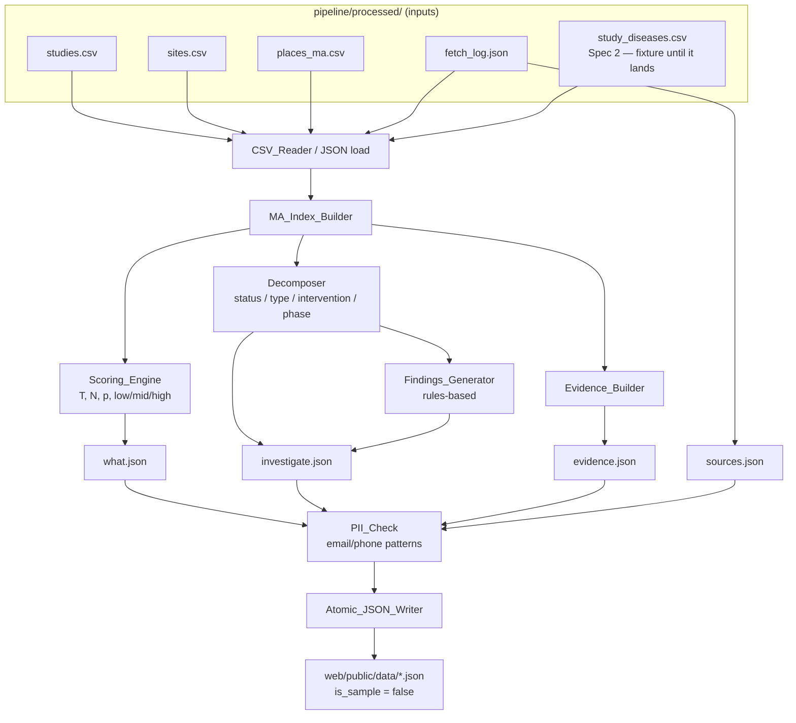
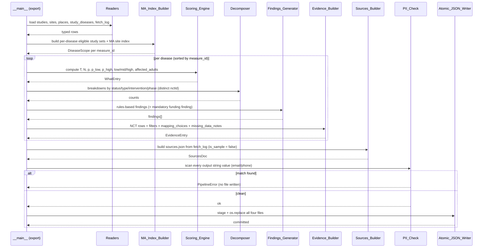

# Design Document: Scoring & Export (Spec 3)

## Overview

The scoring-export stage reads the processed CSVs produced by Spec 1
(`studies.csv`, `sites.csv`, `places_ma.csv`, `fetch_log.json`) and the
disease-to-measure matches produced by Spec 2 (`study_diseases.csv`), computes
the burden-vs-activity index and activity decomposition per disease, and writes
the four dashboard JSON files to `web/public/data/`. It is a pure local,
offline step: given byte-identical inputs it produces byte-identical outputs,
performs no network I/O, and writes atomically so a failure never corrupts the
committed dashboard data.

This design follows `.kiro/steering/data-contract.md` as the source of truth for
every output key, definition, and formula. The dashboard (Spec 4) is already
built against that contract, so the keys below are exact: extra keys are allowed,
but renaming or removing a contract key is not.

The entry point is `python -m pipeline.scoring.export`. The module lives under
`pipeline/scoring/` per `structure.md`.

### Deferred (not produced by this spec)

Per the data contract, this stage **does not** produce `where.json` or
`ma_counties.geojson`. County map / WHERE view is deferred because county shapes
would require a data source outside clinicaltrials.gov and data.cdc.gov. The
dashboard hides the WHERE view when those files are absent. US/national
comparison is also deferred: `investigate.json.us_studies` is always `null`.

### Hard rules enforced throughout

- **Counts are always distinct `nctId`.** Sites, intervention strings, phases, or
  condition rows never inflate a count. One MA study with several MA sites counts
  once.
- **Uncomputable values are `null`, never `0`** (data-contract; product.md
  "show unknown instead of 0").
- **All four files set `is_sample = false`** (only `sources.json` carries the
  flag; it must be `false` for real output). This replaces the dashboard's
  shipped sample files.
- **Findings are rules-based text only — no AI/LLM/ML.** Each `investigate.json`
  entry always includes exactly one finding labelled
  `"cannot determine from public data"` about funding/sponsor decisions.
- **Forbidden language is never emitted:** never "neglected", "underfunded",
  "needs more trials", "needs more drugs", and no diagnosis / treatment /
  eligibility / "you should join" / recommendation / prediction wording
  (health-safety.md, product.md). "Drug" finding text must note the drug may be
  an existing drug, comparator, or placebo.
- **No contact data (PII) ever.** This stage reads only the already-scrubbed
  processed CSVs and emits only identifiers, titles, statuses, counts, phases,
  intervention types/names, and URLs. Every output string value is checked
  against the email and phone patterns (reusing `pipeline.patterns`) before any
  file is written; a match aborts the run with no file written.
- **Deterministic & sorted output:** diseases ordered by `measure_id`; arrays
  within each entry sorted by a stable key (label, then nct_id); JSON serialized
  with sorted object keys and `ensure_ascii=False`, LF endings, trailing
  newline.
- **Atomic writes:** all four files staged then committed with `os.replace`,
  mirroring `pipeline/io/atomic.py`. A failure leaves `web/public/data/`
  byte-for-byte unchanged.

---

# PART A — High-Level Design (Diagrams & Interfaces)

## Architecture



## Data flow (sequence)



## Components and Interfaces

### Component 1: `Readers` (`pipeline/scoring/readers.py`)

**Purpose**: Load and type the five inputs. Reuses `pipeline.io.csv_reader`
conventions for `studies`/`sites`/`places`; `study_diseases.csv` is read with a
dedicated reader that validates its contract columns, and tolerates a fixture
supplied in tests (same columns, any directory).

**Interface**:
```python
def load_studies(path: Path) -> list[StudyRow]
def load_sites(path: Path) -> list[SiteRow]
def load_places(path: Path) -> list[PlacesRow]
def load_study_diseases(path: Path) -> list[DiseaseMatch]   # Spec 2 contract
def load_fetch_log(path: Path) -> dict
```

**Responsibilities**:
- Reject a file whose header does not match the expected columns (name file +
  mismatch only, never cell content — matches `csv_reader` style).
- Decode list columns (`phases`, `interventionTypes`, `interventionNames`,
  `conditions`, etc.) as JSON arrays of strings.
- Until Spec 2 lands, `study_diseases.csv` is absent in production; the reader
  raises a clear `PipelineError` naming the missing file. Tests pass a fixture
  path with the contract columns so scoring is fully testable now.

### Component 2: `MA_Index_Builder` (`pipeline/scoring/index.py`)

**Purpose**: Apply the data-contract definitions once and produce a
`DiseaseScope` per measure that the rest of the pipeline consumes.

**Interface**:
```python
def ma_study_ids(studies, sites) -> set[str]      # MA study definition
def recruiting_ma_site_ids(sites) -> set[str]      # MA site with site status RECRUITING
def build_scopes(studies, sites, diseases) -> dict[str, DiseaseScope]
```

**Responsibilities**:
- **MA study** = a study with ≥1 site in `sites.csv` whose `state` is
  Massachusetts (case-insensitive `massachusetts`/`ma`, matching
  `sanity_checker.MA_STATES`).
- **Eligible for a disease** = `match_status == "included"` in
  `study_diseases.csv`, intersected with MA studies.
- Precompute the set of studies that have ≥1 MA site with site status
  `RECRUITING` (unknown site status never counts — site `siteStatus` is a
  separate field from overall `overallStatus`).

### Component 3: `Scoring_Engine` (`pipeline/scoring/scoring.py`)

**Purpose**: Compute `what.json` numbers exactly per the data contract.

**Interface**:
```python
def compute_T(scope: DiseaseScope) -> int
def compute_N(places, measure_id) -> int                 # sum totalpop18plus over 14 counties
def compute_prevalence(places, measure_id) -> Prevalence # p, p_low, p_high (fractions)
def build_what_entry(scope, places, condition) -> WhatEntry
```

**Responsibilities**: see Part B for exact formulas. Returns `null` for
`low`/`mid`/`high`/`affected_adults` when a divisor is 0 or prevalence is
unavailable.

### Component 4: `Decomposer` (`pipeline/scoring/decompose.py`)

**Purpose**: Build the `investigate.json` breakdown arrays. Every count is
distinct `nctId`.

**Interface**:
```python
def by_overall_status(scope) -> list[LabelCount]
def by_study_type(scope) -> list[LabelCount]
def by_intervention_type(scope) -> list[LabelCount]   # distinct nctId per type
def by_phase(scope) -> list[LabelCount]               # NA + Not reported as labels
def phase_overlap_studies(scope) -> int               # studies listing >1 phase
```

### Component 5: `Findings_Generator` (`pipeline/scoring/findings.py`)

**Purpose**: Produce rules-based, record-grounded finding sentences from the
computed numbers. No AI.

**Interface**:
```python
def generate_findings(scope, what, breakdowns) -> list[Finding]
```

**Responsibilities**:
- Each `Finding` has `text` and a `label` that is exactly one of
  `"possible explanation from available records"` or
  `"cannot determine from public data"`.
- **Always** append exactly one `"cannot determine from public data"` finding
  about funding / sponsor decisions.
- Never emit forbidden terms. "Drug" text must note the drug may be existing,
  comparator, or placebo.

### Component 6: `Evidence_Builder` (`pipeline/scoring/evidence.py`)

**Purpose**: Build `evidence.json` — the per-disease NCT list plus method notes.

**Interface**:
```python
def build_evidence_entry(scope, condition) -> EvidenceEntry
```

### Component 7: `Sources_Builder` (`pipeline/scoring/sources.py`)

**Purpose**: Build `sources.json` from `fetch_log.json`, with
`is_sample = false`.

### Component 8: `PII_Check` + `Atomic_JSON_Writer` (`pipeline/scoring/export.py`)

**Purpose**: Orchestrate; scan all emitted strings against the email/phone
patterns (reusing `pipeline.patterns.PATTERNS`); serialize deterministically;
stage and commit all four files atomically.

## Data Models

Input models reuse Spec 1 dataclasses (`StudyRow`, `SiteRow`, `PlacesRow`). The
Spec 2 match model is new to this stage:

```python
@dataclass(frozen=True)
class DiseaseMatch:            # one row of study_diseases.csv
    nctId: str
    measureid: str             # CASTHMA / HIGHCHOL / DIABETES (later BPHIGH/DEPRESSION)
    disease_label: str
    match_status: str          # included | questionable | excluded
    exclusion_reason: str      # "" if included; e.g. child_only, gestational
    matched_on: str            # mesh | ancestor | condition_text
    matched_term: str

@dataclass(frozen=True)
class Prevalence:
    p: float                   # fraction, e.g. 0.102
    p_low: float
    p_high: float
    year: str                  # PLACES year for this measure

@dataclass(frozen=True)
class DiseaseScope:
    measure_id: str
    condition: str
    eligible_ids: set[str]              # eligible MA studies (all fetched statuses)
    t_ids: set[str]                     # subset that counts toward T
    studies_by_id: dict[str, StudyRow]
```

**Output models** map 1:1 to the data-contract JSON shapes (below).

### Output: `what.json` (array, one entry per disease)
```json
{ "condition": "Asthma", "measure_id": "CASTHMA",
  "low": 1.23, "mid": 1.45, "high": 1.80,
  "t": 12, "affected_adults": 540000, "adults_18plus": 5300000,
  "p_low": 0.095, "p_high": 0.110, "p": 0.102,
  "prevalence_year": "2023",
  "ctgov_url": "https://clinicaltrials.gov/search?cond=Asthma&locStr=Massachusetts" }
```
`low`/`mid`/`high`/`affected_adults` are `float|null` / `int|null`.

### Output: `investigate.json` (array, one entry per disease)
```json
{ "measure_id": "CASTHMA", "condition": "Asthma",
  "ma_studies": 34, "us_studies": null,
  "by_overall_status":    [{ "label": "Recruiting", "count": 12 }],
  "by_study_type":        [{ "label": "Interventional", "count": 30 }],
  "by_intervention_type": [{ "label": "Drug", "count": 18 }],
  "by_phase":             [{ "label": "Phase 2", "count": 9 }],
  "phase_overlap_studies": 4,
  "findings": [{ "text": "...", "label": "possible explanation from available records" },
               { "text": "...", "label": "cannot determine from public data" }] }
```

### Output: `evidence.json` (array, one entry per disease)
```json
{ "measure_id": "CASTHMA", "condition": "Asthma",
  "ncts": [{ "nct_id": "NCT0...", "url": "https://clinicaltrials.gov/study/NCT0...",
             "title": "...", "status": "RECRUITING", "study_type": "INTERVENTIONAL",
             "phases": ["PHASE2"], "intervention_types": ["DRUG"],
             "intervention_names": ["..."] }],
  "filters": ["..."], "mapping_choices": ["..."], "missing_data_notes": ["..."] }
```

### Output: `sources.json`
```json
{ "data_as_of": "2026-10-24", "is_sample": false,
  "sources": [{ "name": "ClinicalTrials.gov", "url": "...", "fetched": "2026-10-24" },
              { "name": "CDC PLACES 2025 county release",
                "url": "https://data.cdc.gov/...swc5-untb", "fetched": "2026-10-24" }],
  "prevalence_years": { "CASTHMA": "2023", "HIGHCHOL": "2022", "DIABETES": "2023" } }
```

## Error Handling

| Scenario | Condition | Response | Recovery |
|---|---|---|---|
| Missing input file | a required CSV/JSON absent (incl. `study_diseases.csv` before Spec 2 lands) | `PipelineError` naming the file; exit non-zero | no output written; `web/public/data/` unchanged |
| Header mismatch | columns differ from contract | `PipelineError` naming file + mismatch (no cell content) | as above |
| Uncomputable metric | N·p_low/high == 0 or prevalence missing | emit `null` for that value | run continues |
| Missing PLACES measure | measure_id absent in `places_ma.csv` | prevalence `null`, so low/mid/high/affected_adults `null`; add a `missing_data_notes` entry | run continues |
| County count ≠ 14 | fewer/more than 14 counties for a measure | warning to stderr (Sanity_Checker style); still exit 0 | N uses the counties present; noted |
| PII match | any output string matches email/phone pattern | `PipelineError` listing file/field/pattern (never matched text); exit non-zero | no file written |
| Write failure | OS error during stage/commit | `PipelineError` naming file + OS error type; exit non-zero | staging removed; outputs byte-identical |

## Testing Strategy

- **Unit tests** mirror `tests/scoring/` per module: index membership, T/N/p
  formulas, rounding, null propagation, decomposition distinct-count semantics,
  findings label validity and mandatory funding finding, forbidden-term absence,
  deterministic ordering, atomic write + rollback.
- **Property-based tests (Hypothesis, ≥100 examples each)** — the 5 correctness
  properties in Part B. Strategies generate studies, sites, PLACES rows, and
  disease matches; see `tests/strategies.py` for existing generators to extend.
- **Network block**: reuse `tests/test_network_block.py` conventions — this
  stage must make zero requests.

## Dependencies

- Standard library: `json`, `csv`, `pathlib`, `os`, `tempfile`, `shutil`, `re`.
- `pandas` is allowed for grouping/aggregation (pinned in `requirements.txt` if
  imported).
- Internal: `pipeline.errors.PipelineError`, `pipeline.patterns` (email/phone),
  `pipeline.io.csv_reader`, Spec 1 row dataclasses, `pipeline.io.atomic`
  conventions.
- Hypothesis + pytest for tests.

---

# PART B — Low-Level Design (Code-First)

Notation: Python 3.11 (the project's language, explicitly mentioned in the
request and `tech.md`). All formulas are stated exactly per the data contract.

## Core types / signatures

```python
# pipeline/scoring/scoring.py
LabelCount = dict[str, object]        # {"label": str, "count": int}

def compute_T(scope: DiseaseScope) -> int: ...
def compute_N(places: list[PlacesRow], measure_id: str) -> int | None: ...
def compute_prevalence(places: list[PlacesRow], measure_id: str) -> Prevalence | None: ...
def population_weighted_index(T: int, N: int | None,
                              prev: Prevalence | None) -> tuple[float | None, float | None, float | None]:
    """Return (low, mid, high) rounded to 2 decimals, or (None, None, None)."""
```

## Key functions with formal specifications

### `compute_T(scope)`

**Preconditions**: `scope.t_ids` already restricted to eligible MA studies with
`overallStatus == "RECRUITING"` **and** ≥1 MA site with site status
`RECRUITING`.

**Postconditions**: returns `len(scope.t_ids)`, i.e. a count of distinct
`nctId`. Unknown site status never contributes.

```python
def compute_T(scope: DiseaseScope) -> int:
    return len(scope.t_ids)
```

### `compute_N(places, measure_id)`

**Preconditions**: `places` rows carry `totalpop18plus` and `locationname`.

**Postconditions**: `N = sum of totalpop18plus over the (up to 14) MA counties`
for the given measure, counting each county once. Returns `None` only if no rows
exist for the measure.

```python
def compute_N(places, measure_id):
    rows = [r for r in places if r.measureid == measure_id]
    if not rows:
        return None
    pop_by_county = {r.locationname: int(r.totalpop18plus) for r in rows}
    return sum(pop_by_county.values())   # 14 counties expected; warn if not
```

### `compute_prevalence(places, measure_id)` — fractions, population-weighted

**Postconditions**: `p`, `p_low`, `p_high` are MA crude prevalence as FRACTIONS
(0.102 = 10.2%), population-weighted over counties:
`p = sum(pop18 * value/100) / sum(pop18)` and likewise for the confidence limits
using `low_confidence_limit` / `high_confidence_limit`. Returns `None` if the
measure is absent or total pop is 0.

```python
def compute_prevalence(places, measure_id):
    rows = [r for r in places if r.measureid == measure_id]
    if not rows:
        return None
    pop   = sum(int(r.totalpop18plus) for r in rows)
    if pop == 0:
        return None
    p      = sum(int(r.totalpop18plus) * float(r.data_value)            / 100 for r in rows) / pop
    p_low  = sum(int(r.totalpop18plus) * float(r.low_confidence_limit)  / 100 for r in rows) / pop
    p_high = sum(int(r.totalpop18plus) * float(r.high_confidence_limit) / 100 for r in rows) / pop
    year   = rows[0].year
    return Prevalence(p=p, p_low=p_low, p_high=p_high, year=year)
```

### `population_weighted_index(T, N, prev)` — low / mid / high

**Postconditions** (data contract, per 100,000 affected adults):
- `low  = T / (N * p_high) * 100000`
- `high = T / (N * p_low)  * 100000`
- `mid  = T / (N * p)      * 100000`
- Rounded to 2 decimals. Any value whose divisor is 0 (or `N`/`prev` is `None`)
  is `null`, never 0. Note `low` uses `p_high` and `high` uses `p_low` — larger
  prevalence gives the lower per-capita index.

```python
def population_weighted_index(T, N, prev):
    if N is None or prev is None:
        return (None, None, None)
    def rate(divisor_prev):
        denom = N * divisor_prev
        return round(T / denom * 100000, 2) if denom > 0 else None
    low  = rate(prev.p_high)
    high = rate(prev.p_low)
    mid  = rate(prev.p)
    return (low, mid, high)
```

### `build_what_entry(scope, places, condition)`

```python
def build_what_entry(scope, places, condition):
    T = compute_T(scope)
    N = compute_N(places, scope.measure_id)
    prev = compute_prevalence(places, scope.measure_id)
    low, mid, high = population_weighted_index(T, N, prev)
    affected = round(N * prev.p) if (N is not None and prev is not None) else None
    return {
        "condition": condition, "measure_id": scope.measure_id,
        "low": low, "mid": mid, "high": high, "t": T,
        "affected_adults": affected,
        "adults_18plus": N,                        # contract allows null? N is int; null only if measure absent
        "p_low": prev.p_low if prev else None,
        "p_high": prev.p_high if prev else None,
        "p": prev.p if prev else None,
        "prevalence_year": prev.year if prev else None,
        "ctgov_url": f"https://clinicaltrials.gov/search?cond={quote(condition)}&locStr=Massachusetts",
    }
```

## Decomposition algorithm (distinct nctId per label)

```pascal
ALGORITHM by_label(scope, extract)
INPUT: scope; extract(study) -> list of labels for that study
OUTPUT: list of {label, count}, sorted by label (Unicode code point)
BEGIN
  ids_per_label <- empty map(label -> set of nctId)
  FOR each nctId IN scope.eligible_ids DO
    study <- scope.studies_by_id[nctId]
    FOR each label IN distinct(extract(study)) DO       // distinct within a study
      ids_per_label[label].add(nctId)                   // a study counts once per label
    END FOR
  END FOR
  RETURN [ {label: L, count: |ids_per_label[L]|}
           FOR L IN sorted(keys(ids_per_label)) ]
END
```

- `by_overall_status`: label = humanized `overallStatus`
  (e.g. RECRUITING → "Recruiting").
- `by_study_type`: label = humanized `studyType` ("Interventional",
  "Observational").
- `by_intervention_type`: labels from `interventionTypes`
  (Drug, Biological, Device, Behavioral, Procedure, Dietary Supplement, Other…);
  a study with several types counts under each (distinct nctId per label).
- `by_phase`: labels from `phases`; map empty/missing to "Not reported" and
  "NA"/"Not applicable" to "Not applicable", each as a separate label.
- `phase_overlap_studies`: count of studies whose `phases` list has length > 1.

## Findings (rules-based)

```pascal
ALGORITHM generate_findings(scope, what, breakdowns)
OUTPUT: list of Finding{text, label}, each label in LABELS
BEGIN
  findings <- []
  // record-grounded observations, each gated on a numeric condition
  IF drug_count(breakdowns) > 0 THEN
    APPEND possible("... includes studies listing a DRUG-type intervention, " +
                    "which may be an existing drug, a comparator, or a placebo.")
  IF what.t = 0 AND what.ma_studies > 0 THEN
    APPEND possible("No studies are both recruiting overall and recruiting at an MA site, " +
                    "though other MA-associated studies exist in the record.")
  IF phase_overlap_studies > 0 THEN
    APPEND possible("Some studies list more than one phase; counts by phase overlap.")
  // MANDATORY — always exactly one, last
  APPEND cannot_determine("Whether this reflects funding levels or sponsor decisions " +
                          "cannot be determined from ClinicalTrials.gov or CDC PLACES records.")
  ASSERT exactly_one(findings, label = "cannot determine from public data")
  ASSERT no_forbidden_terms(findings)   // neglected, underfunded, needs more trials/drugs, etc.
  RETURN findings
END

LABELS = { "possible explanation from available records",
           "cannot determine from public data" }
```

## Deterministic serialization & atomic write

```python
def serialize(obj) -> bytes:
    text = json.dumps(obj, ensure_ascii=False, sort_keys=True,
                      separators=(",", ":"), indent=2)
    return (text + "\n").encode("utf-8")

def write_all(web_data_dir: Path, files: dict[str, object]) -> None:
    # 1. build bytes for all four files
    # 2. PII_Check: scan every string value via pipeline.patterns.PATTERNS; raise on match
    # 3. stage each file in a sibling .staging-* dir, fsync
    # 4. os.replace each into web/public/data/  (mirrors pipeline/io/atomic.py)
    # 5. remove staging in finally
    ...
```

## Example usage

```python
# python -m pipeline.scoring.export
studies  = load_studies(PROCESSED / "studies.csv")
sites    = load_sites(PROCESSED / "sites.csv")
places   = load_places(PROCESSED / "places_ma.csv")
diseases = load_study_diseases(PROCESSED / "study_diseases.csv")   # fixture in tests
fetchlog = load_fetch_log(PROCESSED / "fetch_log.json")

scopes = build_scopes(studies, sites, diseases)                    # dict[measure_id -> DiseaseScope]
what, investigate, evidence = [], [], []
for measure_id in sorted(scopes):                                  # deterministic order
    scope = scopes[measure_id]
    what.append(build_what_entry(scope, places, scope.condition))
    investigate.append(build_investigate_entry(scope))
    evidence.append(build_evidence_entry(scope, scope.condition))
sources = build_sources(fetchlog)                                  # is_sample = false

write_all(WEB_DATA, {
    "what.json": what, "investigate.json": investigate,
    "evidence.json": evidence, "sources.json": sources,
})
```

## Correctness Properties

The following five properties are verified by property-based tests (Hypothesis,
≥100 examples each).

### Property 1: Index ordering

For every `what.json` entry, when `low`, `mid`, `high` are all non-null,
`low <= mid <= high`.

**Validates: Requirements 3.1** (data-contract low/mid/high formulas; `low` uses
`p_high`, `high` uses `p_low`, so the index is ordered).

```python
# for entry in what:
#   if None not in (entry["low"], entry["mid"], entry["high"]):
#       assert entry["low"] <= entry["mid"] <= entry["high"]
```

### Property 2: Prevalence bounds

For every entry, `p_low <= p <= p_high` whenever all three are non-null (follows
from county confidence limits being ordered).

**Validates: Requirements 3.2** (data-contract population-weighted prevalence and
confidence limits as fractions).

### Property 3: Distinct-count integrity

Every `count` in every breakdown and every `t` / `ma_studies` equals the size of
a set of distinct `nctId`; no count exceeds `ma_studies`, and duplicate study
rows or multiple MA sites never change a count.

**Validates: Requirements 3.3** (data-contract "counts are always distinct
nctId, never sites or intervention strings").

### Property 4: Findings label validity

Every finding's `label` is one of the two allowed strings, and each
`investigate.json` entry contains exactly one finding labelled
`"cannot determine from public data"`. No finding text contains a forbidden
term.

**Validates: Requirements 3.4** (data-contract findings rules; always include one
"cannot determine from public data" funding/sponsor finding; forbidden-term
ban).

### Property 5: Schema conformance

Every generated file validates against the data-contract shape — all required
keys present with correct types, `sources.json.is_sample is False`,
`investigate.json.us_studies is None`, uncomputable numeric values are `null`
(never `0`), and no output string matches the email or phone pattern.

**Validates: Requirements 3.5** (data-contract JSON schemas for what/investigate/
evidence/sources; `is_sample = false`; null never 0; no PII).
