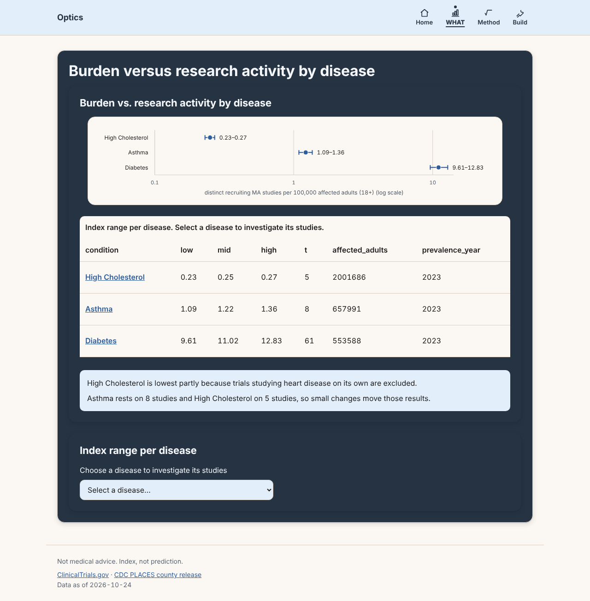

# Optics

Compares how common selected diseases are among Massachusetts adults (18+) with observed MA-associated clinical study activity. It measures study activity against adult prevalence, not disease severity.

Not medical advice. Index, not prediction.

**Live demo:** https://research-gap-index-web.vercel.app/

Built for **Hackachusetts 2026**, healthcare track.



## What it does
- Shows which conditions have the least study activity compared with how many MA adults have them
- Currently covers asthma, diabetes, and high cholesterol
- Lets users see the evidence and sources behind each score

## Who it helps
Researchers, funders, and public health teams looking for conditions that are under-studied relative to how many people they affect.

## Team
- Ethan Au-Yeung
- Justin Fung
- Samantha Lau
- Ashley Lau

## Data sources
- [ClinicalTrials.gov (NIH)](https://clinicaltrials.gov/): study activity
- [CDC PLACES](https://www.cdc.gov/places/): adult disease prevalence

## Project structure
- `pipeline/`: Python data pipeline and scoring
- `web/`: dashboard website
- `web/public/data/`: exported JSON the site reads
- `.kiro/`: specs, steering docs, hooks, and agent config

## Run it locally

**1. Generate the data**
```bash
python3 -m pipeline.scoring.export
```
This writes `what.json`, `investigate.json`, `evidence.json`, and `sources.json` to `web/public/data/`.

**2. Run the website**
```bash
cd web
npm install
npm run dev
```
Open the local link it prints.

**3. Run the tests**
```bash
python3 -m pytest
cd web && npm test
```

## How we used Kiro
See [KIRO_USAGE.md](KIRO_USAGE.md) for the full write-up, plus `.kiro/` and `KIRO_LOG.md`.

## License
MIT. See [LICENSE](LICENSE).
